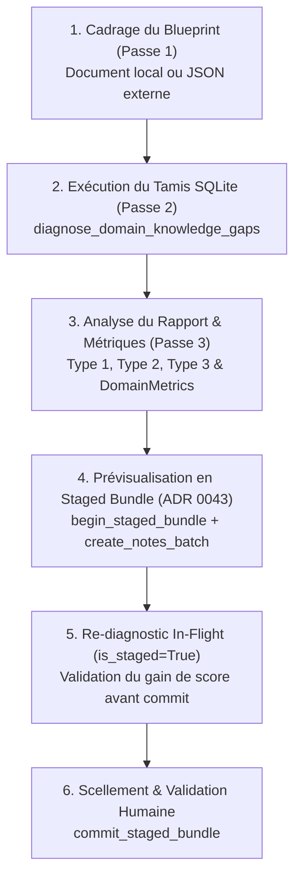

# 🧠 Diagnostic Neuro-Symbolique des Lacunes & Décloisonnement de Collection

Ce skill formalise l'usage du moteur de diagnostic de domaine d'AnkiForge (**Approche F**, [ADR 0057](file:///Users/tristanrigaud-humbert/PycharmProjects/AnkiForge/docs/adr/0057-outillage-mcp-ancrage-documentaire-et-skills-couverture-enrichissement-deck.md)) et de l'outil FastMCP `diagnose_domain_knowledge_gaps`.

---

## 🎯 1. Principes Cognitifs Fondamentaux (Pourquoi le Décloisonnement ?)

Évaluer la maîtrise d'un domaine d'étude en se cantonnant à un unique paquet (*deck*) produit deux illusions cognitives fatales :
1. **L'illusion de lacune (Faux Négatif) :** Déclarer absent un concept alors que l'utilisateur l'a encodé dans un autre paquet transverse (ex. les cookies de session encodés dans `Reseau::Protocoles` alors que l'audit cible `Web::HTTP_REST`).
2. **L'illusion de complétude (Faux Positif) :** Considérer un domaine acquis sous prétexte qu'un paquet héberge 50 cartes, alors que ces cartes surchargent la mémoire de travail sans hiérarchie visuelle ou ignorent les nuances et les liens systémiques.

> [!IMPORTANT]
> **Règle d'Or du Décloisonnement** : L'audit inspecte systématiquement **100% de la collection SQLite du profil actif** en une requête unique, identifie les cartes transversales repêchées (`RescuedCardEntry`) et préserve les acquis multi-paquets avant d'ordonner la moindre création.

---

## 🔬 2. Les Trois Pathologies Mémorielles

Le moteur structure l'audit autour des 3 pathologies cognitives fondamentales (conformes aux sciences de l'apprentissage et aux 20 règles de Piotr Wozniak) :

| Pathologie | Manifestation dans la Collection | Remédiation Recommandée |
| :--- | :--- | :--- |
| **Type 1 : Concept Absent** *(Vide complet)* | Aucune carte active de la collection ne couvre les expressions synonymes du concept pivot. | Créer 1 à 2 carte(s) atomique(s) ancrée(s) dans la source (`source_excerpt`) avec tags durables (`source:<slug>`, `section:<slug>`). |
| **Type 2 : Déficit d'Atomicité** *(Surcharge cognitive)* | Le bloc principal d'une carte empile $\ge 3$ définitions concurrentes, une énumération brute dense ou un paragraphe compact $> 45$ mots sans séparation visuelle. | Proposer une scission (`propose_card_split` ou `create_notes_batch`) sans pénaliser les blocs annexes de contexte (`<hr>`, `<blockquote>`). |
| **Type 3 : Manque de Liant** *(Connaissances inertes)* | Deux concepts voisins existent isolément dans la collection, mais aucune carte comparative ne confronte leurs distinctions fines, causalités ou exceptions bilingues (FR/EN). | Proposer une carte de confrontation explicite sur l'un des 4 registres sémantiques. |

---

## 🧭 3. Guide Opérationnel Pas-à-Pas pour l'Agent



### Étape 1 : Formuler le Référentiel Conceptuel (Blueprint)
Deux modes d'amorçage sont disponibles :
- **Mode A (Ancrage Documentaire Local)** : Passer `reference_document_id=<id>`. Le moteur agrège automatiquement les sections `h1`/`h2`, remonte les sous-sections `h3`/`h4`, déduit les relations sœurs (`contrast`) et extrait les preuves textuelles (`source_excerpt`).
- **Mode B (Injection Directe par l'Agent Externe)** : Transmettre `blueprint_json` borné de façon défensive (max 50 concepts, max 100 relations, max 80 car./mot-clé) :
  ```json
  {
    "subject": "Architecture REST et Protocole HTTP",
    "concepts": [
      {"id": "stateless", "label": "Principe sans état", "keywords": ["stateless", "sans etat"]},
      {"id": "idempotence", "label": "Idempotence", "keywords": ["idempotent", "idempotence"]}
    ],
    "relations": [
      {"source_id": "stateless", "target_id": "idempotence", "relation_type": "contrast", "probe_question": "Différence entre statelessness et idempotence"}
    ]
  }
  ```

### Étape 2 : Invoquer l'Outil FastMCP
```python
rapport_json = mcp.call_tool(
    "diagnose_domain_knowledge_gaps", {"subject": "Architecture REST et Protocole HTTP", "target_deck": "Informatique::Web::HTTP_REST", "blueprint_json": blueprint_json, "include_suspended": False}
)
```

### Étape 3 : Interpréter les Résultats et Métriques (`DomainMetrics`)
- `domain_status` :
  - `UNSTARTED` (0 carte trouvée, score 0.0%) : collection vierge, exiger d'abord la création de cartes de niveau 1 avant d'auditer le liant.
  - `IN_PROGRESS` : lacunes actives présentes.
  - `MATURE` : score $\ge 85.0\%$ et zéro concept manquant.
- **Formule de Score Composite** :
  - Standard : $0.50 \times \text{Concepts} + 0.25 \times \text{Atomicité} + 0.25 \times \text{Synthèse}$.
  - Domaines terminologiques purs (0 relation) : $0.65 \times \text{Concepts} + 0.35 \times \text{Atomicité}$ (neutralité mathématique).

### Étape 4 : Traitement Ordonné des Écarts par Staged Bundle
1. **Ouvrir une session 2PC** : `begin_staged_bundle(title="Comblement lacunes HTTP")`.
2. **Traiter le Type 1 (Concepts Absents)** :
   - Exploiter `m.source_excerpt` et `m.target_tags` (`["source:<slug>", "section:<slug>"]`) pour générer des cartes factuellement ancrées sans hallucination.
   - Soumettre via `create_notes_batch(notes=[...])`.
3. **Traiter le Type 2 (Non-Atomicité)** :
   - Ne scinder que le bloc principal ; préserver le contexte en bloc annexe séparé par un `<hr>` ou `<blockquote>`.
   - Les énumérations concises (3-4 puces courtes de $< 8$ mots simples) sont acceptées sans pénalité.
4. **Traiter le Type 3 (Liant & Nuances Bilingues)** :
   - Formuler des cartes de synthèse mobilisant au moins un marqueur sémantique parmi les 4 registres bilingues :
     - *Distinction* : `différence`, `unlike`, `versus`, `n'est pas`, `does not support`.
     - *Conditionnalité* : `sauf si`, `unless`, `only if`, `conditionné par`.
     - *Causalité* : `entraîne`, `leads to`, `triggers`, `aboutit à`.
     - *Synergie* : `complémentaire`, `synergy with`, `articulé avec`.
   - **Règle de préséance cognitive** : Ne jamais proposer de carte de synthèse sur une notion dont l'un des deux concepts n'est pas encore acquis (Type 1 prime sur Type 3).

### Étape 5 : Prévisualisation Virtuelle & Validation Humaine
- Grâce à l'**Overlay Virtuel des Staged Bundles (ADR 0043)**, ré-invoquer `diagnose_domain_knowledge_gaps` alors que le bundle est ouvert intègre automatiquement les propositions avec `is_staged=True` et mesure l'incrément de score `global_health_score` avant écriture en base.
- Si le résultat est satisfaisant : `commit_staged_bundle(bundle_id=...)` pour soumettre les propositions au Garde-Fou et à l'arbitrage humain.

---

## 📊 4. Consultation des Rapports Persistants sur Disque

Le service génère systématiquement deux fichiers atomiques sous `~/.ankiforge/profiles/<nom>/reports/` (ou `~/.ankiforge-dev/profiles/<nom>/reports/`) :
- `domain_gaps_<slug>_latest.json` : arborescence complète pour traitement automatisé avec l'objet `telemetry`.
- `domain_gaps_<slug>_latest.md` : synthèse visuelle exécutif pour l'humain intégrant :
  - Le badge d'état (`🟢 MATURE`, `🟡 EN COURS`, `🔴 VIERGE`).
  - Les jauges textuelles Unicode : `[████████░░] 82.1%`.
  - La liste des cartes transversales repêchées (`transversal_cards_rescued`).
  - La rotation automatique (les 10 archives les plus récentes sont conservées, les anciennes sont purgées).

---

## ⛔ Ne PAS utiliser ce skill si...

- Pour découper un document brut en chunks vectoriels RAG $\implies$ utiliser `rag-smart-coverage`.
- Pour extraire un PDF, une vidéo YouTube ou une page web $\implies$ utiliser `ingestion-multimedia`.
- Pour concevoir des gabarits Jinja2, HTML ou CSS de modèles de cartes $\implies$ utiliser `modeles-cartes-jinja`.
- Pour auditer la pureté de formulation Wozniak d'une carte individuelle isolée $\implies$ utiliser `audit-card-wozniak`.
