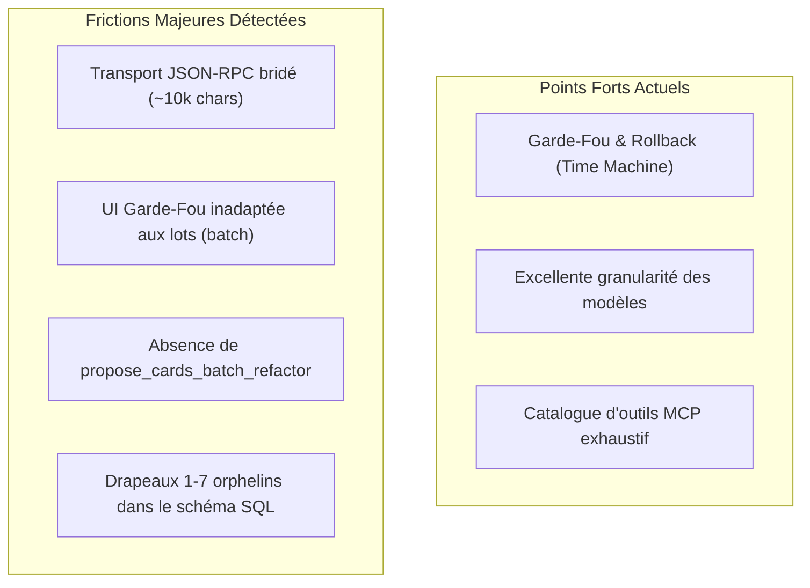
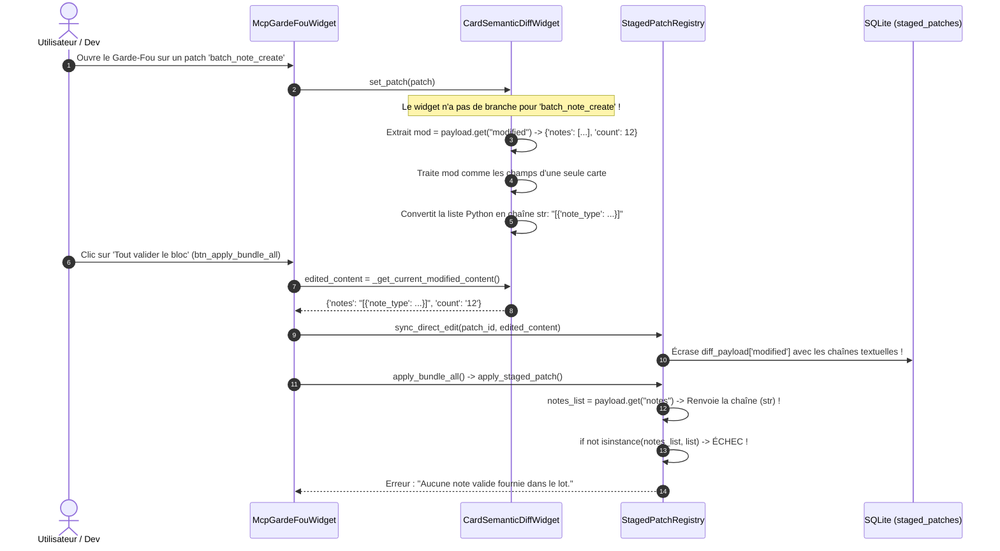
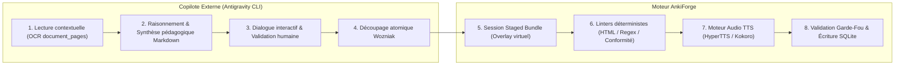
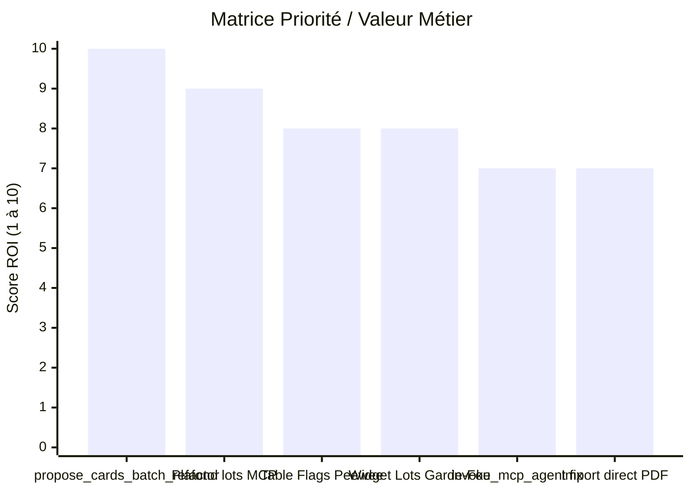

# Retours d'Expérience & Critique Système AnkiForge (Developer Edition)

Ce document compile l'ensemble des retours d'expérience, diagnostics techniques, bugs d'architecture et propositions d'amélioration issus de l'utilisation intensive d'**AnkiForge** par un agent autonome (Antigravity CLI / Gemini) en pair-programming avec son concepteur Tristan.

Date de dernière mise à jour : **26 octobre 2026**.

---

## 📑 Sommaire

1. [Synthèse Exécutive & Vision d'Ensemble](#1-synthèse-exécutive--vision-densemble)
2. [Focus Architecture : L'Anatomie du Two-Phase Commit sur les Lots](#2-focus-architecture--lanatomie-du-two-phase-commit-sur-les-lots)
3. [Nouvelle Approche : Le Rôle du « Copilote CLI » dans les DAGs](#3-nouvelle-approche--le-rôle-du--copilote-cli--dans-les-dags)
4. [Diagnostic Détaillé par Axe Technique](#4-diagnostic-détaillé-par-axe-technique)
   * [Axe 1 : Protocole MCP & Transport JSON-RPC](#axe-1--protocole-mcp--transport-json-rpc)
   * [Axe 2 : Two-Phase Commit & StagedPatch](#axe-2--two-phase-commit--stagedpatch)
   * [Axe 3 : Schéma BDD & Requêtage Peewee](#axe-3--schéma-bdd--requêtage-peewee)
   * [Axe 4 : Modèles de Cartes, Moteur de Rendu & CSS](#axe-4--modèles-de-cartes-moteur-de-rendu--css)
   * [Axe 5 : Albums, Documents & RAG Visuel](#axe-5--albums-documents--rag-visuel)
   * [Axe 6 : Moteur DAG, Pipelines & Studio de Création](#axe-6--moteur-dag-pipelines--studio-de-création)
5. [Roadmap Priorisée pour les Prochains Sprints](#5-roadmap-priorisée-pour-les-prochains-sprints)
6. [Fiches d'Évolution Prêtes à l'Emploi (Issue-Ready)](#6-fiches-dévolution-prêtes-à-lemploi-issue-ready)

---

## 1. Synthèse Exécutive & Vision d'Ensemble

L'application AnkiForge propose une architecture remarquable et innovante, notamment grâce à :
* Son **serveur MCP natif (~56 outils)** permettant un pilotage granulaire et programmable.
* Son mécanisme de **Two-Phase Commit (Garde-Fou & Staged Patches)** garantissant la souveraineté de l'utilisateur sur toute mutation de sa collection Anki.
* Ses modèles d'apprentissage avancés (modèles japonais multi-angles, modèles scientifiques avec CSS soigné).

Cependant, l'utilisation par un agent autonome met en tension une frontière fondamentale : **l'application a été conçue principalement pour des opérations unitaires ou des flux DAG pré-paramétrés en UI**, alors que les agents ont besoin d'interagir par **lots transactionnels cohérents (batches)** avec une réactivité instantanée.



---

## 2. Focus Architecture : L'Anatomie du Two-Phase Commit sur les Lots

### Le Bug de Corruption UI rencontré le 26/10/2026

Lors de la validation d'un Staged Bundle contenant des patchs groupés `batch_note_create` via le bouton **« Tout valider le bloc »**, l'application a renvoyé l'erreur :
> *« Échec lors de l'application du bundle : Aucune note valide fournie dans le lot. »*

#### Chronologie du problème dans le code source :



#### Correctifs appliqués le 26/10/2026 :
1. **`src/ankiforge/services/ai/staged_patch_registry.py` (Ligne 703)** :
   Sécurisation de la résolution de `notes_list`. Si `payload.get("notes")` est un `str` ou n'est pas une liste valide, le système effectue un décodage robuste et se replie automatiquement sur la liste racine intacte `diff_data["notes"]`.
2. **`src/ankiforge/ui/views/consultant_view/widgets/mcp_garde_fou_widget.py` (Lignes 763 et 813)** :
   Protection contre l'écrasement fantôme : `sync_direct_edit()` n'est plus appelé si `patch_type` est `batch_note_create` ou `batch_create`.

#### Recommandation d'UI pérenne :
Dans `CardSemanticDiffWidget`, ajouter un composant d'affichage tabulaire dédié aux lots (ou adapter `is_split` pour feuilleter les cartes du lot via le sélecteur horizontal) afin que l'utilisateur puisse inspecter et retoucher chaque carte du lot individuellement.

---

## 3. Nouvelle Approche : Le Rôle du « Copilote CLI » dans les DAGs

La collaboration agentique a clarifié la séparation des responsabilités entre le CLI externe (Antigravity) et AnkiForge :



* **Avantage qualitatif** : L'agent externe prend en charge les étapes `LLM_PROMPT` à forte valeur ajoutée cognitive, éliminant les hallucinations des petits modèles locaux sur les synthèses de cours.
* **Avantage ergonomique** : L'utilisateur approuve d'abord un support d'étude Markdown complet avant la forge des cartes.
* **Pattern UI recommandé pour le Garde-Fou** :
  Privilégier `begin_staged_bundle` + une suite d'appels `create_note` (1 étape par carte) plutôt qu'un unique `create_notes_batch`. Cela offre une revue champ par champ parfaite dans l'UI et une validation globale en 1 clic (`btn_apply_bundle_all`).

---

## 4. Diagnostic Détaillé par Axe Technique

### Axe 1 : Protocole MCP & Transport JSON-RPC

| Symptôme / Problème | Cause Racine dans AnkiForge | Impact & Risque | Solution Recommandée |
|:--------------------|:----------------------------|:----------------|:---------------------|
| **Troncature des arguments `notes_json` au-delà de ~10 000 caractères** | La génération de l'argument est interrompue côté modèle ou client avant la fermeture du littéral JSON ; le transport SDK (4 Mio par défaut, sans borne en stdio) n'est pas en cause (ADR 0048). | `JSONDecodeError: Unterminated string` levée dans `create_notes_batch`, puis boucle de réémission du même lot par l'agent. | Refus structuré `PAYLOAD_TOO_LARGE` / `INVALID_JSON` / `TOO_MANY_NOTES` avec plafond de 100 notes et 32 000 caractères, sous-lots de 5 à 8 notes recommandés (ADR 0048). |
| **`invoke_mcp_agent` renvoie une chaîne vide (`""`)** | L'implémentation MCP interne de la délégation d'agent n'attend pas la fin de l'inférence ou n'encapsule pas le flux de sortie de la persona. | Impossible pour un agent chef d'orchestre de déléguer programmatiquement une tâche à un agent spécialisé via MCP. | Raccorder `invoke_mcp_agent` au moteur d'exécution synchrone ou renvoyer un job ID interrogeable (`get_mcp_job_status`). |
| **Incohérence des paramètres d'outils** | `query_peewee` attend `sql_query` (et non `query`), `get_note_type_details` attend `note_type_name` (et non `model_name`). | Erreurs 400 inutiles lors des premiers appels par les LLMs qui suivent les conventions REST/SQL standard. | Ajouter des alias tolérants aux paramètres dans les décorateurs d'outils FastMCP (`query = sql_query`). |

---

### Axe 2 : Two-Phase Commit & StagedPatch

| Symptôme / Problème | Cause Racine dans AnkiForge | Impact & Risque | Solution Recommandée |
|:--------------------|:----------------------------|:----------------|:---------------------|
| **Absence de `propose_cards_batch_refactor`** | `propose_card_refactor` et `propose_card_split` opèrent uniquement note par note (`note_id`). | Pour 60 cartes avec drapeaux, l'agent doit émettre 60 requêtes MCP séquentielles distinctes, générant de la latence et surchargeant l'historique. | Créer l'outil MCP `propose_cards_batch_refactor(refactors_json)` qui génère un bundle de patchs atomique en une seule opération. |
| **Absence d'annulation unitaire (`abort_staged_patch`)** | Seul `abort_staged_bundle` existe pour annuler un bundle entier ; aucun outil n'annule un patch chirurgical précis. | Si l'utilisateur ou l'agent veut révoquer une proposition erronée sans tout purger, il doit modifier manuellement la BDD. | Exposer `abort_staged_patch(patch_id)` dans le catalogue MCP. |
| **Asynchronisme UI vs Staged Patches** | L'UI ne rafraîchit pas instantanément l'inspecteur de diff lors de l'arrivée d'un patch MCP externe sans action manuelle (clic de rafraîchissement). | L'utilisateur doit parfois changer d'onglet ou recharger pour voir apparaître les nouveaux patchs émis par l'agent. | Émettre un signal Qt via bus d'événements local (`EventBus.staged_patch_created.emit()`) lors de l'écriture en base. |

---

### Axe 3 : Schéma BDD & Requêtage Peewee

| Symptôme / Problème | Cause Racine dans AnkiForge | Impact & Risque | Solution Recommandée |
|:--------------------|:----------------------------|:----------------|:---------------------|
| **Drapeaux (`flags`) orphelins dans le schéma SQL** | Les entiers 1 à 7 dans `cardmodel.flags` ne sont reliés à aucune table de référence ; les libellés vivent sérialisés en JSON dans `settingmodel` (`anki/flag_labels`). | Nécessite des requêtes complexes ou une connaissance implicite pour décoder le sens des drapeaux. | 1. Exposer un outil dédié `get_flagged_cards(deck_name, flag_id)`.<br>2. Créer une vue SQL ou joindre les labels dynamiquement. |
| **`get_cards_by_deck_or_tag` non récursif** | Le filtre `deck_name` fait une égalité stricte `WHERE d.name = :name` sans clause `LIKE 'Nom::%'`. | Interroger un deck parent (ex: `Ensimag Année 1::Japonais`) renvoie 0 carte car les cartes sont stockées dans les sous-paquets. | Ajouter le paramètre booléen `recursive=True` (par défaut True) dans `get_cards_by_deck_or_tag`. |
| **`sqlite_master` totalement verrouillé** | `query_peewee` applique une liste noire stricte incluant `sqlite_master` pour des raisons de sécurité. | Empêche l'agent d'inspecter les index existants, les triggers et la structure réelle des tables non documentées. | Remplacer le blocage global par une fonction dédiée `get_table_schema(table_name)` sans risque pour les secrets. |

---

### Axe 4 : Modèles de Cartes, Moteur de Rendu & CSS

| Symptôme / Problème | Cause Racine dans AnkiForge | Impact & Risque | Solution Recommandée |
|:--------------------|:----------------------------|:----------------|:---------------------|
| **Redondance visuelle des en-têtes pseudo-éléments** | Les classes `.remarque::before` et `.exemple::before` injectent du texte en CSS dur. Si le rédacteur écrit "Remarque :", le rendu affiche "Remarque : Remarque :". | Dégrade l'esthétique des cartes scientifiques révisées dans AnkiWeb/AnkiMobile. | 1. Documenter la règle dans les templates.<br>2. Ou intégrer un linter dans `sanitize_fields_html` qui supprime les redondances préfixées. |
| **`.important` configuré en `display: inline`** | Stylé comme un tag en ligne (badge/surlignage) plutôt qu'un encadré de bloc d'alerte. | S'il est utilisé comme conteneur de paragraphes ou d'équations `\[ \]`, la mise en page explose. | Séparer explicitement en deux classes : `.important-badge` (inline) et `.important-box` (bloc flex avec icône et bordure). |
| **Frottement HTML vs Markdown vs MathJax** | Anki exige du HTML pur avec MathJax `\( ... \)`. Les LLMs génèrent naturellement du Markdown avec `$...$`. | Sauts de lignes inattendus, balises non fermées, corruptions de macros LaTeX (`\ lock`, `\t\theta`). | Intégrer un parseur/convertisseur bidirectionnel Markdown+KaTeX -> HTML Anki canonique dans les endpoints MCP. |

---

### Axe 5 : Albums, Documents & RAG Visuel

| Symptôme / Problème | Cause Racine dans AnkiForge | Impact & Risque | Solution Recommandée |
|:--------------------|:----------------------------|:----------------|:---------------------|
| **Chunks RAG périmés après OCR** | L'indexation sémantique (`CoverageWorker`) s'exécute à l'import, avant que l'OCR de l'album (`AlbumOCRWorker`) ne soit validé par l'utilisateur. | Le RAG contient des placeholders inutiles ("Planche visuelle importée...") alors que `document_pages.ocr_text` est rempli. | Déclencher une réindexation automatique (`reindex_document_chunks`) dès que l'OCR d'un album passe à l'état `ready`. |
| **Albums : Absence d'import direct de PDF** | Les albums n'acceptent que des répertoires d'images (`.png`, `.jpg`). | L'utilisateur doit découper ses livres PDF en images dans un dossier temporaire avant de pouvoir créer un album. | Ajouter une étape d'extraction de pages PDF (`pdf2image` ou `pypdfium2`) directement dans l'assistant de création d'album. |
| **Pas de pilotage OCR via MCP** | L'OCR ne peut être initié que par un clic manuel dans la boîte de dialogue Qt. | L'agent ne peut pas automatiser un pipeline complet : "Importe ce document, lance l'OCR, extrait les cartes". | Exposer `trigger_album_ocr(album_id, provider, model)` dans les outils MCP. |

---

### Axe 6 : Moteur DAG, Pipelines & Studio de Création

| Symptôme / Problème | Cause Racine dans AnkiForge | Impact & Risque | Solution Recommandée |
|:--------------------|:----------------------------|:----------------|:---------------------|
| **Cloisonnement des personas (`universal`)** | Distinction rigide entre types de personas (`mcp`, `pipeline`, `universal`). | Une persona créée pour le consultant MCP n'est pas sélectionnable dans le Studio de création à moins d'être `universal`. | Harmoniser les personas : toute persona devrait être invocable dans les pipelines et en MCP par défaut. |
| **Échec silencieux des templates Jinja2** | Dans `SandboxedEnvironment`, toute exception non interceptée retombe sur le template brut non évalué. | L'utilisateur reçoit une sortie basée sur `{{ variable }}` littérale sans message d'erreur explicite. | Logger une alerte visible dans l'UI et renvoyer une erreur d'exécution DAG claire avec la trace Jinja2. |
| **Variables de contexte incomplètes** | `document_title` est absent de la racine du contexte Jinja2 (nécessite `{{ variables.document_title }}`). | Erreurs récurrentes de conception de prompts chez les créateurs de pipelines. | Injecter `document_title`, `deck_name` et `model_name` directement au premier niveau du contexte de rendu. |
| **Edge-TTS 403 Forbidden** | WebSocket Microsoft Bing Speech renvoie 403 Forbidden suite à un changement d'authentification côté Microsoft. | La génération audio automatique des pipelines DAG échoue silencieusement ou bloque. | Mettre à jour `edge-tts` ou basculer automatiquement sur Kokoro/OS TTS en cas d'erreur réseau. |

---

## 5. Roadmap Priorisée pour les Prochains Sprints



### 🔴 Priorité P0 (Court terme — Quick Wins à très fort ROI)
1. **Créer `propose_cards_batch_refactor(refactors_json)`** :
   Permettre à l'agent de proposer la refactorisation de 50+ cartes en un seul appel MCP, encapsulé dans un Staged Bundle.
2. **Borner et instrumenter les lots MCP** :
   Plafonner `create_notes_batch` et `propose_cards_batch_refactor` à 100 notes / 32 000 caractères, renvoyer un refus structuré (`PAYLOAD_TOO_LARGE`, `INVALID_JSON`, `TOO_MANY_NOTES`) et documenter des sous-lots de 5 à 8 notes ; le buffer de transport (4 Mio) n'est pas en cause (ADR 0048).
3. **Créer l'outil MCP `get_flagged_cards(deck_name=None, flag_id=None)`** :
   Fournir une API propre pour interroger les cartes par couleur/sens de drapeau sans parsing SQL manuel.

### 🟡 Priorité P1 (Moyen terme — Ergonomie & Robustesse)
1. **Visualiseur de lot dans le Garde-Fou** :
   Offrir une vue tabulaire pour `batch_note_create` dans `CardSemanticDiffWidget`.
2. **Exposer `abort_staged_patch(patch_id)`** :
   Permettre d'annuler une proposition unitaire sans purger tout le bundle.
3. **Récursivité dans `get_cards_by_deck_or_tag`** :
   Ajouter `recursive=True` pour explorer automatiquement l'arborescence des sous-paquets.
4. **Correction du retour de `invoke_mcp_agent`** :
   Connecter le retour texte synchrone de la persona au protocole MCP.

### 🟢 Priorité P2 (Long terme — Fonctionnalités Confort)
1. **Refonte CSS des boîtes d'alerte** :
   Dédier `.important-box` pour les blocs complets et réserver `.important` pour les tags en ligne.
2. **Import direct de PDF dans les albums** :
   Conversion automatique PDF -> images lors de la création d'un album.
3. **Auto-reindex RAG après validation OCR** :
   Recalculer les embeddings des fragments dès que le texte OCR de l'album devient disponible.

---

## 6. Fiches d'Évolution Prêtes à l'Emploi (Issue-Ready)

### Fiche 1 : `propose_cards_batch_refactor`
```markdown
### [FEATURE] Outil MCP propose_cards_batch_refactor pour campagnes massives

* **Composant impacté** : Serveur MCP (`src/ankiforge/services/ai/mcp_server.py`, `staged_patch_registry.py`)
* **Comportement actuel** : L'agent doit appeler `propose_card_refactor` N fois séquentiellement pour refactoriser N cartes (ex: 60 cartes avec drapeaux), ce qui crée une latence réseau importante et consomme excessivement le contexte.
* **Comportement attendu** : Un endpoint `propose_cards_batch_refactor(refactors_json)` acceptant une liste d'objets `[{"note_id": 123, "modified_fields": {...}, "explanation": "..."}, ...]` et créant un Staged Bundle contenant l'ensemble des patchs en une transaction unique.
* **Priorité** : P0
```

### Fiche 2 : Garde-fou volumétrique des lots MCP
```markdown
### [BUG/PERF] Troncature des arguments MCP au-delà de 10k caractères

* **Composant impacté** : Outils MCP de lot (`create_notes_batch`, `propose_cards_batch_refactor`)
* **Comportement actuel** : Un payload JSON de `notes_json` dépassant ~10 000 caractères arrive tronqué (génération d'argument interrompue en amont de la trame JSON-RPC, le transport SDK étant borné à 4 Mio), provoquant une erreur `JSONDecodeError: Unterminated string`.
* **Comportement attendu** : Refus structuré et immédiat (`PAYLOAD_TOO_LARGE` / `INVALID_JSON` / `TOO_MANY_NOTES`) au-delà de 100 notes ou 32 000 caractères, sans état partiel ; guides d'amorçage recommandant des sous-lots de 5 à 8 notes (≈ 8 000 caractères) sur un bundle maintenu ouvert. Le buffer de transport n'est pas un levier.
* **Priorité** : P0
```

### Fiche 3 : Fallback du token Edge-TTS vers le moteur système
```markdown
### [BUG] Edge-TTS 403 Forbidden sur la synthèse vocale automatique

* **Composant impacté** : Service audio (`src/ankiforge/services/audio/`)
* **Comportement actuel** : Les pipelines générant de l'audio TTS échouent avec `WSServerHandshakeError: 403, message='Invalid response status'` suite au durcissement des en-têtes Microsoft Edge.
* **Comportement attendu** : Mettre à jour la bibliothèque `edge-tts` vers la dernière version ou implémenter un repli silencieux vers le moteur TTS système macOS (`say` / NSSpeechSynthesizer) ou le modèle local Kokoro.
* **Priorité** : P1
```
