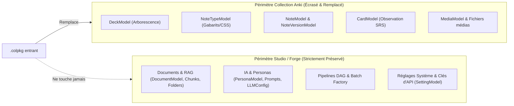

# 36. Importation de collection (.colpkg) par remplacement intégral et préservation du studio

Date: 2026-10-23

## Statut

Accepté

## Contexte

Dans l'écosystème Anki :
- Un fichier **`.apkg`** (Deck Package) transporte un lot ciblé de cartes, conçu pour être fusionné dans une collection existante.
- Un fichier **`.colpkg`** (Collection Package) représente un **instantané complet de la collection** (base SQLite compressée `collection.anki21b`, table unifiée des paquets, types de notes, cartes, ordonnancement et médias).

Jusqu'alors, AnkiForge traitait indifféremment les fichiers `.apkg` et `.colpkg` à travers le même pipeline de fusion incrémentale ([`import_manager.py`](file:///src/ankiforge/services/cards/import_manager.py)). Ce traitement unifié provoquait quatre défaillances majeures :
1. **Écrasement destructeur des types de note** : lors d'un import `.colpkg`, le code écrasait inconditionnellement `fields_schema` des modèles locaux homonymes existants, rendant illisibles et incompatibles les notes locales préexistantes qui dépendaient de l'ancien schéma.
2. **Absence de détection des suppressions (Cartes zombies)** : l'importation se contentait d'ajouter (`new_notes`) et de mettre à jour (`silent_updates`). Les notes, cartes et paquets supprimés dans Anki n'étaient jamais purgés d'AnkiForge, puis réapparaissaient comme des cartes zombies lors des exports ultérieurs.
3. **Nettoyage de modèles orphelins inopérant** : le nettoyage des types de notes absents n'était tenté que si le compte de notes locales était de zéro, ce qui n'arrivait jamais du fait de la conservation des notes fantômes.
4. **Interface utilisateur incohérente** : `ImportDialog` offrait l'option de « Fusionner dans un paquet plat », ce qui menaçait d'écraser la hiérarchie complète de 50 sous-paquets d'un `.colpkg`, tout en risquant de déclencher des arbitrages Smart Merge carte par carte ingérables sur des milliers de fiches.

## Décision

### 1. Sémantique d'importation dichotomique (.apkg vs .colpkg)

L'importation de fichiers Anki est scindée en deux régimes sémantiques formellement distincts :
- **Import `.apkg` (Fusion collaborative)** : conservation du comportement incrémental, détection des conflits de contenu selon la Règle 11, arbitrage par le dialogue 3-panneaux *Smart Merge* et préservation des modèles locaux par scission de suffixe en cas d'incompatibilité de schéma.
- **Import `.colpkg` (Remplacement de collection)** : remplacement total, atomique et fidèle du périmètre de cartes du profil actif par le contenu exact du paquet de collection Anki.

### 2. Sanctuarisation du Studio d'Authoring vs Périmètre Anki

AnkiForge sépare strictement dans la base du profil (`ankiforge.db`) les données issues de la collection Anki et la matière d'authoring propre à la Forge :

1. **Périmètre Anki remplacé à 100%** :
   - `DeckModel`, `NoteTypeModel`, `NoteModel`, `NoteVersionModel`, `NoteVersionMediaModel`, `CardModel`.
   - `MediaModel` et synchronisation/nettoyage du dossier de médias du profil (`get_media_dir()`).
   - `AuditRecordModel` et `IgnoredDuplicateModel` (réinitialisés pour refléter la nouvelle collection).
2. **Périmètre Studio strictement sanctuarisé** :
   - **Documents sources & Découpages RAG** : `FolderModel`, `DocumentModel`, `DocumentPageModel`, `DocumentChunkModel`, `EmbeddingCacheModel`, ainsi que les fichiers originaux stockés sur disque.
   - **Personas, Agents & Prompts IA** : `PersonaFolderModel`, `PersonaModel`, `PersonaVersionModel`, `PromptModel`, `LLMConfigModel`, `PythonToolModel`.
   - **Pipelines DAG & Tâches de génération** : `PipelineModel`, `PipelineStepModel`, `PipelineRunModel`, `BatchRunModel`, `BatchTaskModel`.
   - **Configuration du profil** : `SettingModel` (clés d'API, disposition d'interface, préférences de thèmes, libellés de drapeaux).

### 3. Réconciliation automatique de la traçabilité documentaire

Les liens de couverture physiques (`NoteChunkLinkModel`) sont supprimés en cascade lors de la purge des anciennes notes (`on_delete="CASCADE"`).
Cependant, si les notes entrantes du `.colpkg` contiennent des tags de provenance durable (`doc:`, `section:`, `page:` selon l'ADR 0009 et l'ADR 0010), le service `CoverageAlignmentService` procède immédiatement à une passe de réalignement automatique post-importation pour reconnecter les cartes aux fragments documentaires préservés.

### 4. Sauvegarde de sécurité pré-importation obligatoire

Avant toute opération de remplacement par `.colpkg`, une sauvegarde atomique SQLite complète du profil est déclenchée via `backup_database()`. Cette sauvegarde est estampillée `ankiforge_backup_precolpkg_<horodatage>.db` et échappe à la purge de rotation standard afin de permettre une restauration immédiate en cas de mauvaise manipulation de l'utilisateur.

### 5. Adaptation dynamique de l'interface (`ImportDialog`)

Lorsqu'un fichier avec l'extension `.colpkg` est déposé ou sélectionné dans `ImportDialog` :
- L'option « Fusionner dans le paquet » est désactivée et masquée ; la structure hiérarchique d'origine est imposée.
- Un encart d'avertissement solennel à fond ambré/accentué s'affiche :
  > **Remplacement de collection (.colpkg)** : L'ensemble de vos cartes, paquets et types de notes existants sera remplacé par le contenu exact de cette collection. Vos documents sources, découpages RAG, agents IA et configurations de pipelines seront scrupuleusement conservés. Une sauvegarde automatique de sécurité sera créée.
- Le bouton d'action devient explicitement « Remplacer la collection ».
- Les conflits de contenu ponctuels (Smart Merge) sont neutralisés : la collection Anki entrante fait autorité.

### 6. Relèvement du plafond de décompression pour les collections

Pour éviter les rejets injustifiés sur les collections riches en médias, le plafond anti zip-bomb de sécurité pour les fichiers `.colpkg` est porté à 5 Gio par défaut (ou désactivable par configuration utilisateur), distinct du plafond des paquets unitaires `.apkg`.

## Conséquences

- Élimination définitive des corruptions de schéma de types de note sur les notes locales.
- Disparition des cartes zombies : les cartes supprimées dans Anki sont fidèlement retirées d'AnkiForge lors de l'import d'une sauvegarde de collection.
- Sérénité totale pour l'utilisateur : son studio de travail (cours, documents, modèles d'agents, pipelines de fabrication) reste intact, tandis que le volet flashcards s'aligne exactement sur l'état d'Anki.
- Filet de sécurité garanti par la sauvegarde pré-importation automatique.
- Interface limpide évitant les erreurs de fusion involontaire.
