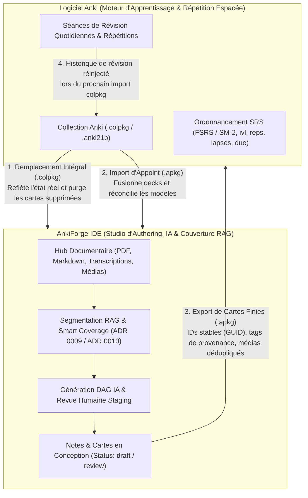

# 37. Réconciliation des types de note, conformité du moteur de rendu Anki et cycle de vie distribué

Date: 2026-10-23

## Statut

Accepté

## Contexte

Dans l'écosystème Anki, un type de note (notetype / modèle) est l'entité structurante définissant la liste ordonnée des champs (`flds`), les gabarits de cartes Recto/Verso (`tmpls`) et la feuille de style CSS (`css`). L'identifiant immuable d'un modèle dans Anki est un entier horodaté `mid` (`anki_id`).

L'analyse de la base de code et les retours utilisateurs ont mis en lumière trois défaillances critiques :

1. **Corruption de données par écrasement aveugle du schéma (`fields_schema`)** :
   Dans [`import_manager.py`](file:///src/ankiforge/services/cards/import_manager.py), lorsqu'un modèle entrant dans un paquet `.apkg` porte le même nom qu'un modèle local (ex. `"Basique"`), AnkiForge assigne immédiatement `existing_nt.anki_id = int_mid`. La condition de mise à jour devient alors vraie et écrase `fields_schema`, alors même que des dizaines de notes locales utilisent ce modèle avec un JSON de données indexé sur les anciens noms de champs. Le rendu et l'édition de ces notes deviennent inopérants.
2. **Prolifération des doublons `(Importé X)`** :
   À l'inverse, si deux paquets partagent un modèle structurellement identique mais avec des `anki_id` différents, AnkiForge crée des clones en cascade (`Basique (Importé)`, `Basique (Importé 1)`), polluant la collection.
3. **Seeds initiaux déconnectés d'Anki** :
   À la création d'un profil vierge, AnkiForge injecte en dur trois modèles (`"Basique"`, `"Texte à trous"`, `"Image Occlusion"`) avec `anki_id = None`. Dès qu'un utilisateur importe sa collection Anki (en français ou en anglais `"Basic"`), AnkiForge ne fait pas la réconciliation et duplique les modèles.
4. **Non-respect des règles de génération et quantificateurs conditionnels Anki (`#`, `^`)** :
   Dans [`anki_renderer.py`](file:///src/ankiforge/utils/anki_renderer.py), le parser conditionnel est une regex plate non-gloutonne qui échoue sur les balises imbriquées et ignore les champs absents. De plus, AnkiForge engendre aveuglément des cartes physiques pour tous les gabarits, y compris ceux dont le recto est totalement vide, violant la règle fondamentale d'Anki selon laquelle une carte n'est créée que si son recto contient du contenu visible.
5. **Absence de formalisation du cycle de vie distribué AnkiForge ↔ Anki** :
   Anki et AnkiForge constituent un système distribué fonctionnant par échanges d'archives (snapshots). Sans schéma pédagogique clair et sans contrat de synchronisation, l'utilisateur risque d'accumuler des cartes mortes dans Anki ou de perdre des données lors d'imports/exports croisés.

## Décision

### 1. Protocole de Réconciliation Hybride des Types de Note (Option B2 + Isomorphisme A)

L'importation de types de notes (notamment via `.apkg`) obéit aux règles suivantes :

1. **Primauté de l'autorité Anki via `anki_id` (`mid`)** :
   - Si un modèle local possède le même `anki_id` que le modèle entrant, Anki fait autorité.
   - Les gabarits (`templates`) et le CSS (`css_style`) sont mis à jour avec ceux d'Anki.
   - **Gestion de l'évolution des champs (Option B2 Hybride)** :
     - Si de nouveaux champs sont ajoutés dans Anki, ils sont ajoutés au schéma local sans friction.
     - Si des champs sont réordonnés, la correspondance est préservée via l'index ordinal (`ord`).
     - Si un champ existant est supprimé dans Anki : les données locales associées à ce champ sur les notes existantes sont automatiquement archivées dans une clé spéciale `_orphaned_fields` du JSON de contenu. Si des notes locales portent du contenu non synchronisé dans un champ supprimé, un avertissement explicite informe l'utilisateur afin d'interdire toute perte invisible de texte rédigé dans AnkiForge.
2. **Isomorphisme structurel (Option A)** :
   - Si le modèle entrant n'a pas de correspondance exacte par `anki_id`, mais qu'un modèle local porte un nom équivalent ET possède une liste de champs identique (ou isomorphe comme `["Recto", "Verso"]` ↔ `["Front", "Back"]`), le modèle local est réutilisé pour les nouvelles notes, sans instancier de clone artificiel `(Importé)`.
   - Si et seulement si les structures sont irréconciliables et que le modèle local a déjà des notes associées, une scission propre est créée sous le nom explicite `Nom (DeckSource)`.

### 2. Modèle Basique Amorce Unique (Seed Minimaliste Épuré)

- À l'initialisation d'un profil vierge ([`initial_seed.py`](file:///src/ankiforge/database/seeds/initial_seed.py)), AnkiForge ne génère qu'**un unique modèle de carte** : `"Basique"` (`["Recto", "Verso"]`, `anki_id: None`).
- **Adoption transparente** : lors du premier import d'un paquet Anki contenant un modèle basique (qu'il se nomme `"Basique"` ou `"Basic"`), le modèle local vierge (0 note) adopte silencieusement l'`anki_id`, le nom canonique, les gabarits et le CSS d'Anki.
- Les modèles spécialisés (`"Texte à trous (Cloze)"`, `"Image Occlusion Enhanced"`, QCM) ne sont plus imposés au démarrage : ils sont activés à la demande (en un clic via le Starter Pack ou automatiquement à l'ouverture d'un dialogue d'occlusion).
- Le seed est idempotent sur les alias `Basique`/`Basic` : après adoption du modèle par un premier import, il n'est jamais recréé au démarrage suivant.

### 3. Conformité Totale au Moteur de Cartes Anki & Quantificateurs Conditionnels

Le moteur de rendu ([`anki_renderer.py`](file:///src/ankiforge/utils/anki_renderer.py)) et le gestionnaire de création de cartes ([`note_manager.py`](file:///src/ankiforge/services/cards/note_manager.py)) adoptent l'intégralité des spécifications officielles d'Anki :

1. **Parser conditionnel récursif** :
   - Support complet des conditionnels positifs `{{#Champ}}...{{/Champ}}` et négatifs `{{^Champ}}...{{/Champ}}`.
   - Prise en charge des balises imbriquées (arbre ou pile d'évaluation, remplaçant la regex plate).
   - Tout champ absent du dictionnaire de valeurs ou ne contenant que des espaces / balises HTML vides est évalué comme **falsy**.
2. **Règle de génération conditionnelle de carte** :
   - Avant de créer un `CardModel` pour le gabarit `i`, AnkiForge évalue son recto `qfmt`.
   - Si après substitution des conditionnels et des champs, le recto ne contient aucun texte visible (hors balises structurelles), **la carte n'est pas créée**.
   - Ceci élimine définitivement les cartes fantômes et cartes inversées vides (ex. modèle *Basique (avec carte inversée optionnelle)* où le champ inversé n'est pas rempli).
3. **Complétude des balises spéciales Anki** :
   - `{{FrontSide}}` au verso avec masquage des champs de saisie `{{type:...}}`.
   - `{{Tags}}`, `{{Deck}}`, `{{Subdeck}}`, `{{Card}}`, `{{Type}}`.
   - Filtres de formatage : `{{text:Champ}}` (suppression du HTML), `{{cloze:Champ}}`, `{{hint:Champ}}`.

### 4. Matrice & Architecture du Cycle de Vie Distribué AnkiForge ↔ Anki

AnkiForge et Anki forment un système distribué asynchrone gouverné par le principe de **Sanctuarisation des Responsabilités** :

#### Rôles et Frontières de Responsabilité

| Domaine | Source d'Autorité | Règle d'Échange |
|---|---|---|
| **Ordonnancement SRS** (`ivl`, `reps`, `lapses`, `due`) | **Anki** | AnkiForge ne calcule ni ne modifie jamais les dates d'échéance. Il se contente d'afficher les compteurs d'observation et la stabilité estimée. |
| **Documents, Livres & Cours** | **AnkiForge** | Strictement sanctuarisés dans le Périmètre Studio (ADR 0036). Anki n'en a jamais connaissance. |
| **Génération & Traçabilité RAG** | **AnkiForge** | Liens de couverture (`NoteChunkLinkModel`) ancrés sur les tags durables (`doc:`, `section:`, `page:`). |
| **Création & Édition de Flashcards** | **Partagée** | AnkiForge est l'IDE d'authoring (conception assistée par IA). Les notes validées sont exportées en `.apkg`. |
| **Suppression définitive de cartes** | **Anki** | Les cartes supprimées dans Anki sont purgées d'AnkiForge lors du remplacement de collection `.colpkg` (éliminant les cartes zombies). |

#### Guide Utilisateur : Comment Utiliser l'Application Sans Perte de Données

1. **Au démarrage ou après révision dans Anki** :
   - Exporter sa collection complète depuis Anki au format `.colpkg` (avec médias).
   - L'importer dans AnkiForge : AnkiForge remplace le périmètre Anki, rafraîchit les compteurs SRS et nettoie les cartes supprimées dans Anki, tout en conservant intacts tous les documents et agents du Studio.
2. **Pendant la session de travail dans AnkiForge** :
   - Importer des cours ou documents dans le Hub Documentaire.
   - Générer des cartes via la Batch Factory ou le Studio de Création.
   - Trancher les cartes en revue (Staging). Les cartes validées reçoivent leur identifiant canonique stable (GUID).
3. **Pour étudier dans Anki** :
   - Exporter les paquets enrichis depuis AnkiForge au format `.apkg`.
   - Dans Anki, importer le fichier `.apkg`. Anki met à jour les notes existantes grâce au GUID stable sans réinitialiser vos progrès SRS, et ajoute les nouvelles cartes.

## Conséquences

- **Zéro corruption de schéma** : les notes existantes ne peuvent plus voir leurs champs renommés ou écrasés silencieusement lors de l'import d'un deck.
- **Zéro prolifération de modèles fantômes** : l'isomorphisme structurel évite de créer `Basique (Importé)` lorsque la structure de champs est identique.
- **Conformité stricte Anki** : disparition des cartes vides dans la prévisualisation et l'éditeur grâce au respect de la règle de génération conditionnelle Anki.
- **Démarrage épuré** : profil vierge propre avec un seul modèle basique qui s'adapte immédiatement au premier import Anki.
- **Clarté totale pour l'utilisateur** : flux de travail documenté et visualisé éliminant le doute sur la perte de données ou les cartes zombies.
