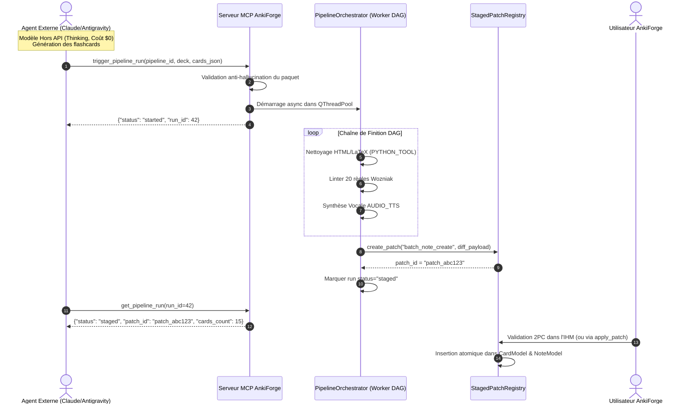

# Intégration MCP : Déclenchement de Pipelines DAG, Modèles Hors API et Chaîne de Finition Staged

**Statut :** accepté (révision et extension de l'arbitrage Phase 1 du ticket *MCP — Accès aux albums et à la gestion des pipelines DAG*, en conformité avec l'ADR 0043)

---

## 1. Contexte & Problématique

Lors de la mise en place initiale des outils MCP pour la gestion des pipelines DAG (Phase 1), l'accès avait été strictement restreint à la lecture seule (`list_pipelines` et `get_pipeline_run`). Le déclenchement de pipeline (`trigger_pipeline_run`) et la création de cartes associées avaient été provisoirement reportés afin d'éviter tout risque d'exécution concurrente non maîtrisée ou de consommation involontaire d'API payantes.

Cette interdiction présentait cependant deux limitations majeures :
1. **Gaspillage du potentiel des agents externes** : les agents d'IA opérant via MCP (Claude Code, Antigravity CLI, Cursor) s'appuient sur des modèles de raisonnement de pointe dits « hors API » (Claude 3.7 Sonnet avec Extended Thinking, forfaits d'abonnements développeur sans coût de jeton à l'usage dans AnkiForge), dont la qualité de formulation pédagogique surpasse souvent celle des petits modèles d'API directe.
2. **Perte de la chaîne de valeur d'AnkiForge** : inciter un agent externe à créer directement des notes via `create_notes_batch` privait l'utilisateur des étapes à haute valeur ajoutée configurées dans les pipelines DAG d'AnkiForge (nettoyage HTML/LaTeX, normalisation des formules mathématiques, déduplication Levenshtein via extension C native, linter des 20 règles de formulation de Piotr Wozniak, synthèse vocale `AUDIO_TTS` avec injection des balises `[sound:...]`, et tags hiérarchiques).

Il s'agissait donc de revoir l'interdiction de Phase 1 et de concevoir une intégration élégante permettant à l'agent externe de piloter les pipelines DAG tout en respectant scrupuleusement les invariants de sécurité du dépôt (Two-Phase Commit, anti-hallucination de paquets).

---

## 2. Décisions & Arbitrages Tranchés

### A. Rôle de l'Agent Externe : Fournisseur de Cartes & Finition par le DAG
L'agent externe utilise son modèle d'IA de pointe hors API pour synthétiser les connaissances et générer le premier jet des flashcards. 
Le pipeline DAG d'AnkiForge n'est pas court-circuité : il sert de **chaîne de finition industrielle déterministe** :
- Exécution des étapes `PYTHON_TOOL` de nettoyage (`clean_html_latex`),
- Exécution du linter Wozniak et du filtrage Levenshtein,
- Exécution des étapes multimédias comme `AUDIO_TTS`,
- Injection des métadonnées et de la traçabilité documentaire.

### B. Outil MCP de Déclenchement : `trigger_pipeline_run`
Un nouvel outil d'action est exposé sur le serveur MCP :
```python
@mcp.tool()
def trigger_pipeline_run(
    pipeline_id: int,
    deck_name: str,
    cards_json: str,
    note_type_name: str = "",
    document_id: int | None = None,
    variables_json: str = "{}",
) -> str:
    """Déclenche l'exécution asynchrone d'un pipeline DAG de finition sur un lot de cartes candidates générées hors API."""
```

**Garde-fous stricts à l'invocation :**
- **Contrôle d'hallucination de paquet (ADR 0043)** : le `deck_name` doit obligatoirement correspondre à un paquet existant dans la collection (vérification via `DeckRepository`). Tout nom invalide est rejeté avec suggestion des paquets les plus proches.
- **Validation syntaxique des cartes** : `cards_json` doit être une liste JSON de dictionnaires de champs non vide.
- **Intégrité du pipeline** : le `pipeline_id` doit correspondre à un `PipelineModel` valide.

### C. Exécution Asynchrone Découplée (Non-Bloquante)
Les étapes d'un pipeline (en particulier la synthèse vocale `AUDIO_TTS` ou le traitement par lots) peuvent durer plusieurs dizaines de secondes. Bloquer l'appel MCP provoquerait des dépassements de délai (*timeouts*) côté client MCP.
- `trigger_pipeline_run` initialise l'état partagé `PipelineRunState`, instancie `PipelineOrchestrator`, démarre l'exécution dans le `QThreadPool` d'arrière-plan et renvoie **immédiatement** une réponse JSON contenant le numéro de run (`run_id`) et son statut initial (`started`).
- L'agent externe interroge l'avancement via l'outil existant `get_pipeline_run(run_id=...)` jusqu'à completion.

### D. Sanctuarisation du Two-Phase Commit (`StagedPatchModel`)
En conformité absolue avec l'ADR 0043 :
- Les cartes produites et traitées par le pipeline déclenché via MCP ne sont **JAMAIS** insérées directement en base de données.
- À l'issue des étapes de finition du DAG, la finalisation du run génère obligatoirement un `StagedPatch` de type `batch_note_create` dans `StagedPatchRegistry`.
- Le statut du run passe à `staged`, et l'identifiant du patch (`patch_id`) est consigné dans l'état du run.
- L'utilisateur peut inspecter et valider le lot en un clic dans le Garde-Fou MCP, ou l'agent externe peut invoquer `apply_patch(patch_id)` avec confirmation explicite.

---

## 3. Schéma du Flux d'Exécution



---

## 4. Conséquences

- **Qualité & Économie** : L'utilisateur bénéficie de l'intelligence de ses modèles de pointe sans surcoût d'API par token dans AnkiForge, tout en conservant la rigueur algorithmique du DAG.
- **Sécurité et intégrité de la collection** : Zéro injection sauvage ; le Garde-Fou Two-Phase Commit protège la base de données.
- **Absence de régression** : Les pipelines existants restent inchangés et continuent de fonctionner dans l'interface Qt (`CreationView` et `BatchView`).
- **Observabilité** : Le cockpit MCP et `get_pipeline_run` fournissent une traçabilité totale des étapes franchies, des durées et des erreurs potentielles.
