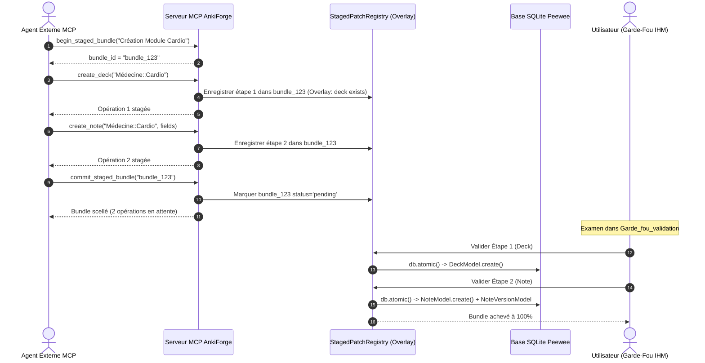

# Régime d'Écriture MCP : Binarité Stricte, Staged Bundles Séquentiels, Contexte Virtuel et Architecture 2PC

**Statut :** accepté (consolide, généralise et refonde les ex-ADR 0017, 0034, 0042)

---

## 1. Contexte & Problématique

L'arbitrage initial d'écriture MCP reposait sur un régime asymétrique (ex-ADR 0017) : les paquets, déplacements de cartes et nettoyages légers étaient exécutés directement en base, tandis que seules les créations et refactorisations de notes passaient par le Two-Phase Commit (`StagedPatch`).

Cette asymétrie présentait trois faiblesses critiques :
1. **Altérations directes non contrôlées** : des opérations d'hygiène (`delete_empty_cards`, `move_cards_to_deck`, `delete_unused_note_type`) pouvaient modifier ou détruire des enregistrements en base sans revue humaine préalable.
2. **Paralysie des agents autonomes** : imposer un arrêt avec validation humaine sur chaque outil unitaire interdisait aux agents d'enchaîner des actions dépendantes (ex. créer un nouveau paquet, puis y insérer des notes, puis taguer ces notes), car l'étape 2 échouait faute d'existence physique de l'étape 1 en base.
3. **Biais de lecture non documenté** : l'agent exécutant des requêtes de vérification après émission d'un patch constatait que la base physique n'avait pas bougé, risquant de relancer des requêtes en boucle ou d'halluciner.

Parallèlement, l'architecture MCP initiale (ex-ADR 0034) établissait le serveur local in-process comme unique moteur d'assistance, mais maintenait encore un chat in-app cloisonné et un rafraîchissement global agressif expulsant l'utilisateur de sa vue. L'ex-ADR 0042 a ensuite délimité le périmètre exact des mutations autorisées, rejetant formellement l'import de documents bruts, la création d'albums, le pilotage de la Batch Factory et la synchronisation AnkiConnect directe.

---

## 2. Principes Fondamentaux de l'Architecture MCP Unifiée

### A. Binarité Stricte : Lecture Directe vs Écriture 100% Staged
- **Lectures (Read-Only)** : Toutes les opérations de consultation (`query_peewee`, `get_deck_stats`, `list_decks`, `list_pipelines`, `search_document`, `get_flagged_cards`, etc.) sont strictement passives, déterministes et directes.
- **Écritures (Mutations)** : **100 % des mutations passent obligatoirement par un patch en attente dans l'onglet `Garde_fou_validation`**. Aucune mutation physique (création, modification, suppression, déplacement, tagging) ne s'applique directement sur la base sans validation humaine préalable.

### B. Priorité Absolue au Serveur MCP Autonome & Centrage Harness
- **Entrée de premier niveau** : La barre latérale globale consacre l'entrée **« MCP & Agents »** (`tr("MCP & Agents")`).
- **Autonomie opérationnelle** : Le tableau de bord permet de superviser l'état du serveur, de démarrer/arrêter/redémarrer le démon SSE, et de régénérer le jeton d'authentification. Des snippets prêts à copier sont générés à chaud pour Claude Desktop/Code, Antigravity CLI et Cursor.
- **Dépose totale du chat in-app** : Retrait définitif des composants de discussion intégrée (`ConsultantChatInput`, `SessionSidebar`, `ContextHubWidget`, `WorkspaceInspectorWidget`). Purge des tables SQLite `consultant_session` et `consultant_message` via migration dédiée. Le registre d'outils (`ConsultantToolRegistry`) devient le moteur autonome `MCPToolRegistry`.
- **Cockpit plein écran 5 sous-onglets** : `MCPServerDashboardWidget` déployé sur 100 % de la largeur, structuré en **Supervision & Connexion**, **Garde-Fou & Validation**, **Catalogue d'Outils**, **Télémétrie & Activité**, **Guides & Workspaces** pilotés par `SegmentedTabBar`.

### C. Les Staged Bundles (Sessions Transactionnelles de Groupe)
Pour permettre à l'agent d'enchaîner une séquence logique complète sans blocage :
1. **Ouverture de session** : `begin_staged_bundle(title: str, explanation: str = "") -> str` alloue un `bundle_id`.
2. **Enchaînement d'opérations** : l'agent invoque ses outils de mutation ordinaires (`create_deck`, `create_note`, `set_tags_bulk`, `propose_card_refactor`, `propose_cards_batch_refactor`). Chaque mutation est enregistrée comme une **étape ordonnée** du bundle (`step_order = 1, 2, 3...`) sans toucher à la base SQLite.
3. **Scellement du bundle** : `commit_staged_bundle(bundle_id: str) -> str` valide la cohérence globale et place le bundle au statut `pending`, prêt pour examen dans l'IHM.
4. **Annulation** : `abort_staged_bundle(bundle_id: str)` supprime le bundle et toutes ses étapes.

### D. Contexte Virtuel (Staged Overlay) Intra-Bundle
Pendant la construction du bundle, le validateur MCP tient compte de l'état virtuel produit par les étapes antérieures :
- Si l'étape 1 déclare `create_deck("Sciences::Physique")`, l'étape 2 `create_note(deck_name="Sciences::Physique", ...)` est acceptée par le contrôle anti-hallucination, car le paquet existe dans le **Staged Overlay** du bundle courant.

### E. Décorrélation des Flux & Passivité de `refresh_data()`
- **Passivité stricte de l'interface** : `refresh_data()` est strictement passive et idempotente. Elle ne doit **jamais** modifier l'onglet actif, ni basculer de vue, ni forcer l'ouverture d'un volet.
- **Routage granulaire par domaine** : L'événement `MCPDataMutatedEvent` transporte un domaine sémantique (`cards`, `decks`, `models`, `docs`) résolu à la source par `resolve_mcp_mutation_domain()`.
- **Réveil ciblé des vues** : Seules les vues abonnées au domaine concerné sont notifiées :
  - `cards` → vues Édition et Analyse
  - `decks` → vues Création, Batch et Édition
  - `models` → vues Modèles de cartes et Édition
  - `docs` → vue Documents
- Une vue implémentant `apply_mcp_mutation()` applique une mise à jour granulaire sans recharger l'intégralité de son modèle.

### F. Workflow de Validation Séquentielle Pas-à-Pas en IHM
Dans le sous-onglet `Garde_fou_validation` (`MCPGardeFouWidget`) :
1. **Regroupement visuel** : Bundles sous forme de cartes maîtresses (titre, nombre d'opérations, progression `Étape X / N`).
2. **Adaptation contextuelle** : Panneau de détail bascule selon l'opération (`deck_create` → visualiseur paquet, `card_refactor` → diff sémantique, `set_tags_bulk` → badges tags, `card_delete` → avertissement suppression).
3. **Édition directe en place** : Retouche des champs via `sync_direct_edit`.
4. **Validation séquentielle & Règle d'arrêt en cascade (Fail-Fast)** :
   - L'utilisateur valide les étapes une par une. Dès validation, l'étape est commitée en base atomiquement.
   - Si l'utilisateur rejette l'étape $k$, **toutes les étapes $k+1 \dots N$ sont automatiquement annulées**.
5. **Raccourci « Tout valider »** : Commit de l'ensemble sous transaction SQLite unique.

---

## 3. Périmètre des Mutations MCP : Garde-Fous 2PC Systématiques

### A. Rejets Formels (Architecture)
Quatre capacités explicitement **rejetées** :
| Capacité | Motif |
|---|---|
| Création / Importation de documents bruts (`create_document`) | Anti-hallucination documentaire : ingestion initiée par l'humain |
| Création d'albums visuels & ajout de planches | Même motif : supports graphiques/OCR doivent être vérifiés |
| Pilotage de la Batch Factory (`trigger_batch_run`) | Protection budgétaire (boucles récursives, quotas API payants) |
| Synchronisation AnkiConnect direct | Préservation du cycle distribué sans corruption |

### B. Matrice des Outils & Régimes de Validation

| Domaine | Outils MCP | Régime d'Écriture |
|---|---|---|
| **Documents & RAG** | `exclude_document_region`, `neutralize_document_region`, `update_document_content`, `reindex_document` | Écriture directe idempotente (non-destructif, réversible) |
| **Hygiène & Suppression** | `propose_card_deletion`, `propose_batch_card_deletion`, `propose_deck_rename`, `propose_deck_deletion`, `propose_empty_cards_deletion` | **StagedPatch (2PC) obligatoire** |
| **Pipelines & Python** | `create_pipeline`, `update_pipeline_step`, `clone_pipeline`, `create_or_update_python_tool` | Écriture directe avec validation syntaxique / sandbox |
| **SRS & Révision** | `set_card_flag`, `suspend_card`, `unsuspend_card`, `get_flagged_cards` | Écriture directe synchrone / lecture directe |
| **Albums** | `correct_plate_ocr` | Écriture directe sur la couche texte de la planche |
| **Export & Système** | `export_deck_apkg`, `trigger_manual_backup` | Opération système synchrone |
| **Notes & Refactor** | `create_note`, `create_notes_batch`, `propose_card_refactor`, `propose_card_split`, `propose_cards_batch_refactor`, `change_note_type` | **StagedPatch (2PC) obligatoire** |
| **Tags** | `set_tags_bulk` | **StagedPatch (2PC) obligatoire** |

### C. Plafonds Volumétriques & Sécurité (ex-ADR 0048)
- **Limite par appel** : 100 notes/cartes max, 32 000 caractères max (double borne cumulative).
- **Recommandation** : Sous-lots de 5–8 éléments (≈ 8 000 caractères) sur un Staged Bundle ouvert.
- **Troncature** : Rejet structuré immédiat si dépassement, jamais réparation silencieuse.

---

## 4. Schéma du Cycle de Vie d'un Staged Bundle

---

## 5. Outils MCP du Cycle de Vie des Bundles
1. `begin_staged_bundle(title: str, explanation: str = "") -> str`
2. `commit_staged_bundle(bundle_id: str) -> str`
3. `abort_staged_bundle(bundle_id: str) -> str`
4. `get_staged_pending_operations(bundle_id: str = "") -> str`

## 6. Corrections d'Anomalies Critiques Intégrées
- `propose_css_tune` : patch `patch_type="css"` persistant dans `StagedPatchModel`.
- `delete_empty_cards` → `propose_empty_cards_deletion` (étape de bundle).
- `sanitize_fields_html` : suppression du seuil empirique de 5 cartes ; diff staged systématique.
- `propose_cards_batch_refactor` : outil unique à émission multi-étapes (ex-ADR 0046), 1 requête MCP pour ≤ 100 cartes, diff unitaire par carte dans `CardSemanticDiffWidget`.

---

## 7. Conséquences
- **Sérénité totale** : Aucune écriture sauvage ou destructive ne contourne le `Garde_fou_validation`.
- **Fluidité maximale** : L'agent compose ses scénarios d'authoring complexes en une session transactionnelle sans blocage synchrone.
- **Intégrité relationnelle** : Règle d'annulation en cascade empêchant les incohérences (ex. notes dans paquet refusé).
- **Sécurité budgétaire** : Rejet du pilotage Batch Factory protège contre les boucles de consommation API.
- **Traçabilité complète** : Chaque mutation est auditable, réversible et validée humainement.