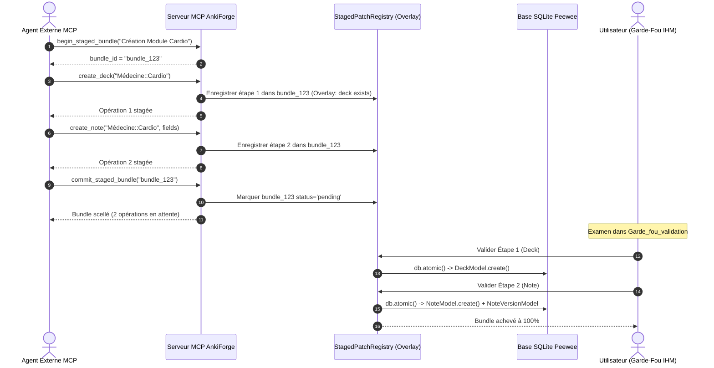

# Régime d'Écriture MCP : Binarité Stricte, Staged Bundles Séquentiels et Contexte Virtuel (Staged Overlay)

**Statut :** accepté (consolide, généralise et refonde l'ADR 0017, l'ADR 0034 et l'ADR 0042)

---

## 1. Contexte & Problématique

L'arbitrage initial d'écriture MCP reposait sur un régime asymétrique ([ADR 0017](file:///Users/tristanrigaud-humbert/PycharmProjects/AnkiForge/docs/adr/0017-regime-ecriture-mcp-paquets-direct-vs-notes-staged.md)) : les paquets, déplacements de cartes et nettoyages légers étaient exécutés directement en base, tandis que seules les créations et refactorisations de notes passaient par le Two-Phase Commit (`StagedPatch`).

Cette asymétrie présentait trois faiblesses critiques :
1. **Altérations directes non contrôlées** : des opérations d'hygiène (`delete_empty_cards`, `move_cards_to_deck`, `delete_unused_note_type`) pouvaient modifier ou détruire des enregistrements en base sans revue humaine préalable.
2. **Paralysie des agents autonomes** : imposer un arrêt avec validation humaine sur chaque outil unitaire interdisait aux agents d'enchaîner des actions dépendantes (ex. créer un nouveau paquet, puis y insérer des notes, puis taguer ces notes), car l'étape 2 échouait faute d'existence physique de l'étape 1 en base.
3. **Biais de lecture non documenté** : l'agent exécutant des requêtes de vérification après émission d'un patch constatait que la base physique n'avait pas bougé, risquant de relancer des requêtes en boucle ou d'halluciner.

---

## 2. Principes Fondamentaux de la Refonte

### A. Binarité Stricte : Lecture Directe vs Écriture 100% Staged
- **Lectures (Read-Only)** : Toutes les opérations de consultation (`query_peewee`, `get_deck_stats`, `list_decks`, `list_pipelines`, `search_document`, etc.) sont strictement passives, déterministes et directes.
- **Écritures (Mutations)** : **100 % des mutations passent obligatoirement par un patch en attente dans l'onglet `Garde_fou_validation`**. Aucune mutation physique (création, modification, suppression, déplacement, tagging) ne s'applique directement sur la base sans validation humaine préalable.

### B. Les Staged Bundles (Sessions Transactionnelles de Groupe)
Pour permettre à l'agent d'enchaîner une séquence logique complète sans blocage, le serveur MCP introduit la notion de **Staged Bundle** (bloc d'opérations groupées) :
1. **Ouverture de session** : `begin_staged_bundle(title: str, explanation: str = "") -> str` alloue un identifiant de bundle (`bundle_id`).
2. **Enchaînement d'opérations** : l'agent invoque ses outils de mutation ordinaires (`create_deck`, `create_note`, `set_tags_bulk`, `propose_card_refactor`). Tant que le bundle est ouvert, chaque mutation est enregistrée comme une **étape ordonnée** du bundle (`step_order = 1, 2, 3...`) sans toucher à la base SQLite.
3. **Scellement du bundle** : `commit_staged_bundle(bundle_id: str) -> str` valide la cohérence globale du bloc et le place au statut `pending`, prêt pour examen dans l'IHM.

### C. Contexte Virtuel (Staged Overlay) Intra-Bundle
Pendant la construction du bundle, le validateur MCP tient compte de l'état virtuel produit par les étapes antérieures du même bundle :
- Si l'étape 1 déclare `create_deck("Sciences::Physique")`, l'étape 2 `create_note(deck_name="Sciences::Physique", ...)` est acceptée par le contrôle anti-hallucination d'ADR 0017, car le paquet existe dans le **Staged Overlay** du bundle courant.

### D. Workflow de Validation Séquentielle Pas-à-Pas en IHM
Dans le sous-onglet `Garde_fou_validation` ([`MCPGardeFouWidget`](file:///Users/tristanrigaud-humbert/PycharmProjects/AnkiForge/src/ankiforge/ui/views/consultant_view/widgets/mcp_garde_fou_widget.py)) :
1. **Regroupement visuel** : Les bundles s'affichent sous forme de cartes maîtresses affichant le titre, le nombre total d'opérations et la progression (`Étape X / N`).
2. **Adaptation contextuelle de la vue** : Le panneau de détail bascule dynamiquement selon la nature de l'opération en cours (visualiseur de paquet pour `deck_create`, diff sémantique champ par champ pour `card_refactor`, badges de tags pour `set_tags_bulk`, avertissement de suppression pour `card_delete`).
3. **Édition directe en place** : L'utilisateur peut retoucher les champs de chaque étape avant application via `sync_direct_edit`.
4. **Validation séquentielle & Règle d'arrêt en cascade** :
   - L'utilisateur valide les étapes les unes après les autres. Dès validation, l'étape courante est commitée en base atomiquement et l'IHM présente l'étape suivante.
   - **Règle d'arrêt en cascade (Fail-Fast)** : si l'utilisateur rejette l'étape $k$, **toutes les étapes subséquentes $k+1 \dots N$ du bundle sont automatiquement annulées et rejetées**, car leur intégrité dépendait de l'étape refusée.
5. **Raccourci « Tout valider »** : Un bouton permet de committer l'ensemble des étapes d'un coup sous transaction SQLite unique si l'utilisateur approuve la totalité du bloc.

---

## 3. Schéma du Cycle de Vie d'un Staged Bundle

---

## 4. Outils MCP Ajoutés & Corrigés

1. **Cycle de vie des bundles** :
   - `begin_staged_bundle(title: str, explanation: str = "") -> str`
   - `commit_staged_bundle(bundle_id: str) -> str`
   - `abort_staged_bundle(bundle_id: str) -> str`
   - `get_staged_pending_operations(bundle_id: str = "") -> str`
2. **Corrections des anomalies critiques** :
   - `propose_css_tune` : corrigé pour enregistrer un véritable patch `patch_type="css"` persistant dans `StagedPatchModel`.
   - `delete_empty_cards` : transformé en proposition staged `propose_empty_cards_deletion` (ou étape de bundle).
   - `sanitize_fields_html` : suppression du seuil empirique de 5 cartes ; génère toujours un diff staged sous contrôle 2PC.

---

## 5. Conséquences

- **Sérénité totale pour l'utilisateur** : Aucune écriture sauvage ou destructive ne contourne l'onglet `Garde_fou_validation`.
- **Fluidité maximale pour l'agent** : L'agent compose ses scénarios d'authoring complexes en une seule session transactionnelle sans blocage synchrone.
- **Intégrité relationnelle garantie** : La règle d'annulation en cascade empêche les incohérences (ex. créer des notes dans un paquet dont la création a été refusée).
