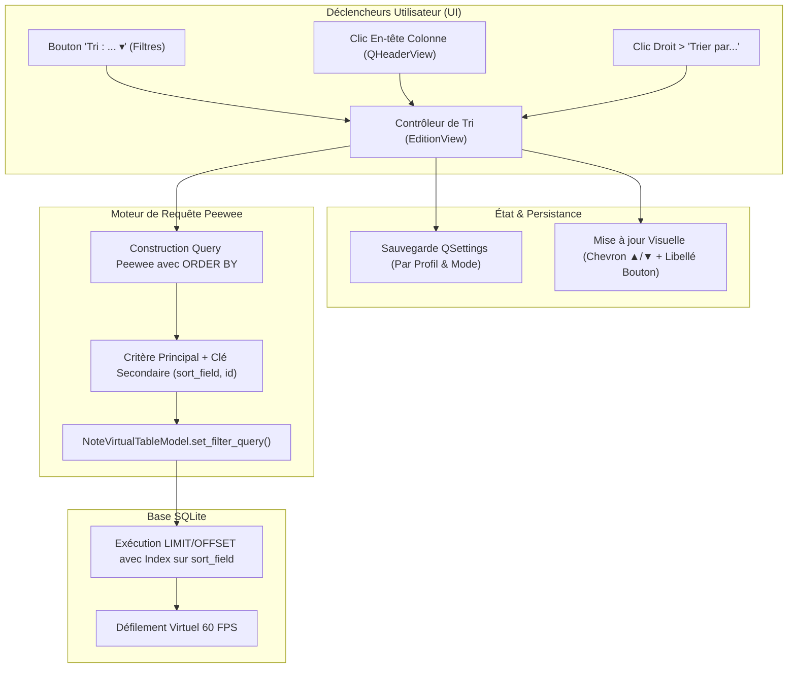

# 44. Système de Tri Multi-Critères Haute Performance et Champ de Tri (`sort_field`) dans la Vue d'Édition

**Date :** 2026-10-25  
**Statut :** Accepté  

---

## 1. Contexte & Problématique

Dans la vue d'Édition (`EditionView`), l'explorateur central de cartes et de notes repose sur un tableau virtuel paginé ([`VirtualTableView`](file:///Users/tristanrigaud-humbert/PycharmProjects/AnkiForge/src/ankiforge/ui/components/tables.py) et [`NoteVirtualTableModel`](file:///Users/tristanrigaud-humbert/PycharmProjects/AnkiForge/src/ankiforge/ui/models/note_table_model.py)).

Jusqu'alors, cette vue souffrait de limitations majeures concernant l'ordonnancement :
1. **Tri figé et statique en base** : Les requêtes Peewee étaient codées en dur avec `NoteModel.select().order_by(NoteModel.id.asc())` et `CardModel.select().order_by(CardModel.id.asc())`. L'utilisateur ne disposait d'aucun moyen pour réordonner sa collection.
2. **Absence d'ergonomie de tri dans l'IHM** :
   - Aucun bouton ou menu de tri dans la barre de filtres supérieure.
   - Le clic sur les en-têtes de colonnes ([`QHeaderView.sectionClicked`](file:///Users/tristanrigaud-humbert/PycharmProjects/AnkiForge/src/ankiforge/ui/views/edition_view/view.py)) ne traitait que la colonne 0 (sélection/désélection globale) et ignorait toutes les autres colonnes.
   - Aucun sous-menu contextuel au clic droit n'offrait d'options de tri (contrairement à la vue des types de notes formalisée dans l'[ADR 0035](file:///Users/tristanrigaud-humbert/PycharmProjects/AnkiForge/docs/adr/0035-menu-contextuel-et-tri-persistant-des-types-de-note.md)).
3. **Verrou technique de pagination sur le contenu textuel** : Les champs de contenu (Question, Réponse, Recto, Verso) étaient sérialisés en JSON dans la table liée `NoteVersionModel.content`. Sans dénormalisation, un tri SQL natif paginé (`LIMIT/OFFSET`) à 60 FPS sur de grandes collections (100 000+ notes) était impossible sans saturer la mémoire vive ou bloquer la boucle d'événements Qt.

---

## 2. Décisions Architecturales

### A. Triple Accès Ergonomique Synchronisé (Triple Sort Access)

Le tri peut être déclenché indifféremment et de manière synchronisée depuis trois points d'accès :
1. **Bouton dédié dans la barre de filtres supérieure** : Un bouton `btn_sort_order = QPushButton("Tri : [Critère actif] ▾")` muni de l'icône Phosphor `sort-ascending` ouvre un menu déroulant structuré (`StyledMenu`).
2. **En-têtes de colonnes interactifs (`QHeaderView`)** : Un clic sur un en-tête de colonne trie sur le champ correspondant et affiche le chevron visuel standard de direction (`▲` pour ascendant, `▼` pour descendant).
3. **Menu contextuel (Clic droit sur le tableau)** : Un sous-menu `Trier par...` permet d'accéder directement aux tris principaux depuis n'importe quelle sélection de lignes.

### B. Cycle de Bascule Binaire & Réinitialisation Déterministe

- **Cycle binaire fluide** : Cliquer successivement sur un même en-tête alterne de façon prévisible entre `Ascendant (▲)` et `Descendant (▼)` sans rupture silencieuse.
- **Réinitialisation explicite** : Une action dédiée `Réinitialiser le tri par défaut` (rétablissant l'ordre chronologique par `id` croissant/décroissant) figure en pied du menu déroulant et dans le clic droit.

### C. Dénormalisation du Champ de Tri (`NoteModel.sort_field`)

Afin de garantir un tri instantané en base de données SQLite sans charger les objets en mémoire :
- Un champ textuel indexé `sort_field = CharField(max_length=512, default="", index=True)` est intégré au modèle [`NoteModel`](file:///Users/tristanrigaud-humbert/PycharmProjects/AnkiForge/src/ankiforge/database/models.py).
- **Contrat canonique Anki (`sfld`)** : `sort_field` contient le texte épuré de tout code HTML du premier champ non vide de la note active.
- **Maintien automatique** : Ce champ est mis à jour de façon atomique et transparente lors de toute écriture :
  - Création et mise à jour de version dans `NoteRepository.save_note_version()`.
  - Importation de paquets `.apkg` / `.colpkg` dans `ImportManager`.
  - Application de mutations MCP dans `EditionView.apply_mcp_mutation()` et le service de staging.
- **Migration & Backfill transparent** : Au chargement du profil, si la colonne `sort_field` est absente ou non renseignée, une routine non-bloquante effectue la migration et le remplissage par lots (avec dialogue de progression si la base dépasse 5 000 notes).

### D. Pack Exhaustif de Critères de Tri

Le système supporte un ensemble unifié de critères adaptés aux deux modes de la vue d'Édition :

| Catégorie | Critère de Tri | Clé SQL / Peewee sous-jacente | Mode Disponible |
| :--- | :--- | :--- | :--- |
| **Dates & Versions** | Date de création (Plus récents / Plus anciens) | `NoteModel.id` / `CardModel.id` | Notes & Cartes |
| | Date de révision / modification | `NoteVersionModel.created_at` (jointure) | Notes & Cartes |
| **Contenu Textuel** | Recto / Question (A → Z / Z → A) | `NoteModel.sort_field` | Notes & Cartes |
| | Verso / Réponse (A → Z / Z → A) | `json_extract(content, '$.Verso')` | Notes & Cartes |
| | Champs spécifiques du modèle actif | `json_extract(content, '$.<nom_champ>')` | Notes (modèle filtré) |
| **Organisation** | Paquet / Deck (A → Z / Z → A) | `DeckModel.name` | Notes & Cartes |
| | Type de note (A → Z / Z → A) | `NoteTypeModel.name` | Notes & Cartes |
| | Tags (Alphabétique) | `NoteModel.tags` | Notes & Cartes |
| **Statut & Drapeaux** | Drapeau (Priorité 7 ➔ 1 ➔ Sans drapeau) | `CardModel.flags` | Notes & Cartes |
| | Statut de suspension (Actives ➔ Suspendues) | `CardModel.is_suspended` | Notes & Cartes |
| **SRS & Apprentissage** | Sangsues / Échecs (`lapses` décroissant) | `CardModel.lapses` | Cartes |
| | Intervalle (`ivl` croissant / décroissant) | `CardModel.ivl` | Cartes |
| | Répétitions (`reps` croissant / décroissant) | `CardModel.reps` | Cartes |
| | Stabilité FSRS (`stability`) | `CardModel.stability` | Cartes |
| | Difficulté FSRS (`difficulty`) | `CardModel.difficulty` | Cartes |

### E. Clé de Départage Déterministe (Secondary Sort Key)

Pour éviter tout sautillement visuel ou discontinuité de pagination lors du parcours de listes volumineuses, toute égalité sur un critère primaire (ex. plusieurs cartes partageant le même paquet, le même drapeau ou le même nombre d'échecs) est automatiquement résolue par :
1. `NoteModel.sort_field.asc()` (ordre alphabétique du contenu).
2. `NoteModel.id.desc()` / `CardModel.id.desc()` (ordre chronologique de création).

### F. Persistance Découplée par Profil et par Mode

L'état du tri est persisté dans les réglages du profil via `QSettings` :
- `edition/sort_notes` : dictionnaire stockant `criterion` et `direction` pour le mode `📝 Notes`.
- `edition/sort_cards` : dictionnaire stockant `criterion` et `direction` pour le mode `🗂️ Cartes`.
Lors du basculement entre les modes d'affichage, le tri spécifique au mode cible est immédiatement restauré avec rafraîchissement des en-têtes et du menu.

---

## 3. Architecture du Flux d'Événements

---

## 4. Conséquences & Bénéfices

- **Confort de navigation unifié** : Alignement de l'expérience d'exploration d'AnkiForge sur les standards reconnus de bureau et du navigateur Anki officiel.
- **Haute performance démontrée** : Maintien strict du défilement 60 FPS sur des bases dépassant 100 000 cartes grâce à la dénormalisation indexée de `sort_field` et à la pagination SQL sans chargement mémoire anticipé.
- **Détection immédiate des cartes critiques** : Possibilité de trier en un clic par nombre de chutes (`lapses`) ou difficulté FSRS pour lancer des opérations ciblées de refactorisation ou d'audit Wozniak.
- **Isolement et intégrité des sessions** : Préservation fidèle des préférences de tri entre les lancements sans interférer entre les différents profils d'utilisateurs.
