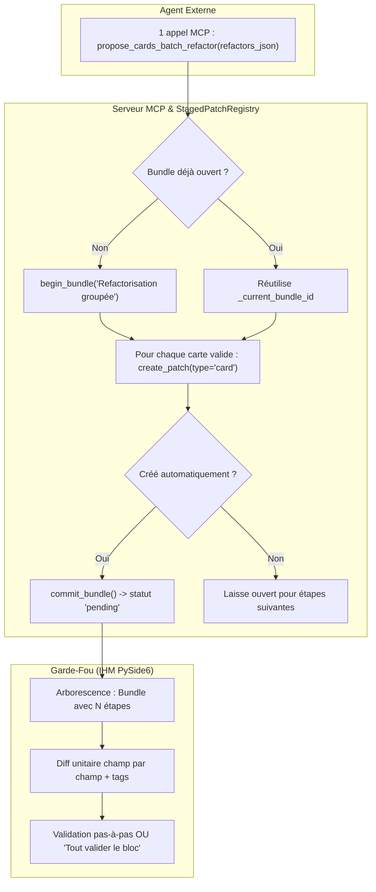

# ADR 0046 : Refactorisation par Lot MCP, Staged Bundles Multi-Étapes et Validation Hybride des Tags

**Statut :** accepté (étend et complète l'ADR 0043 sur les Staged Bundles et le Garde-Fou MCP)

---

## 1. Contexte & Problématique

Lors de campagnes de remédiation cognitive (traitement des cartes sangsues, normalisation de tags, mise en conformité des gabarits scientifiques, refonte de champs après audit), un agent autonome doit fréquemment proposer des retouches sur plusieurs dizaines de cartes (de 10 à 80 cartes).

Dans l'architecture initiale :
1. **Latence réseau et saturation de contexte** : L'agent était contraint d'appeler `propose_card_refactor` de manière strictement séquentielle (une requête réseau JSON-RPC par carte). Pour un lot de 60 cartes, cela représentait 60 allers-retours MCP, générant plusieurs minutes d'attente et surchargeant l'historique de la conversation.
2. **Inadéquation des patches monolithiques** : Une tentative de regrouper les modifications dans un unique patch monolithique (à l'image de `batch_note_create`) s'avérait défaillante pour l'IHM :
   - Le visualiseur sémantique de diff (`CardSemanticDiffWidget`) a été conçu pour comparer deux états d'une carte unique et ne sait pas restituer un dictionnaire multi-cartes.
   - Cela interdisait à l'utilisateur toute validation ou rejet chirurgical carte par carte.
   - Cela entraînait des risques de corruption de types (sérialisation de listes en chaînes de caractères lors de l'enregistrement).
3. **Déconnexion des tags** : L'outil `propose_card_refactor` unitaire ne portait que sur les champs de contenu textuels de la note, obligeant l'agent à recourir à un second outil (`set_tags_bulk`) pour réajuster la taxonomie.

---

## 2. Principes & Décisions d'Architecture

### A. Outil MCP Unique à Émission Multi-Étapes

Le serveur MCP expose l'outil :
```python
@mcp.tool()
def propose_cards_batch_refactor(refactors_json: str, title: str = "", reason: str = "") -> str:
    """Propose la refactorisation atomique d'un lot de cartes sous forme de Staged Bundle multi-étapes."""
```

Plutôt que de fabriquer un patch monolithique hybride, `propose_cards_batch_refactor` s'appuie sur la machinerie des **Staged Bundles** ([ADR 0043](file:///Users/tristanrigaud-humbert/PycharmProjects/AnkiForge/docs/adr/0043-regime-staged-bundles-atomicite-sequentielle-et-overlay-mcp.md)) :
1. L'outil valide le lot et alloue (ou réutilise) un `StagedBundle`.
2. Pour chaque carte valide du lot, il enregistre une étape unitaire de type `card` dans le bundle via `StagedPatchRegistry.create_patch(patch_type="card", target_id=note_id, diff_payload=...)`.
3. Chaque étape encapsule son propre diff sémantique complet (`original` vs `modified`, `original_tags` vs `modified_tags`, `explanation`).
4. Si aucun bundle n'était ouvert au préalable, l'outil scelle immédiatement le bundle (`commit_staged_bundle`), le rendant immédiatement visible dans le Garde-Fou au statut `pending`.



### B. Tolérance aux Anomalies Partielles (Rapport d'Exécution)

Le traitement du lot n'est pas strictement bloquant en "Tout-ou-Rien" si certaines cartes sont introuvables :
- Les cartes valides dont les identifiants existent en base et dont les modifications sont conformes sont stagées avec succès.
- Les identifiants inexistants, supprimés ou ayant un schéma corrompu font l'objet d'avertissements explicites (`warnings`) dans la réponse JSON retournée à l'agent.
- L'agent peut ainsi constater immédiatement quelles cartes ont été préparées et lesquelles ont été ignorées sans devoir ré-émettre tout le lot.

### C. Plafond Volumétrique de Sécurité (Garde-Fou 100 Cartes)

Pour prévenir tout gel de l'IHM PySide6 et tout refus pour volume excessif :
- Un appel à `propose_cards_batch_refactor` est **strictement limité à un maximum de 100 cartes et de 32 000 caractères** d'argument (double borne cumulative, [ADR 0048](0048-troncature-des-arguments-tool-call-et-plafonds-volumetriques-des-lots-mcp.md)).
- Si le tableau fourni contient plus de 100 éléments **ou** si l'argument dépasse 32 000 caractères, l'appel est rejeté d'emblée avec une erreur structurée invitant l'agent à scinder sa requête en sous-lots de 5 à 8 cartes (≈ 8 000 caractères).
- La troncature observée vers 10 000 caractères ne provient **pas** du buffer JSON-RPC (4 Mio par défaut côté SDK, non borné en stdio) mais de l'interruption de génération de l'argument côté modèle : l'hypothèse d'un « débordement de buffer » est écartée par l'ADR 0048.

### D. Validation Stricte des Schémas de Champs

Pour chaque carte traitée :
- Les champs modifiés sont confrontés au `fields_schema` déclaré sur le `NoteTypeModel` associé à la note.
- **Rejet strict des clés fantômes** : toute clé de champ présente dans `new_fields` mais absente du schéma du type de note provoque le rejet de la carte avec avertissement explicite, éliminant les corruptions de gabarit.

### E. Support Hybride des Tags (Intégral vs Incrémental)

Chaque élément de `refactors_json` peut modéliser la révision taxonomique selon deux modes mutuellement exclusifs :
1. **Mode Remplacement Intégral (`tags`)** :
   - Fournit une liste de chaînes `["tag1", "tag2"]` (ou une chaîne délimitée par des espaces).
   - Les tags de la note sont intégralement remplacés par cette nouvelle liste lors de l'application.
2. **Mode Incrémental (`add_tags` / `remove_tags`)** :
   - Fournit les tags à ajouter (`add_tags: ["sangsue_traitee"]`) et/ou à retirer (`remove_tags: ["sangsue"]`).
   - Préserve les tags préexistants non ciblés.

Le payload du patch (`diff_payload`) persiste à la fois `original_tags` et `modified_tags` pour permettre un rendu visuel distinct dans l'inspecteur de diff.

### F. Application Transactionnelle en Base (`apply_staged_patch`)

Lors de la validation de chaque étape (ou lors de l'application globale du bundle) :
1. La version active de la note est incrémentée dans `NoteVersionModel` avec le nouveau contenu JSON des champs.
2. Si des modifications de tags sont spécifiées, `note.tags` est mis à jour et persisté sous la même transaction atomique SQLite (`with db.atomic():`).
3. L'événement de mutation `cls._notify_mutation("note_update", note.id, ...)` synchronise en temps réel la vue d'édition et le navigateur de cartes.

---

## 3. Format de Données d'Échange

### Signature d'Entrée JSON (`refactors_json`)
```json
[
  {
    "note_id": 142,
    "fields": {
      "Recto": "Définition concise du concept X",
      "Verso": "Explication claire sans verbiage"
    },
    "tags": ["sciences", "chimie"],
    "explanation": "Suppression du verbiage et scission de la formule"
  },
  {
    "note_id": 143,
    "fields": {
      "Recto": "Théorème Y"
    },
    "add_tags": ["revu_ia"],
    "remove_tags": ["sangsue"],
    "explanation": "Ajout du tag de suivi après correction"
  }
]
```

### Réponse Structurée MCP
```json
{
  "status": "staged",
  "bundle_id": "bundle_9a8b7c6d5e",
  "total_staged": 2,
  "total_requested": 2,
  "warnings": [],
  "message": "Lot de 2 carte(s) enregistré avec succès dans le bundle 'bundle_9a8b7c6d5e'. Transmis au Garde-Fou."
}
```

---

## 4. Conséquences & Bénéfices

- **Performance réseau décuplée** : 1 seule requête MCP remplace jusqu'à 100 requêtes unitaires, éliminant la latence réseau et les coûts de contexte pour l'agent.
- **Expérience Garde-Fou intacte** : L'utilisateur bénéficie d'un diff sémantique haute fidélité carte par carte dans `CardSemanticDiffWidget` avec la liberté de valider/rejeter chaque retouche individuellement ou de tout valider en 1 clic.
- **Zéro risque d'écrasement fantôme** : Élimination définitive des bugs de sérialisation brute observés sur les structures monolithiques non typées.
- **Cohérence totale du Two-Phase Commit** : Parfaitement aligné avec les garanties d'inviolabilité de la base de l'ADR 0043.
