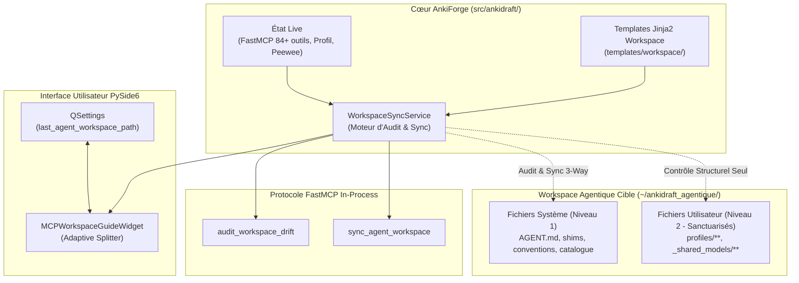

# ADR 0059 — Vérificateur de Drift, Synchronisation Semi-Automatique et Refonte Adaptative du Workspace Agentique

**Statut** : Accepté  
**Date** : 2026-11-11  
**Décideurs** : Tristan Rigaud-Humbert, Agent Antigravity  
**Contexte** : Cadrage `/grill-with-docs` sur le ticket `MCP et UI - Verificateur de Drift et Refonte de l Initialisation de Workspace Agentique`  
**Référence Modèle** : `~/ankidraft_agentique/`

---

## Contexte & Problématique

L'environnement de travail d'agents IA interagissant avec AnkiForge via le protocole FastMCP a connu une rupture d'échelle :
1. **Limites de l'architecture historique (ADR 0024 & ADR 0030)** :
   - L'amorçage via l'outil `init_agent_workspace` se limitait à injecter un fichier plat Markdown (`CLAUDE.md`, `GEMINI.md`, `.cursorrules` ou `ANKIFORGE_GUIDE.md`) contenant les instructions et un extrait figé des ~58 premiers outils MCP.
   - Le contrôle de version `check_guide_version` ne reposait que sur un simple hash SHA-256 dans l'en-tête de ce fichier unique.
   - L'IHM du sous-onglet `MCPWorkspaceGuideWidget` n'offrait qu'un formulaire rudimentaire avec un panneau d'aperçu statique.
2. **Émergence du standard d'espace de travail agentique (`ankidraft_agentique`)** :
   - Le modèle canonique introduit une véritable arborescence multi-niveaux articulée autour :
     - De fichiers maîtres universels (`AGENT.md`) et shims clients (`AGENTS.md`, `CLAUDE.md`, `GEMINI.md`).
     - D'un répertoire `.agents/` hébergeant le profil actif (`active-profile.md`), le glossaire technique et schéma relationnel SQLite (`glossary-and-internals.md`), le catalogue dynamique des 84+ outils FastMCP (`mcp-catalog.md`), les conventions de rapports (`rules/ankiforge-conventions.md`), les compétences transversales (`skills/general/**`) et d'évolution (`skills/meta/**`).
     - D'une frontière stricte isolant les contextes et modèles utilisateur (`.agents/profiles/<profil>/profile-context.md`, `.agents/rules/_shared_models/**`, `_shared_domain/**`).
3. **Problème de dérive (Drift)** :
   - Au fil des évolutions d'AnkiForge (nouveaux outils FastMCP, bascule de profils, ajustement du schéma de données, enrichissement des compétences), le workspace local de l'agent se désynchronise silencieusement.
   - Il est indispensable d'offrir dans AnkiForge un moteur d'audit de dérive (Drift Checker), une remédiation semi-automatique respectant les personnalisations humaines, et une interface adaptative fluide.

---

## Décisions d'Architecture

### 1. Gabarits Jinja2 Dynamiques Embarqués Hors-Ligne
- Les modèles de référence du workspace sont hébergés dans le package AnkiForge sous `src/ankidraft/services/ai/templates/workspace/`.
- La génération ne consiste pas en une copie statique mais en une compilation Jinja2 dynamique injectant :
  - La liste intégrale des 84+ outils FastMCP et leurs descriptions normalisées.
  - Le profil actif sélectionné dans la session AnkiForge.
  - Le schéma SQL exact des tables SQLite introspecté depuis les modèles Peewee.
  - Les versions logicielles et empreintes SHA-256 de référence.
- Aucune dépendance réseau ou connexion à un dépôt distant n'est requise (autonomie locale totale).

### 2. Moteur de Dérive Granulaire & Modèle Typé (`WorkspaceDriftReport`)
- Le moteur d'analyse `WorkspaceSyncService` audite le dossier cible selon une taxonomie stricte à 4 niveaux de sévérité :
  - `CRITICAL` : arborescence incomplète, fichiers maîtres système manquants (`AGENT.md`, `.agents/mcp-catalog.md`).
  - `DESYNC` : désynchronisation de contexte actif (`active-profile.md` divergent du profil AnkiForge courant) ou catalogue d'outils incomplet (outils FastMCP ajoutés/retirés).
  - `OUTDATED` : empreinte de fichier système obsolète par rapport aux gabarits de la version courante.
  - `PROTECTED` : fichiers utilisateur détectés (`profiles/**`, `_shared_models/**`), validés sur le plan structurel mais sanctuarisés contre toute altération.
- Le diagnostic retourne un rapport typé `WorkspaceDriftReport` sérialisable en JSON, consommable à la fois par l'UI et par FastMCP.

### 3. Remédiation Semi-Automatique à Mémoire d'Empreinte (3-Way Merge)
- Pour éviter d'écraser les personnalisations de l'utilisateur sur les fichiers système ou les conventions :
  - AnkiForge mémorise l'empreinte de distribution initiale (base hash) via un fichier manifeste interne `.agents/.ankiforge-sync.json`.
  - Si un fichier système diffère de la version serveur ET de la version base initiale, une modification locale humaine est détectée.
  - L'utilisateur est notifié et peut arbitrer (conserver la version locale, fusionner ou écraser).
- **Règle d'or de sanctuarisation du contenu** :
  - La *structure* globale du workspace doit être strictement respectée (arborescence des dossiers, existence des manifestes).
  - Le *contenant* (fichiers `profile-context.md`, instructions de cartes `_shared_models/`, skills personnalisés) n'est jamais écrasé ou altéré lors de la synchronisation.

### 4. Interface Utilisateur Adaptative & Persistance (`MCPWorkspaceGuideWidget`)
- **Persistance de l'espace de travail** : mémorisation systématique du dernier chemin de workspace sélectionné via `QSettings` (`mcp/last_agent_workspace_path`) avec rechargement automatique à l'ouverture du sous-onglet.
- **Diviseur adaptatif (Adaptive Splitter)** :
  - *Workspace non initialisé / vide* : le diviseur s'incline pour accorder une priorité visuelle (ratio 70/30) au panneau d'initialisation et à la sélection des options d'amorçage.
  - *Workspace avec dérive détectée* : priorité visuelle (ratio 50/50 ou 45/55) au tableau de bord de drift, mettant en évidence les éléments désynchronisés et le panneau de détail/diff.
  - *Workspace synchronisé* : affichage équilibré et apaisé avec indicateur d'intégrité vert et accès direct à la prévisualisation Markdown.
- **Actions claires en 1 clic** :
  - `Vérifier le drift` : scan instantané et rafraîchissement des badges.
  - `Resynchroniser le workspace` : correction semi-automatique sécurisée des fichiers système.
  - `Aligner le profil actif` : mise à jour immédiate d'`active-profile.md` sur le profil en cours.

### 5. Exposition Bidirectionnelle FastMCP
- Deux nouveaux outils FastMCP sont exposés sur le serveur `ankiforge` :
  - `audit_workspace_drift(workspace_path: str = "") -> str` : retourne le `WorkspaceDriftReport` au format JSON pour permettre à un agent externe (Antigravity, Claude Code) de s'auto-auditer au démarrage.
  - `sync_agent_workspace(workspace_path: str = "", align_active_profile: bool = True) -> str` : déclenche la resynchronisation non destructive selon la politique 3-Way.
- L'outil historique `check_guide_version` est conservé pour rétrocompatibilité avec délégation transparente vers le nouveau moteur de drift.

---

## Conséquences & Bénéfices

- **Alignement garanti** : l'agent externe dispose toujours d'une description exacte des 84+ outils MCP, du schéma SQL live et du profil actif.
- **Sécurité des données utilisateur** : sanctuarisation absolue des modèles de cartes et profils personnels contre tout écrasement accidentel.
- **Ergonomie studio** : l'utilisateur pilote la santé de son harness agentique directement dans l'interface AnkiForge sans jongler avec des scripts shell manuels.
- **Traçabilité totale** : intégration avec le ticket Obsidian `MCP et UI - Verificateur de Drift et Refonte de l Initialisation de Workspace Agentique.md` et le Kanban du projet.
