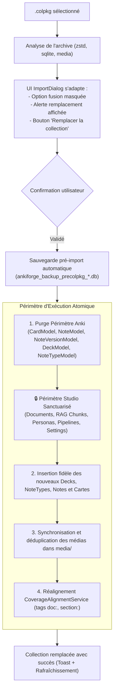

# Spécification Technique — Importation de Collection (.colpkg) par Remplacement Intégral et Sanctuarisation du Studio

**Statut :** Validé (Issue du cadrage `grill-with-docs`)  
**ADR de Référence :** [ADR 0036 — Importation de collection (.colpkg) par remplacement intégral et préservation du studio](../adr/0036-import-colpkg-remplacement-collection-et-preservation-studio.md)  
**Glossaire Métier :** [CONTEXT.md](https://github.com/tristanrigaud-humbert/AnkiForge/blob/master/CONTEXT.md#L328-L343) (*Import de collection (.colpkg)*, *Périmètre Collection Anki*, *Périmètre Studio / Forge*, *Sauvegarde pré-importation*)  

**Ticket Associé :** `ankiforge_obsidian/Tickets/Import Colpkg - Remplacement Integral de Collection et Sanctuarisation Studio.md`

---

## 1. Problématique (Problem Statement)

Dans l'écosystème Anki, un fichier **`.colpkg`** (Collection Package) constitue une sauvegarde intégrale d'une collection (base SQLite compressée en Zstandard `collection.anki21b`, table des paquets, types de notes, cartes et médias).

Jusqu'alors, AnkiForge traitait indifféremment les fichiers `.apkg` (paquets partagés de cartes) et les fichiers `.colpkg` à travers le même pipeline de fusion incrémentale ([`import_manager.py`](file:///Users/tristanrigaud-humbert/PycharmProjects/AnkiForge/src/ankiforge/services/cards/import_manager.py)) :
1. **Écrasement destructeur des modèles existants :** Lorsqu'un type de note homonyme présentait des champs différents, `ImportManager` écrasait inconditionnellement son `fields_schema`, rompant les notes locales existantes qui dépendaient de l'ancienne définition.
2. **Prolifération des cartes zombies :** L'importation n'effectuait que des ajouts et des mises à jour. Les cartes, notes et paquets supprimés dans Anki n'étaient jamais purgés d'AnkiForge, puis réapparaissaient comme des cartes fantômes lors des exports ultérieurs.
3. **Nettoyage de modèles inopérant :** Le nettoyage des modèles orphelins n'était déclenché que si le compte de notes locales était nul, ce qui n'arrivait jamais du fait de la conservation des notes fantômes.
4. **Interface utilisateur inadaptée :** `ImportDialog` proposait de fusionner la collection dans un paquet cible plat unique (risquant de déverser 50 paquets imbriqués dans un conteneur plat) et imposait un arbitrage carte par carte (*Smart Merge*) ingérable sur des collections volumineuses.
5. **Rejet par plafond de décompression :** Le plafond par défaut de 1 Gio conçu pour les paquets `.apkg` provoquait le rejet d'archives de collections riches en médias.

---

## 2. Solution Proposée

Mise en place d'une **sémantique d'importation dichotomique** :
- **`.apkg`** : reste un flux de *fusion collaborative incrémentale* avec Smart Merge et préservation des modèles par scission de suffixe unique.
- **`.colpkg`** : devient un flux de *remplacement intégral et atomique du Périmètre Anki* du profil actif, tout en **sanctuarisant à 100% le Périmètre Studio** (documents sources, découpages RAG, agents IA, personas, prompts, pipelines et réglages).

L'opération est sécurisée par une **sauvegarde automatique SQLite de pré-importation**, une **adaptation dynamique de l'interface `ImportDialog`** et un **réalignement déterministe de la traçabilité documentaire** via `CoverageAlignmentService`.



---

## 3. User Stories (Extensives)

1. **En tant qu'** utilisateur important une sauvegarde de collection `.colpkg`,  
   **Je veux** que l'ensemble de mes cartes, paquets et modèles Anki soit fidèlement synchronisé et reflète exactement l'état de mon archive,  
   **Afin de** retrouver ma collection sans cartes zombies ni résidus obsolètes supprimés dans Anki.

2. **En tant qu'** utilisateur ayant constitué une bibliothèque de cours et configuré des personas d'IA dans AnkiForge,  
   **Je veux** que mes documents PDF, mes transcriptions, mes fragments RAG, mes agents IA et mes pipelines DAG soient intégralement préservés lors du remplacement de ma collection Anki,  
   **Afin de** ne jamais perdre ma matière de travail propre à la Forge lors d'une synchronisation.

3. **En tant qu'** utilisateur important un `.colpkg` dont les cartes proviennent de cours déjà présents dans mon studio,  
   **Je veux** que la traçabilité documentaire (`doc:`, `section:`, `page:`) soit automatiquement reconnectée aux fragments de cours préservés,  
   **Afin de** conserver le suivi de couverture de mes documents sans intervention manuelle.

4. **En tant qu'** utilisateur sélectionnant un `.colpkg` dans `ImportDialog`,  
   **Je veux** être clairement averti de l'impact de l'opération et ne pas voir d'option incohérente de fusion dans un paquet unique,  
   **Afin de** ne pas commettre d'erreur de manipulation sur l'arborescence de mes paquets.

5. **En tant qu'** utilisateur effectuant un import de collection par mégarde,  
   **Je veux** qu'une sauvegarde automatique de sécurité soit créée juste avant le remplacement de la base,  
   **Afin de** pouvoir restaurer l'état antérieur en un clic si nécessaire.

---

## 4. Décisions d'Implémentation

### 4.1 Modules et Interfaces Touchés

| Fichier | Nature des Modifications |
|---|---|
| [`src/ankiforge/services/cards/import_manager.py`](file:///Users/tristanrigaud-humbert/PycharmProjects/AnkiForge/src/ankiforge/services/cards/import_manager.py) | - Constante `MAX_COLPKG_DECOMPRESSED_BYTES = 5 * 1024 * 1024 * 1024` (5 Gio).<br>- Détection stricte `source_type == "colpkg"`.<br>- Méthode dédiée `_commit_colpkg_replacement(...)`.<br>- Purge ordonnée du Périmètre Anki respectant l'intégrité référentielle.<br>- Réalignement documentaire post-import via `CoverageAlignmentService`. |
| [`src/ankiforge/database/backup.py`](file:///Users/tristanrigaud-humbert/PycharmProjects/AnkiForge/src/ankiforge/database/backup.py) | - Fonction `backup_before_colpkg_import() -> Path` générant un instantané horodaté `ankiforge_backup_precolpkg_<horodatage>.db` exclu de la rotation standard. |
| [`src/ankiforge/services/workers/import_cards_worker.py`](file:///Users/tristanrigaud-humbert/PycharmProjects/AnkiForge/src/ankiforge/services/workers/import_cards_worker.py) | - Émission des statuts de progression spécifiques à la sauvegarde et au remplacement de collection. |
| [`src/ankiforge/ui/dialogs/import_dialog.py`](file:///Users/tristanrigaud-humbert/PycharmProjects/AnkiForge/src/ankiforge/ui/dialogs/import_dialog.py) | - Détection réactive de l'extension `.colpkg`.<br>- Masquage dynamique de `self.options_frame` (choix du paquet cible).<br>- Affichage de `self.colpkg_warning_card` (encart d'alerte explicite).<br>- Mise à jour du libellé du bouton : `Remplacer la collection`.<br>- Court-circuit de `SmartMergeDialog` lors d'un `.colpkg`. |

### 4.2 Périmètres de Persistance Peewee

```
BASE DU PROFIL (ankiforge.db)
│
├── 🔴 PÉRIMÈTRE ANKI (PURGÉ & RÉINJECTÉ LORS D'UN .COLPKG)
│   ├── CardModel (cascade)
│   ├── NoteVersionMediaModel (cascade)
│   ├── NoteVersionModel (cascade)
│   ├── NoteModel
│   ├── DeckModel
│   ├── NoteTypeModel
│   ├── MediaModel & Fichiers médias physiques (media/)
│   ├── AuditRecordModel
│   └── IgnoredDuplicateModel
│
└── 🟢 PÉRIMÈTRE STUDIO (STRICTEMENT SANCTUARISÉ)
    ├── FolderModel
    ├── DocumentModel
    ├── DocumentPageModel
    ├── DocumentChunkModel
    ├── EmbeddingCacheModel
    ├── PersonaFolderModel
    ├── PersonaModel & PersonaVersionModel
    ├── PromptModel & LLMConfigModel
    ├── PythonToolModel
    ├── PipelineModel & PipelineStepModel
    ├── PipelineRunModel
    ├── BatchRunModel & BatchTaskModel
    └── SettingModel (clés API, thèmes, layouts, drapeaux)
```

### 4.3 Ordre de Purge et Insertion Atomique (`_commit_colpkg_replacement`)

1. **Sauvegarde Pré-Remplacement :**
   ```python
   backup_path = backup_before_colpkg_import()
   ```
2. **Transaction Atomique SQLite :**
   ```python
   with db.atomic():
       # 1. Purge ordonnée des tables dépendantes
       CardModel.delete().execute()
       NoteVersionMediaModel.delete().execute()
       NoteVersionModel.delete().execute()
       NoteModel.delete().execute()
       DeckModel.delete().execute()
       NoteTypeModel.delete().execute()
       AuditRecordModel.delete().execute()
       IgnoredDuplicateModel.delete().execute()

       # 2. Insertion des Decks (arborescence respectée)
       # 3. Insertion des NoteTypes (schémas, gabarits, CSS conformes)
       # 4. Insertion des Notes et NoteVersions
       # 5. Insertion des Cartes et observation SRS (ivl, reps, lapses, flags, is_suspended)
       # 6. Extraction et déduplication des Médias
   ```
3. **Réalignement Déterministe de Couverture :**
   ```python
   CoverageAlignmentService().realign_profile_coverage()
   ```

### 4.4 Adaptation Dynamique de l'UI (`ImportDialog`)

* Lorsque `path.lower().endswith(".colpkg")` :
  * `self.options_frame.hide()`
  * `self.colpkg_warning_card.show()`
  * `self.btn_import.setText(self.tr("Remplacer la Collection"))`
* Lorsque `path.lower().endswith((".apkg", ".txt"))` :
  * `self.options_frame.show()`
  * `self.colpkg_warning_card.hide()`
  * `self.btn_import.setText(self.tr("Lancer l'Importation"))`

---

## 5. Décisions de Test

### 5.1 Coutures Clés de Test

1. **Intégration Backend (`test_import_colpkg_replacement.py`) :**
   * **Test d'isolation du Studio :** Vérifier qu'un document existant (`DocumentModel` + 10 `DocumentChunkModel`) et un agent IA (`PersonaModel`) survivent intacts après un remplacement `.colpkg`.
   * **Test de purge des cartes zombies :** Créer des cartes A, B, C en base locale. Importer un `.colpkg` ne contenant que B et D. Vérifier après import que A et C n'existent plus, que B est synchronisée et que D est créée.
   * **Test de mise à jour des NoteTypes :** Vérifier que si un type de note `Basic` local avait 2 champs et que le `.colpkg` contient un type `Basic` à 3 champs, les nouvelles notes utilisent le nouveau schéma sans conflit ni crash.
   * **Test de réconciliation documentaire :** Vérifier que si une note importée porte le tag `section:Chapitre 1`, elle est réassociée au fragment documentaire existant correspondant.
   * **Test de la sauvegarde automatique :** Vérifier la présence physique du fichier `ankiforge_backup_precolpkg_*.db` dans le dossier de backups du profil.

2. **Oracle Anki Officiel (`tests/integration/test_anki_export_oracle.py` / `slow`) :**
   * Génération par le backend `anki` officiel d'un `.colpkg` complexe (contenant du Zstd `collection.anki21b`, du cloze et des médias).
   * Validation de l'ingestion par AnkiForge de bout en bout sans aucune exception.

3. **Interface Graphique Headless (`tests/ui/test_import_dialog_colpkg.py`) :**
   * Vérifier par introspection des signaux Qt et des widgets (`qtbot`) que le passage d'un chemin `.apkg` à `.colpkg` bascule instantanément l'affichage du panneau d'avertissement et masque le cadre de sélection de destination.

---

## 6. Hors Périmètre (Out of Scope)

* **Fabrication d'ordonnancement ou calcul d'échéances calendaires :** Conformément à l'ADR 0020 et l'ADR 0022, la Forge reporte les compteurs observés (`ivl`, `reps`, `lapses`, drapeaux, suspension), mais ne stocke ni `due`, ni `revlog`, ni mémoire FSRS.
* **Exportation `.colpkg` :** La Forge n'exporte que des paquets `.apkg` (contenu seul). L'export de collection complète n'est pas réintroduit (ADR 0022).
* **Fusion manuelle 3 voies pour les .colpkg :** Le remplacement d'une collection est absolu ; aucun arbitrage carte par carte via *Smart Merge* n'est proposé sur un `.colpkg`.
