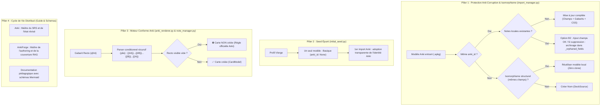

# Spécification Technique — Réconciliation des Types de Note, Rendu Conforme Anki et Cycle de Vie Distribué

**Statut :** Validé (Issue du cadrage `grill-with-docs`)  
**ADR de Référence :** [ADR 0037 — Réconciliation des types de note, conformité du moteur de rendu Anki et cycle de vie distribué](../adr/0037-reconciliation-types-notes-cycle-de-vie-distribue.md)  
**Glossaire Métier :** [CONTEXT.md](https://github.com/tristanrigaud-humbert/AnkiForge/blob/master/CONTEXT.md) (*Modèle basique amorce*, *Isomorphisme structurel*, *Règle de génération conditionnelle*, *Champ orphelin archivé*, *Réconciliation de types de note*, *Périmètre d'autorité distribuée*)  
**Tickets Associés :**
- `ankiforge_obsidian/Tickets/Sync - Reconciliation des Types de Note et Protection Anti-Corruption de Schema.md`
- `ankiforge_obsidian/Tickets/Rendu - Moteur de Parser Conditionnel Recursif et Regle de Generation Anki.md`
- `ankiforge_obsidian/Tickets/Modeles - Seed Minimaliste Unique et Adoption Transparente du Premier Import.md`
- `ankiforge_obsidian/Tickets/Doc - Guide Visuel du Cycle de Vie Distribue AnkiForge et Schemas d Usage.md`

---

## 1. Problématique (Problem Statement)

Dans l'écosystème Anki, les types de notes (`notetypes` / modèles) gouvernent la structure des données (`flds`), la logique de génération des cartes physiques et leur mise en page Recto/Verso (`tmpls` / `css`). L'interaction entre AnkiForge et les collections Anki de l'utilisateur souffrait de quatre défaillances majeures :

1. **Corruption irrémédiable de données par écrasement de schéma :**
   Dans [`import_manager.py`](file:///src/ankiforge/services/cards/import_manager.py#L983-L1020), l'importation d'un paquet `.apkg` contenant un modèle homonyme à un modèle local (ex. `"Basique"`) provoquait l'affectation immédiate d'`existing_nt.anki_id = int_mid`, ce qui déclenchait inconditionnellement `existing_nt.fields_schema = fields_schema`. Si les champs différaient (ex. `"Recto"`/`"Verso"` vs `"Front"`/`"Back"`, ou renommage), les notes locales préexistantes perdaient leur correspondance de champs, rendant leur contenu invisible dans l'éditeur et cassant le rendu.
2. **Prolifération de clones artificiels `(Importé X)` :**
   Lorsqu'un deck importé possédait un modèle structurellement identique à un modèle local mais avec un `anki_id` numérique différent, AnkiForge instanciat des doublons en cascade (`Basique (Importé)`, `Basique (Importé 1)`), polluant la collection et fragmentant les modèles.
3. **Seed initial encombré et déconnecté d'Anki :**
   Au démarrage d'un profil vierge, AnkiForge injectait trois modèles en dur avec `anki_id = None`. Dès qu'un utilisateur importait sa collection Anki (contenant `Basic` ou `Basique` avec son ID officiel), AnkiForge créait des doublons au lieu d'adopter la collection entrante.
4. **Non-respect des règles officielles de génération et des quantificateurs Anki (`#`, `^`) :**
   Dans [`anki_renderer.py`](file:///src/ankiforge/utils/anki_renderer.py#L67-L75), la regex plate ne supportait pas les balises conditionnelles imbriquées et ignorait les champs absents. Par ailleurs, `NoteManager` créait aveuglément des cartes physiques pour tous les gabarits, y compris ceux dont le recto était totalement vide, générant des « cartes fantômes » inexistantes dans Anki.

---

## 2. Solution Proposée

Une refonte cohérente articulée autour de 4 piliers fonctionnels :



---

## 3. User Stories (Extensives)

1. **En tant qu'** utilisateur important un paquet `.apkg`,  
   **Je veux** que mes types de notes existants et toutes mes notes déjà créées dans AnkiForge restent intacts et lisibles,  
   **Afin d'** éviter toute corruption de données liée à des divergences de noms de champs.

2. **En tant qu'** utilisateur important plusieurs paquets partageant un modèle standard (ex. Recto/Verso),  
   **Je veux** qu'AnkiForge réutilise mon modèle existant sans fabriquer des doublons `Basique (Importé)`,  
   **Afin de** maintenir une liste de modèles propre et lisible.

3. **En tant que** nouvel utilisateur ouvrant AnkiForge pour la première fois,  
   **Je veux** démarrer avec un profil épuré contenant un seul modèle basique qui adopte automatiquement les paramètres de mon premier import Anki,  
   **Afin de** ne pas être submergé de modèles non désirés.

4. **En tant qu'** utilisateur concevant des types de notes avec des cartes conditionnelles (ex. carte inversée optionnelle `{{#Ajouter Inverse}}`),  
   **Je veux** que la carte inversée ne soit pas générée si le champ déclencheur est vide,  
   **Afin d'** avoir une parité absolue avec le comportement officiel d'Anki et ne pas avoir de cartes blanches dans ma collection.

5. **En tant qu'** utilisateur utilisant conjointement Anki et AnkiForge,  
   **Je veux** comprendre grâce à des schémas explicatifs comment circulent mes cartes et révisions,  
   **Afin de** ne jamais perdre de progrès d'apprentissage ni créer de cartes zombies.

---

## 4. Décisions d'Implémentation

### A. Réconciliation & Protection Anti-Corruption (`import_manager.py`)
- **Règle d'inviolabilité de schéma** :
  Si un modèle local possède des notes existantes (`notes_count > 0`), `fields_schema` ne peut être écrasé que si :
  1. Le nouveau schéma est une sur-ensemble strict (ajout de nouveaux champs à la fin ou renommage sans perte d'ordinal).
  2. En cas de retrait d'un champ existant : les données de ce champ pour chaque note locale existante sont copiées dans un dictionnaire `_orphaned_fields` stocké dans le JSON de `NoteVersionModel.content`.
- **Règle d'isomorphisme structurel** :
  Avant de créer un clone `(Importé)`, vérifier si un modèle local possède exactement la même liste ordonnée de champs (ou une équivalence multilingue canonique `["Recto", "Verso"]` ↔ `["Front", "Back"]`). Si oui, réutiliser ce modèle pour les nouvelles notes.

### B. Seed Initial Épuré (`initial_seed.py`)
- Les définitions canoniques résident dans `src/ankiforge/database/note_type_catalog.py` (`basic_note_type_definition()`, `seed_default_note_types()`), consommées par le seed d'amorçage et les services de cartes sans cycle d'import.
- Restreindre l'initialisation de la base à un seul modèle :
  - `name`: `"Basique"`
  - `fields_schema`: `json.dumps(["Recto", "Verso"])`
  - `anki_id`: `None`
  - `templates`: gabarit simple Carte 1
  - `css_style`: styles standards Anki
- Retirer l'injection automatique de `"Texte à trous (Cloze)"` et `"Image Occlusion Enhanced"`. Ces modèles sont installables via `CardModelIO.install_starter_pack()` ou auto-créés à la première ouverture du dialogue d'occlusion.

### C. Moteur de Rendu et Règle de Génération Anki (`anki_renderer.py` & `note_manager.py`)
- **Parser conditionnel récursif** :
  Remplacer `_process_conditionals` dans [`anki_renderer.py`](file:///src/ankiforge/utils/anki_renderer.py) par un algorithme à base de pile capable d'évaluer les structures arborescentes :
  ```
  {{#Condition1}}
      Texte 1
      {{#Condition2}}Texte 2{{/Condition2}}
  {{/Condition1}}
  ```
- **Évaluation des champs falsy** :
  Tout champ dont la clé est absente ou dont la valeur épurée de HTML ne contient que des espaces est considéré comme falsy.
- **Règle de génération de carte** :
  Ajouter la fonction `should_generate_card(template_qfmt: str, fields_dict: dict[str, Any]) -> bool` dans `anki_renderer.py`.
  Dans `NoteManager.create_note` et dans les services de création de cartes :
  N'appeler `CardModel.create(...)` pour un gabarit que si `should_generate_card` renvoie `True`.

### D. Documentation Visuelle du Cycle de Vie Distribué (`docs/guide_utilisateur/cycle_de_vie_distribue.md`)
- Création d'une page de référence dans la documentation Zensical illustrée de diagrammes Mermaid et de guides pas-à-pas pour l'utilisateur.

---

## 5. Décisions de Test

- **Tests unitaires parser conditionnel (`tests/unit/test_anki_renderer_conditionals.py`)** :
  - Test des conditionnels imbriqués multiples.
  - Test de l'inversion `{{^Champ}}` avec champ vide, absent, ou rempli.
  - Test de la fonction `should_generate_card` sur les modèles standards (Basique, Basique inversé, Inversé optionnel).
- **Tests d'intégration import réconciliation (`tests/integration/test_import_notetype_reconciliation.py`)** :
  - Test de non-écrasement de schéma lors de l'import d'un `.apkg` homonyme avec des notes locales existantes.
  - Test d'archivage non destructif dans `_orphaned_fields`.
  - Test d'isomorphisme structurel (réutilisation sans clone `(Importé)`).
- **Tests de cycle de vie et création de note (`tests/unit/test_note_manager_card_generation.py`)** :
  - Vérification qu'une note créée avec un champ inversé vide n'engendre qu'une seule carte physique.
- **Validation globale** :
  - Exécution de `uv run python script/verify.py` et `uv run zensical build`.

---

## 6. Hors Périmètre (Out of Scope)

- Modification de l'algorithme d'ordonnancement FSRS/SM-2 (qui relève exclusivement d'Anki).
- Édition visuelle complexe de gabarits dans l'interface (couverte par les tickets existants de `CardModelsView`).
- Synchronisation réseau directe via AnkiConnect (les échanges restent fidèles au standard `.apkg` / `.colpkg`).
