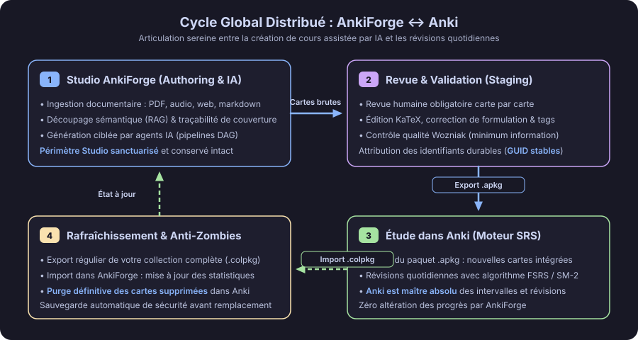
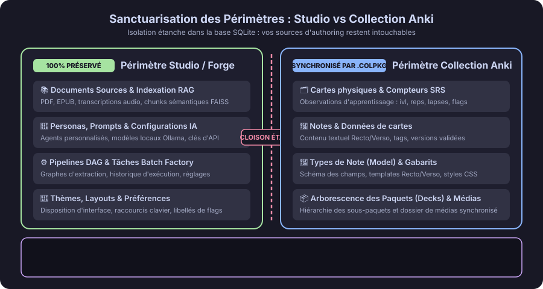
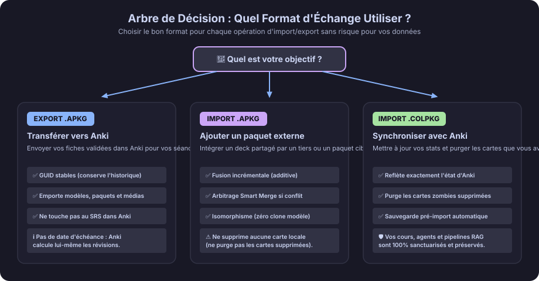
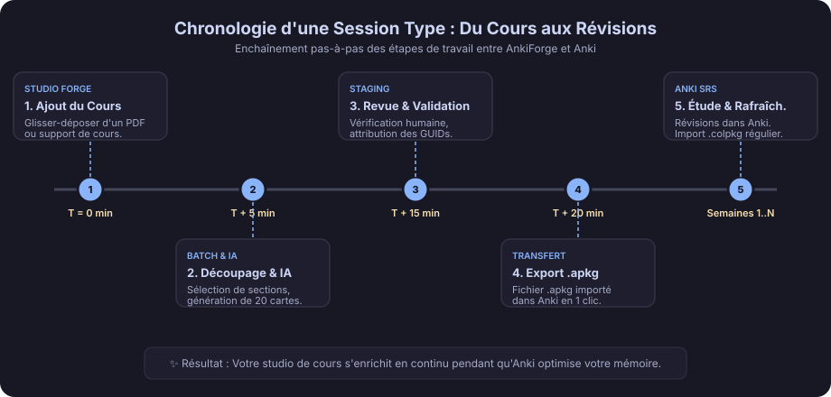
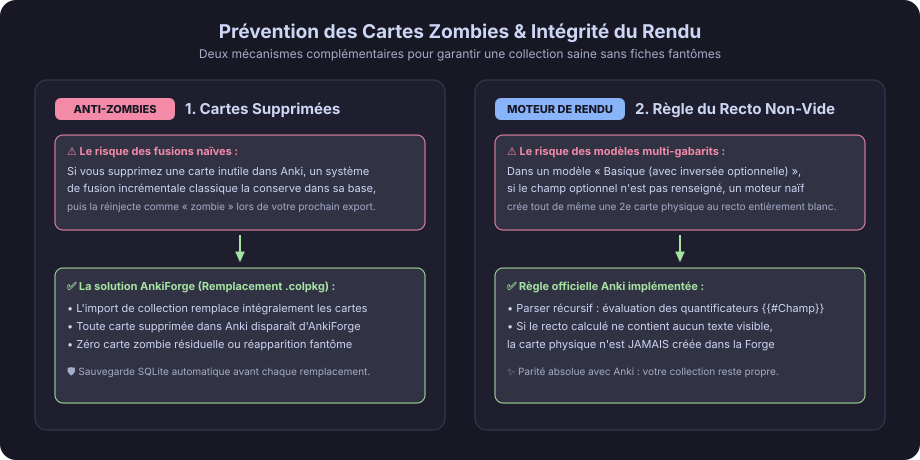

# Guide Visuel du Cycle de Vie Distribué AnkiForge ↔ Anki 🔄

Bienvenue dans le guide d'utilisation du système distribué d'AnkiForge.

AnkiForge et Anki fonctionnent main dans la main comme un duo complémentaire :
- **AnkiForge est votre Studio d'Authoring** : c'est votre atelier de création intellectuelle assisté par intelligence artificielle. Vous y organisez vos cours, vos livres, vos découpages RAG, vos personas d'extraction et vous y concevez des flashcards fidèles à vos sources avec une validation humaine rigoureuse.
- **Anki est votre Moteur de Mémorisation (SRS)** : c'est le logiciel dédié à vos répétitions quotidiennes. Anki détient l'autorité exclusive sur vos intervalles de révision, vos dates d'échéance et les algorithmes de mémoire espacée (FSRS ou SM-2).

Grâce à cette séparation étanche, **vous ne risquez jamais de perdre vos progrès de révision dans Anki, ni d'altérer vos cours et vos modèles d'IA dans AnkiForge**.

---

## 1. Le Cycle Global de Travail

Le schéma ci-dessous illustre la boucle vertueuse de travail entre la conception dans AnkiForge et la mémorisation dans Anki :

Le cycle s'articule en quatre temps :
1. **Studio AnkiForge** : Importez vos documents sources (PDF, articles, vidéos, cours audio). L'application segmente les textes et mesure en continu votre taux de couverture documentaire. L'IA extrait des propositions de cartes ciblées.
2. **Revue en Staging** : Chaque carte générée passe par une étape de relecture humaine obligatoire. Vous ajustez la formulation, appliquez les principes de concision atomique de Piotr Wozniak et validez. Chaque carte validée reçoit un identifiant durable immuable (GUID).
3. **Export vers Anki (.apkg)** : Exportez vos nouvelles cartes au format `.apkg` et ouvrez le paquet dans Anki. Anki intègre les cartes, charge les médias associés et planifie vos premières révisions.
4. **Révision & Rafraîchissement (.colpkg)** : Vous révisez quotidiennement dans Anki. Régulièrement (par exemple une fois par mois ou après une session d'apprentissage intensive), exportez votre collection `.colpkg` depuis Anki et déposez-la dans AnkiForge pour actualiser vos statistiques de rétention et synchroniser vos suppressions.

---

## 2. Sanctuarisation des Données : Périmètre Studio vs Périmètre Anki

Pour garantir une sérénité totale, AnkiForge sépare formellement vos données en deux périmètres distincts au sein de votre profil :

### 🛡️ Le Périmètre Studio (Strictement Préservé)
Ce périmètre vous appartient exclusivement et n'est **jamais** écrasé par vos imports de collection Anki :
- **Vos documents originaux** : PDF, transcriptions audio, fichiers Markdown, planches d'albums.
- **Vos index RAG** : découpages sémantiques, fragments de texte et représentations vectorielles locales.
- **Vos agents IA & Personas** : modèles de prompts personnalisés, configurations Ollama / cloud.
- **Vos pipelines DAG & usine de lots (Batch)** : règles d'automatisation, historique de génération.
- **Vos réglages d'application** : thèmes graphiques, dispositions d'écran, raccourcis personnalisés.

### 🗂️ Le Périmètre Collection Anki (Synchronisé & Remplacé)
Ce périmètre est le reflet exact de votre collection Anki :
- Vos paquets de cartes (`Decks`) et sous-paquets hiérarchiques.
- Vos types de notes (`Note Types`), gabarits Recto/Verso et styles CSS.
- Vos notes et vos cartes physiques d'apprentissage.
- Vos compteurs d'observation SRS (historique d'échecs, drapeaux de couleur, cartes suspendues).

> [!TIP]
> **Réconciliation automatique de la provenance** : Lorsque vous remplacez votre collection par un `.colpkg`, AnkiForge lit automatiquement les tags durables (`doc:`, `section:`, `page:`) inscrits sur vos cartes pour les reconnecter instantanément aux fragments de cours préservés du Studio. Vos jauges de couverture documentaire se mettent à jour sans aucune manipulation manuelle.

---

## 3. Quel Format d'Échange Choisir : .apkg ou .colpkg ?

AnkiForge distingue nettement les deux formats d'archive de l'écosystème Anki :

| Critère | Export / Import de Paquet (`.apkg`) | Import de Collection (`.colpkg`) |
| :--- | :--- | :--- |
| **Finalité** | Échange ciblé de cartes nouvelles ou d'appoint | Remplacement intégral pour alignement parfait |
| **Comportement** | **Fusion collaborative incrémentale** : ajoute les nouvelles fiches sans toucher aux autres | **Remplacement complet du périmètre Anki** : votre profil adopte l'exact état d'Anki |
| **Gestion des suppressions** | Ne supprime aucune carte locale | **Purge définitive des cartes supprimées dans Anki** |
| **Gestion des conflits** | Boîte de dialogue *Smart Merge* en cas de modification concurrente | L'archive Anki entrante fait foi (remplacement fidèle) |
| **Protection de sécurité** | Détection d'isomorphisme de types de notes (zéro clone inutile) | **Sauvegarde SQLite de secours créée automatiquement** |

---

## 4. Chronologie d'une Session Type

Voici comment se déroule une session classique, de l'assimilation d'un nouveau cours jusqu'à son intégration dans votre mémoire à long terme :

1. **Jalon 1 (0 min)** : Déposez votre support de cours dans le Hub Documentaire.
2. **Jalon 2 (+5 min)** : Découpez le document en sections clés avec le Batch Slice Composer et lancez l'extraction IA.
3. **Jalon 3 (+15 min)** : Relisez les cartes en Staging, validez les meilleures formulations.
4. **Jalon 4 (+20 min)** : Exportez le paquet `.apkg` généré et ouvrez-le dans Anki.
5. **Jalon 5 (Semaines suivantes)** : Étudiez chaque jour dans Anki selon le rythme fixé par l'algorithme SRS.
6. **Jalon 6 (Périodique)** : Exportez une sauvegarde `.colpkg` depuis Anki et glissez-la dans AnkiForge pour mettre à jour vos indicateurs de maîtrise et nettoyer les cartes obsolètes.

---

## 5. Prévention des Cartes Zombies et Rendu Fidèle

L'un des écueils majeurs des systèmes d'échange entre logiciels d'apprentissage est la prolifération de cartes mortes ou de cartes vides. AnkiForge résout définitivement ce problème grâce à deux verrous techniques :

### 🧟 1. Éradication des Cartes Zombies
Dans un système d'importation incrémentale classique, si vous supprimez une carte obsolète ou ratée directement dans Anki, le logiciel d'authoring n'en a pas connaissance. Au prochain export, il réinjecte la carte fantôme dans votre deck Anki.

Dans AnkiForge, l'importation de collection (`.colpkg`) procède par **remplacement atomique exact**. Toute carte supprimée dans Anki est immédiatement retirée d'AnkiForge. Vous gardez une collection saine et synchronisée, sans résidu fantôme.

### 📄 2. Règle Officielle Anki du Recto Non-Vide
Certains types de notes comportent des gabarits optionnels (par exemple, une carte inversée qui ne doit être générée que si le champ `{{#Ajouter Inverse}}` est rempli).

AnkiForge intègre le **moteur de rendu conditionnel conforme d'Anki** :
- Les directives conditionnelles imbriquées (`{{#Champ}}...{{/Champ}}` et `{{^Champ}}...{{/Champ}}`) sont scrupuleusement évaluées.
- **Si le recto généré d'une carte ne contient aucun texte visible, la carte physique n'est jamais créée**.
- Vous avez la certitude que les cartes visualisées dans l'éditeur d'AnkiForge correspondent au pixel près à celles qui apparaîtront sur votre écran dans Anki.

---

## 6. Guides Pratiques Pas-à-Pas

### Scénario 1 : Premier Démarrage & Importation de votre Collection Anki
1. Ouvrez Anki sur votre ordinateur.
2. Cliquez sur **Fichier > Exporter...**
3. Sélectionnez le format **Collection Anki (.colpkg)** en cochant la case *Inclure les médias*. Enregistrez le fichier.
4. Dans AnkiForge, cliquez sur le bouton d'importation (ou utilisez <kbd>Ctrl+Shift+I</kbd>).
5. Glissez votre fichier `.colpkg` dans la zone de dépôt. L'interface détecte automatiquement le format collection.
6. Cliquez sur **Remplacer la collection**.
7. En quelques secondes, vos paquets, types de notes et cartes sont importés, vos compteurs SRS sont initialisés, et votre studio est prêt à l'emploi.

### Scénario 2 : Création de Cartes depuis un Cours & Export vers Anki
1. Ouvrez la vue **Documents** et importez votre cours (ex. `Physiologie_Cardiaque.pdf`).
2. Ouvrez la **Batch Factory** et sélectionnez les sections que vous souhaitez transformer en fiches.
3. Lancez la génération avec votre pipeline IA préféré.
4. Dans l'onglet **Revue (Staging)**, examinez les propositions de cartes, affinez les formulations et cliquez sur **Valider**.
5. Cliquez sur **Exporter (.apkg)** (ou <kbd>Ctrl+Alt+E</kbd>).
6. Double-cliquez sur le fichier `.apkg` généré pour l'importer dans Anki : vos nouvelles cartes s'ajoutent à votre paquet d'étude avec tous leurs médias sans réinitialiser vos cartes existantes.

### Scénario 3 : Rafraîchissement Périodique après Révision
1. Après plusieurs semaines d'étude dans Anki, exportez à nouveau votre collection au format `.colpkg`.
2. Déposez-la dans le dialogue d'importation d'AnkiForge.
3. AnkiForge effectue une sauvegarde instantanée de sécurité de votre profil, remplace les compteurs de cartes par votre progression réelle et supprime les cartes que vous aviez purgées dans Anki.
4. Vos cours, vos agents IA et vos pipelines d'extraction restent rigoureusement intacts.
