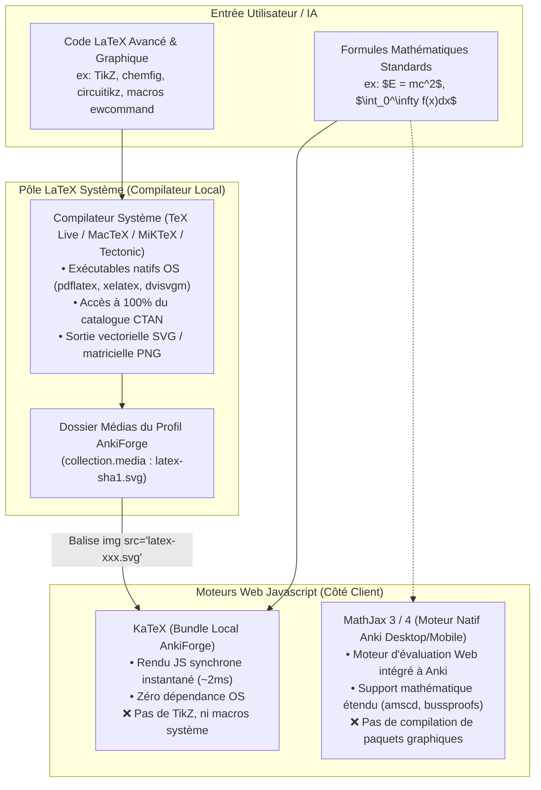
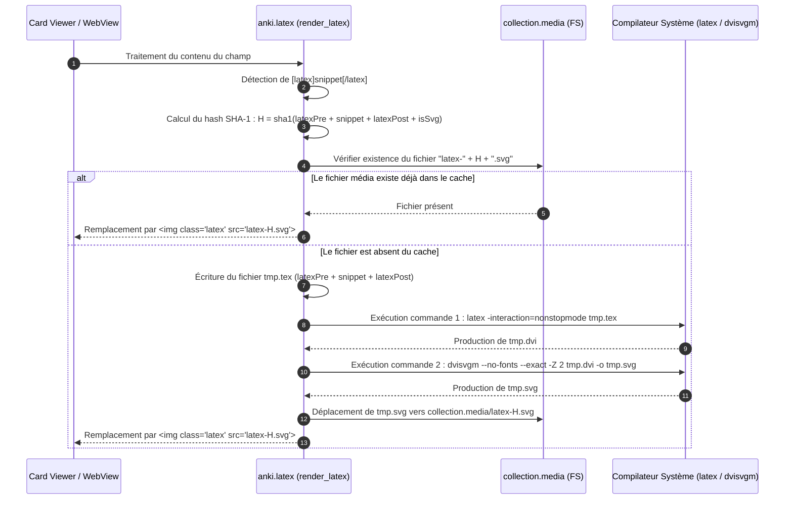
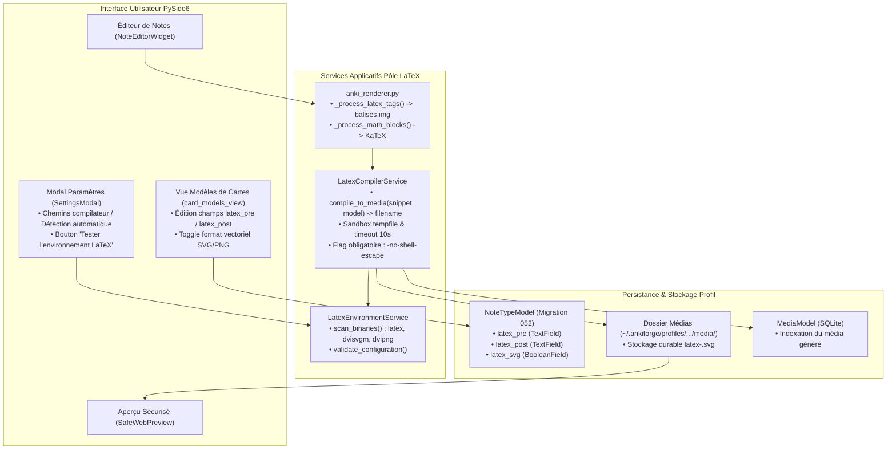
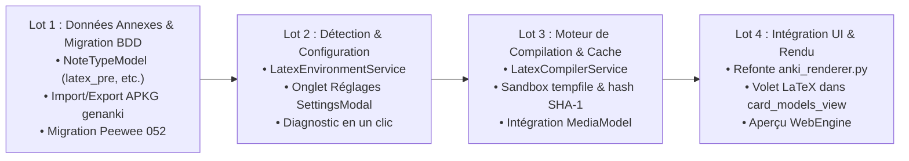

# Recherche Fondamentale : Intégration d'un Pôle LaTeX Natif et Données Annexes des Modèles de Cartes dans AnkiForge

**Auteur :** Agent Superviseur & Équipe R&D AnkiForge  
**Date :** 11 novembre 2026  
**Statut :** Synthèse d'architecture, état de l'art et étude prospective (Ticket Kanban `ready-for-spec`)  
**Périmètre :** Rendu scientifique, compilation TeX locale, données annexes des types de notes (`NoteTypeModel`), rétrocompatibilité Anki APKG, sécurité des sous-processus et cache de médias  
**Fichiers Associés :** `ankidraft_obsidian/Tickets/ticket-actif/Recherche - Integration d un Pole LaTeX Natif et Donnees Annexes des Modeles de Cartes.md`, `src/ankidraft/database/models/cards.py`, `src/ankidraft/utils/anki_renderer.py`

---

## Résumé Exécutif

AnkiForge s'adresse à des apprenants et concepteurs de connaissances exigeants : étudiants en médecine, en classes préparatoires, ingénieurs, chercheurs en informatique, mathématiciens et linguistes. Pour ces profils, le formatage des expressions scientifiques ne se résume pas à de simples égalités algébriques inline : il implique fréquemment des **diagrammes commutatifs (TikZ)**, des **mécanismes réactionnels (chemfig)**, des **schémas de circuits électriques (circuitikz)** ou des **arbres syntaxiques formels**.

Jusqu'à présent, AnkiForge a traité l'ensemble des besoins mathématiques via un unique prisme : **le bundle JavaScript KaTeX local** (`src/ankidraft/utils/anki_renderer.py`). Dans ce modèle, toute balise Anki native `[latex]...[/latex]` est convertie sans discernement en délimiteur de bloc KaTeX `\[...\]`.

Or, **KaTeX n'est pas LaTeX**. KaTeX est un moteur JavaScript ultra-rapide mais borné à un sous-ensemble restreint de macros mathématiques standard. Il est fondamentalement incapable d'interpréter des extensions TeX, de compiler des environnements graphiques ou de charger des paquets CTAN. De surcroît, le modèle relationnel d'AnkiForge (`NoteTypeModel`) ignore complètement les métadonnées officielles d'Anki que sont `latexPre`, `latexPost` et `latexsvg`. Par conséquent :
1. Les modèles de cartes importés depuis Anki perdent leurs préambules spécialisés.
2. Les exports `.apkg` générés par AnkiForge réinitialisent les préambules TeX aux valeurs d'usine de `genanki`.
3. Les cartes contenant du véritable code LaTeX plantent avec une erreur visuelle brute de KaTeX dans le `QWebEngineView`.

Ce rapport d'investigation pose les fondations architecturales du futur **Pôle LaTeX d'AnkiForge**. Il clarifie la frontière stricte entre **KaTeX** (l'aperçu temps-réel léger pour les maths courantes), **MathJax** (le moteur de restitution Web d'Anki moderne) et **LaTeX Natif Compilé** (le moteur lourd produisant des images vectorielles SVG dans les médias du profil). Il détaille la stratégie d'extension du modèle de données, les mécanismes de détection de compilateurs sur le poste de travail, le protocole d'exécution sécurisé en sous-processus sandboxé et le découpage en tranches d'implémentation opérationnelles.

---

## 1. Problématique Fondamentale : Le Malentendu KaTeX vs MathJax vs LaTeX Natif

### 1.1 L'Illusion de l'Équivalence Syntaxique

Dans le monde du développement web et des outils d'édition Markdown, la confusion entre KaTeX, MathJax et LaTeX est omniprésente car tous trois emploient une syntaxe d'apparence similaire (délimiteurs `$...$`, `$$...$$`, `\(...\)`, `\[...\]`). 

Pourtant, sous le capot, leurs principes d'exécution, leurs capacités et leurs contraintes architecturales sont diamétralement opposés :



### 1.2 Matrice Comparative Rigoureuse des 3 Moteurs

| Critère d'Évaluation | KaTeX (Actuel dans AnkiForge) | MathJax 3 (Anki Moderne) | LaTeX Système Natif (Pôle Proposé) |
| :--- | :--- | :--- | :--- |
| **Environnement d'exécution** | JavaScript dans `QWebEngineView` (local-first) | JavaScript dans Anki Desktop / AnkiDroid / AnkiMobile | Exécutable binaire natif sur l'OS (`latex`, `dvisvgm`) |
| **Dépendance système externe** | **Aucune** (bundle JS/CSS embarqué dans le dépôt) | **Aucune** (embarqué dans le runtime Anki) | **Requiert un compilateur TeX** installé sur la machine |
| **Latence de rendu** | Ultra-faible (< 5 ms par formule) | Faible à modérée (~30 à 100 ms) | Élevée lors de la première compilation (~300 à 1500 ms), **instantanée ensuite via cache média** |
| **Périmètre fonctionnel** | Formules mathématiques standard uniquement | Formules mathématiques étendues (mhchem, etc.) | **Universel** (Tout document LaTeX valide) |
| **Support de TikZ / PGF** | ❌ **Strictement impossible** | ❌ **Strictement impossible** | ✅ **100% supporté** via compilation vectorielle |
| **Support de la chimie (`chemfig`)** | ❌ Non supporté (seul `mhchem` partiel) | ⚠️ Limité à `mhchem` basique | ✅ **100% supporté** (structures 2D, mécanismes) |
| **Format de sortie produit** | Éléments DOM HTML/CSS enrichis | DOM SVG ou HTML/CSS | Fichier autonome **SVG vectoriel** ou **PNG haute densité** |
| **Délimiteurs canoniques Anki** | N/A (transformé en interne) | `\( ... \)` (inline) et `\[ ... \]` (block) | `[latex]...[/latex]`, `[$]...[/$]`, `[$$]...[/$$]` |
| **Surface d'attaque / Sécurité** | Très faible (purement sandboxed dans WebEngine) | Faible (JS sandboxed) | **Élevée si mal configuré** (risque d'exécution arbitraire si `-shell-escape` actif) |

### 1.3 Cas d'Usage Métier Concrets Exigeant du Vrai LaTeX

Pour comprendre pourquoi l'absence d'un pôle LaTeX pénalise de nombreux utilisateurs, examinons 3 exemples réels qui échouent dans KaTeX :

#### A. Schéma Électronique ou Graphique TikZ (Ingénierie & Physique)
```latex
[latex]
\begin{tikzpicture}[scale=0.8]
  \draw[thick,->] (0,0) -- (4,0) node[anchor=north west] {x};
  \draw[thick,->] (0,0) -- (0,4) node[anchor=south east] {y};
  \draw[red,domain=0:3.5] plot (\x,{sin(\x r)}) node[right] {$f(x)=\sin(x)$};
\end{tikzpicture}
[/latex]
```
*Comportement sous KaTeX :* Échec immédiat avec `ParseError: KaTeX parse error: No such environment: \begin{tikzpicture}`.  
*Comportement avec Pôle LaTeX :* Compilation via `latex` + `dvisvgm` vers un fichier `latex-8a4f9b2c.svg`, affiché instantanément comme une image vectorielle nette.

#### B. Structure Moléculaire Complexe `chemfig` (Chimie Organique & Médecine)
```latex
[latex]
\chemfig{A=[:30]B-[:-30]C=[:30]D}
[/latex]
```
*Comportement sous KaTeX :* Rejeté car la commande `\chemfig` n'est pas reconnue par le sous-module mathématique.  
*Comportement avec Pôle LaTeX :* Intégration du paquet `\usepackage{chemfig}` présent dans `latexPre`, et production d'un SVG net quelle que soit la résolution d'écran.

#### C. Arbres de Dérivation ou Preuves Logiques (Linguistique & Informatique Théorique)
```latex
[latex]
\begin{prooftree}
  \AxiomC{$A \land B$}
  \UnaryInfC{$A$}
\end{prooftree}
[/latex]
```
*Comportement sous KaTeX :* Échec sur l'environnement de déduction séquentielle `prooftree`.

---

## 2. Anatomie de la Compilation LaTeX dans Anki Desktop

L'étude des sources officielles d'Anki (`pylib/anki/latex.py`) révèle avec précision le pipeline de production et les conventions adoptées par Damian Elmes et l'équipe Ankitects.

### 2.1 Le Cycle de Compilation Anki

Le module `anki.latex` procède de la façon suivante lors du rendu d'une carte contenant des balises `[latex]...[/latex]` :



### 2.2 Les Métadonnées Fondamentales d'un Type de Note (`notetype`)

Dans la base SQLite interne d'Anki (`col.anki21`), chaque type de note contient trois clés dédiées à LaTeX :

1. **`latexPre` (LaTeX Preamble) :**  
   Texte inséré en tête du fichier `.tex` temporaire avant chaque compilation. Sa valeur standard d'usine est :
   ```latex
   \documentclass[12pt]{article}
   \special{papersize=3in,5in}
   \usepackage[utf8]{inputenc}
   \usepackage{amssymb,amsmath}
   \pagestyle{empty}
   \setlength{\parindent}{0in}
   \begin{document}
   ```
   *Rôle utilisateur :* C'est ici que l'utilisateur ajoute ses paquets personnalisés (`\usepackage{tikz}`, `\usepackage{chemfig}`) et ses macros (`\newcommand{\R}{\mathbb{R}}`).

2. **`latexPost` (LaTeX Postamble) :**  
   Texte inséré en clôture du document. Sa valeur standard est :
   ```latex
   \end{document}
   ```

3. **`latexsvg` (Scalable Vector Graphics Flag) :**  
   Booléen indiquant à Anki s'il doit utiliser la chaîne vectorielle `svgCommands` (`dvisvgm`) au lieu de la chaîne matricielle historique `pngCommands` (`dvipng`). Anki recommande désormais le mode SVG pour un rendu parfait sur écrans haute densité (Retina/4K).

### 2.3 Commandes Canoniques Système Utilisées par Anki

Dans `anki/latex.py`, les chaînes de commande sont paramétrées ainsi :

* **Mode SVG (`svgCommands`) :**
  ```python
  svgCommands = [
      ["latex", "-interaction=nonstopmode", "tmp.tex"],
      ["dvisvgm", "--no-fonts", "--exact", "-Z", "2", "tmp.dvi", "-o", "tmp.svg"],
  ]
  ```
* **Mode PNG historique (`pngCommands`) :**
  ```python
  pngCommands = [
      ["latex", "-interaction=nonstopmode", "tmp.tex"],
      ["dvipng", "-D", "200", "-T", "tight", "tmp.dvi", "-o", "tmp.png"],
  ]
  ```

### 2.4 La Politique de Sécurité d'Anki

Depuis les versions récentes d'Anki (2.1.50+), l'option **"Générer les images LaTeX" est désactivée par défaut**. La raison est impérieuse : le langage TeX standard permet d'exécuter des commandes système via la primitive `\write18` si le compilateur est invoqué avec le drapeau `-shell-escape`. 

Un paquet de cartes téléchargé sur Internet pourrait théoriquement contenir du code TeX malveillant. Pour cette raison :
- Le drapeau `-no-shell-escape` doit **impérativement** être passé au compilateur.
- La compilation doit être encadrée par un timeout strict en sous-processus pour parer aux boucles infinies de compilation (ex: macros récursives non terminées).
- L'utilisateur doit pouvoir activer ou désactiver la compilation automatique dans les paramètres d'AnkiForge.

---

## 3. Diagnostic Détaillé de l'Existant dans AnkiForge

L'inspection chirurgicale du code source d'AnkiForge met en lumière 5 ruptures techniques majeures :

### 3.1 Carence dans le Schéma de Persistance (`cards.py`)
Dans [`src/ankidraft/database/models/cards.py`](file:///Users/tristanrigaud-humbert/PycharmProjects/AnkiForge/src/ankidraft/database/models/cards.py#L39-L48) :
```python
class NoteTypeModel(BaseModel):
    anki_id = BigIntegerField(unique=True, null=True)
    name = CharField(unique=True)
    description = TextField(null=True, default="")
    fields_schema = TextField(default='["Front", "Back"]')
    templates = TextField(default="[]")
    css_style = TextField(default="")
```
*Constat :* Les champs `latex_pre`, `latex_post` et `latex_svg` n'existent pas dans la table `notetypemodel`. Aucune migration Peewee ne les a définis.

### 3.2 Perte de Données à l'Exportation APKG (`export_manager.py`)
Dans [`src/ankidraft/services/cards/export_manager.py`](file:///Users/tristanrigaud-humbert/PycharmProjects/AnkiForge/src/ankidraft/services/cards/export_manager.py#L275-L282) :
```python
g_model = genanki.Model(
    model_id=mid,
    name=nt.name,
    fields=[{"name": f} for f in fields_list],
    templates=g_templates,
    css=nt.css_style or "",
    model_type=model_type,
)
```
*Constat :* Bien que la bibliothèque `genanki.Model` accepte dans son constructeur `latex_pre` et `latex_post`, AnkiForge ne les transmet pas. `genanki` injecte donc son préambule par défaut, écrasant les directives de l'utilisateur.

### 3.3 Troncature Silencieuse à l'Importation (`import_manager.py`)
Dans [`src/ankidraft/services/cards/import_manager.py`](file:///Users/tristanrigaud-humbert/PycharmProjects/AnkiForge/src/ankidraft/services/cards/import_manager.py#L1519-L1524) :
Lors de l'ingestion d'un fichier `.apkg` ou `.colpkg`, AnkiForge parse le JSON du modèle, mais n'extrait ni ne stocke les champs `latexPre`, `latexPost` ou `latexsvg`. Si un utilisateur importe son deck de médecine ou de maths dans AnkiForge puis le réexporte, ses configurations LaTeX sont définitivement perdues.

### 3.4 Détournement Destructeur dans le Rendu (`anki_renderer.py`)
Dans [`src/ankidraft/utils/anki_renderer.py`](file:///Users/tristanrigaud-humbert/PycharmProjects/AnkiForge/src/ankidraft/utils/anki_renderer.py#L310) :
```python
# Ligne 310 :
html = re.sub(r"\[latex\](.*?)\[/latex\]", lambda m: r"\[" + m.group(1) + r"\]", html, flags=re.DOTALL | re.IGNORECASE)
html = re.sub(r"\[math\](.*?)\[/math\]", lambda m: r"\(" + m.group(1) + r"\)", html, flags=re.DOTALL | re.IGNORECASE)
```
*Constat :* AnkiForge remplace brutalement la balise `[latex]` par le délimiteur bloc KaTeX `\[`. Dès qu'un paquet ou une macro TeX réelle est présent, KaTeX affiche une erreur de syntaxe rouge vif au milieu de la carte.

### 3.5 Absence de Couche d'Exécution et d'Environnement
Il n'existe actuellement dans `src/ankidraft/` aucun module capable de :
- Localiser les exécutables `latex` ou `dvisvgm` sur l'OS (notamment sur macOS où MacTeX s'installe dans `/Library/TeX/texbin` et n'est pas toujours dans le `PATH` des applications fenêtrées non lancées depuis un terminal).
- Fournir un retour d'erreur lisible lorsque la compilation échoue (parsing des fichiers `.log` TeX).

---

## 4. Analyse Comparative des Approches pour le Pôle LaTeX

Quatre approches ont été analysées pour concevoir ce sous-système dans AnkiForge :

### Approche A : Le "Tout KaTeX / MathJax Élargi" (Status Quo avec Polyfills)
- **Principe :** Ne pas intégrer de compilateur système. Continuer à utiliser KaTeX et tenter de charger des extensions JS tierces (ex: KaTeX avec extensions chimiques mhchem ou MathJax 3 complet avec extensions SVG).
- **Avantages :** 100% hors-ligne, zéro dépendance binaire, très rapide.
- **Faiblesses rédhibitoires :** Incapable par nature de compiler TikZ, circuitikz ou des macros TeX avancées. Ne résout pas la perte des données annexes `latexPre`/`latexPost`.
- **Verdict :** ❌ **Rejeté** (Incompatible avec l'exigence de fidélité scientifique).

### Approche B : Compilateur Système Traditionnel Détecté (TeX Live / MacTeX / MiKTeX)
- **Principe :** Détecter la présence des binaires installés par l'utilisateur (`latex`, `pdflatex`, `dvisvgm`, `dvipng`), calquer fidèlement le protocole d'Anki Desktop et générer les SVG dans le dossier des médias du profil actif.
- **Avantages :** 
  - 100% compatible avec Anki Desktop et les habitudes des utilisateurs avancés de LaTeX.
  - Support de 100% des paquets du système (TeX Live complet).
  - Aucune dépendance Python lourde à ajouter au `pyproject.toml`.
- **Limites :** Requiert que l'utilisateur ait installé une distribution LaTeX sur son PC s'il souhaite exploiter cette fonctionnalité.
- **Verdict :** ✅ **Retenu comme socle principal**.

### Approche C : Moteur TeX Moderne Standalone Embarqué (Tectonic)
- **Principe :** Intégrer ou recommander le moteur Rust moderne `tectonic`. Tectonic est un binaire autonome unique qui télécharge les paquets CTAN à la volée dans un cache local et compile directement en PDF sans distribution TeX Live de plusieurs gigaoctets.
- **Avantages :** Zéro configuration complexe de TeX Live, installation légère.
- **Limites :** 
  - Tectonic compile vers PDF ou XDV, pas directement vers SVG. Il nécessite un outil additionnel (`pdftocairo` de poppler ou `dvisvgm`) pour produire le SVG attendu par Anki.
  - Complexité de packaging d'un binaire Rust multi-plateformes dans les distributions d'AnkiForge.
- **Verdict :** 💡 **Option d'extension future (Phase 2)** comme compilateur alternatif sélectionnable dans les réglages.

### Approche D : L'Architecture Hybride Recommandée (Approche Proposée)

L'architecture retenue est une **solution hybride à triple étage** :

1. **Étymologie & Modèle de Données (Priorité Immédiate) :** Persister intégralement `latex_pre`, `latex_post` et `latex_svg` dans Peewee, préserver 100% des métadonnées lors des imports/exports APKG.
2. **Détection Silencieuse & Dégradation Gracieuse :** 
   - AnkiForge détecte automatiquement la présence d'un compilateur local (`latex` + `dvisvgm`).
   - Si le compilateur est présent : la compilation native des balises `[latex]` s'exécute en tâche de fond avec cache média déterministe.
   - Si le compilateur est absent : repli gracieux sans crash avec badge d'information invitant l'utilisateur à installer MacTeX/TeX Live ou à basculer la carte en MathJax standard.
3. **Double Pipeline dans le Renderer :** 
   - Les balises mathématiques standard `$..$`, `\(..\)` continuent de transiter par KaTeX (vitesse maximale).
   - Les balises `[latex]...[/latex]` et `[$$]...[/$$]` sont réservées au compilateur système et substituées par des balises `` pointant sur les médias générés.

---

## 5. Spécification de l'Architecture Cible

### 5.1 Vue d'Ensemble des Flux de Données



### 5.2 Extension de la Base de Données (Migration Peewee 052)

La migration Peewee `052_add_latex_fields_to_notetype.py` ajoutera trois colonnes à `NoteTypeModel` avec des valeurs par défaut conformes au standard Anki :

```python
# src/ankidraft/database/models/cards.py

DEFAULT_LATEX_PRE = r"""\documentclass[12pt]{article}
\special{papersize=3in,5in}
\usepackage[utf8]{inputenc}
\usepackage{amssymb,amsmath}
\pagestyle{empty}
\setlength{\parindent}{0in}
\begin{document}
"""

DEFAULT_LATEX_POST = r"\end{document}"


class NoteTypeModel(BaseModel):
    # Champs existants...
    name = CharField(unique=True)
    description = TextField(null=True, default="")
    fields_schema = TextField(default='["Front", "Back"]')
    templates = TextField(default="[]")
    css_style = TextField(default="")

    # Nouveaux champs Pôle LaTeX (Migration 052) :
    latex_pre = TextField(default=DEFAULT_LATEX_PRE)
    latex_post = TextField(default=DEFAULT_LATEX_POST)
    latex_svg = BooleanField(default=True)  # True = SVG (dvisvgm), False = PNG (dvipng)
```

### 5.3 Service d'Environnement Système (`LatexEnvironmentService`)

Implanté dans `src/ankidraft/services/cards/latex_environment_service.py`, ce service est chargé de détecter et certifier la chaîne logicielle locale :

```python
class LatexEnvironmentService:
    """Détecte et valide la chaîne d'outils LaTeX locale de l'utilisateur."""

    KNOWN_MAC_PATHS = ["/Library/TeX/texbin", "/usr/local/bin", "/opt/homebrew/bin"]
    KNOWN_WIN_PATHS = [
        r"C:\Program Files\MiKTeX\miktex\bin\x64",
        r"C:\Program Files\texlive\2024\bin\windows",
        r"C:\Program Files\texlive\2023\bin\windows",
    ]

    def detect_latex_binary(self) -> str | None:
        """Localise l'exécutable 'latex' ou 'pdflatex'."""
        return shutil.which("latex") or self._search_paths("latex")

    def detect_dvisvgm_binary(self) -> str | None:
        """Localise l'exécutable 'dvisvgm'."""
        return shutil.which("dvisvgm") or self._search_paths("dvisvgm")

    def is_latex_available(self) -> bool:
        """Certifie que la chaîne minimale est fonctionnelle."""
        return bool(self.detect_latex_binary() and self.detect_dvisvgm_binary())
```

### 5.4 Service de Compilation Sécurisé (`LatexCompilerService`)

Implanté dans `src/ankidraft/services/cards/latex_compiler_service.py` :
- **Calcul du Hash Déterministe :**
  ```python
  payload = f"{latex_pre}\n{snippet}\n{latex_post}\n{is_svg}".encode("utf-8")
  file_hash = hashlib.sha1(payload).hexdigest()
  ext = "svg" if is_svg else "png"
  filename = f"latex-{file_hash}.{ext}"
  ```
- **Gestion du Cache :**
  Si `filename` existe déjà dans `ProfileManager.get_media_dir()`, aucune compilation n'est lancée ; le nom de fichier est immédiatement renvoyé.
- **Exécution en Sandbox Temporaire :**
  - Utilisation de `tempfile.TemporaryDirectory()`.
  - Commande LaTeX : `[latex_bin, "-interaction=nonstopmode", "-halt-on-error", "-no-shell-escape", "tmp.tex"]`.
  - Commande Convertisseur : `[dvisvgm_bin, "--no-fonts", "--exact", "-Z", "2", "tmp.dvi", "-o", "tmp.svg"]`.
  - Timeout strict fixé à **10.0 secondes**.
  - En cas d'erreur de compilation, extraction des lignes critiques du fichier `tmp.log` pour les enregistrer dans les logs applicatifs (`logger.warning`) et renvoyer une exception typée `LatexCompilationError`.

### 5.5 Refonte du Rendu dans `anki_renderer.py`

Le pré-traitement des balises mathématiques évolue pour séparer strictement les compétences :

```python
def _process_latex_blocks(html: str, note_type: NoteTypeModel, compiler: LatexCompilerService | None) -> str:
    """Traite les balises [latex]...[/latex] via le compilateur système."""
    pattern = re.compile(r"\[latex\](.*?)\[/latex\]", flags=re.DOTALL | re.IGNORECASE)
    
    def _replacer(match: re.Match[str]) -> str:
        snippet = match.group(1).strip()
        if not compiler or not compiler.is_ready():
            # Repli élégant : affichage brut avec avertissement visuel
            return f'<span class="af-latex-uncompiled" title="Compilateur LaTeX non configuré">[{html_escape(snippet)}]</span>'
        try:
            media_filename = compiler.render_to_media(snippet, note_type)
            return f''
        except LatexCompilationError as err:
            logger.warning("Échec compilation LaTeX : %s", err)
            return f'<span class="af-latex-error" title="{html_escape(str(err))}">⚠️ [Erreur LaTeX : {html_escape(snippet[:30])}...]</span>'

    return pattern.sub(_replacer, html)
```

---

## 6. Analyse des Risques et Stratégies de Protection

| Risque Identifié | Niveau de Gravité | Mesure de Protection Architecturale Implémentée |
| :--- | :--- | :--- |
| **Exécution de code arbitraire (RCE)** via des commandes `\write18` insérées dans une carte importée | 🔴 **Critique** | **Interdiction absolue du shell escape** : injection systématique de `-no-shell-escape` dans tous les appels subprocess. |
| **Déni de Service (DoS) par boucle infinie TeX** (ex: macro récursive sans arrêt) | 🟡 **Moyen** | Timeout strict de 10 secondes sur `subprocess.run()`. Destruction immédiate du processus orphelin en cas de dépassement. |
| **Gel de l'interface graphique PySide6** lors de la compilation | 🟡 **Moyen** | Délégation de toute compilation à la volée dans un worker d'arrière-plan via `QThreadPool` ou traitement par lot pré-génération. |
| **Pollution du disque par médias orphelins** | 🟢 **Faible** | Nommage déterministe par SHA-1. Intégration immédiate avec `MediaManager.clean_unused_media()`. |
| **Absence de LaTeX sur la machine de l'utilisateur** | 🟢 **Faible** | Aucune régression : l'application continue de fonctionner à 100% avec KaTeX/MathJax. Détection non bloquante avec message d'information. |

---

## 7. Feuille de Route et Découpage en 4 Tranches Atomiques

Ce chantier lourd (`🔴 L`) sera découpé en 4 tickets unitaires (`🟢 S` et `🟡 M`) directement exécutables via `/implement` :



1. **Lot 1 — Socle Modèle de Données & Intégrité APKG (`🟢 S` / `🟡 P1`) :**
   - Migration Peewee 052 : ajout de `latex_pre`, `latex_post`, `latex_svg` sur `NoteTypeModel`.
   - Mise à jour de `export_manager.py` pour transmettre ces paramètres à `genanki.Model`.
   - Mise à jour de `import_manager.py` pour extraire ces paramètres des collections Anki `.apkg`/`.colpkg`.
   - Tests unitaires d'intégrité bidirectionnelle.

2. **Lot 2 — Service d'Environnement & Paramètres Utilisateur (`🟢 S` / `🟢 P2`) :**
   - Implémentation de `LatexEnvironmentService` (détection `latex`, `dvisvgm`, `dvipng`, validation cross-platform).
   - Ajout d'une section "Compilateur LaTeX" dans `SettingsModal` avec bouton de test.

3. **Lot 3 — Moteur de Compilation Sécurisé & Cache Média (`🟡 M` / `🟡 P1`) :**
   - Implémentation de `LatexCompilerService` avec sandboxing temporaire, drapeau `-no-shell-escape`, timeout 10s et déduplication SHA-1 dans `MediaModel`.
   - Tests unitaires avec mocks subprocess (aucun appel binaire en CI).

4. **Lot 4 — Rendu Hybride & Interface Modèles de Cartes (`🟡 M` / `🟡 P1`) :**
   - Refonte de la fonction de substitution dans `anki_renderer.py` pour injecter les balises `` pointant sur les SVG générés.
   - Ajout du volet d'édition du préambule LaTeX dans `card_models_view`.
   - Validation visuelle dans `SafeWebPreview`.

---

## 8. Conclusion et Recommandations

L'intégration d'un pôle LaTeX ne vise pas à remplacer KaTeX, dont l'instantanéité et l'absence de dépendances restent inégalées pour 90% des fiches de révision ordinaires. Elle vise à **débloquer l'excellence technique d'AnkiForge pour les disciplines scientifiques avancées**, tout en comblant une lacune d'intégrité critique dans la synchronisation des modèles de cartes avec l'écosystème Anki.

Le socle proposé garantit :
- **Zéro régression** pour les utilisateurs ne disposant pas de LaTeX (repli KaTeX transparent).
- **Zéro perte de données** lors des allers-retours Anki Desktop ↔ AnkiForge.
- **Une sécurité irréprochable** grâce au verrouillage des sous-processus d'exécution.
