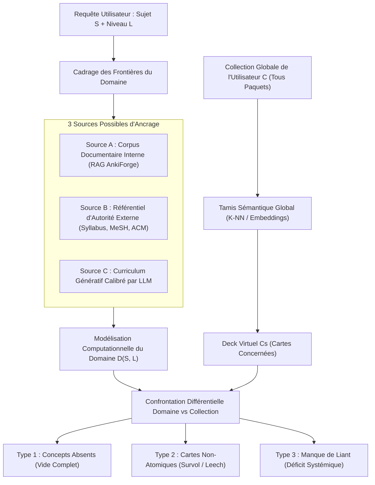
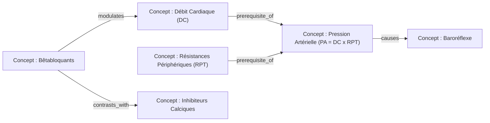
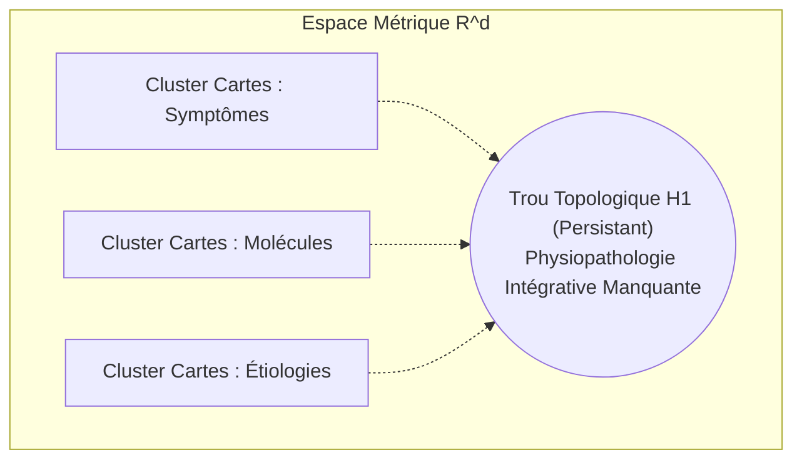
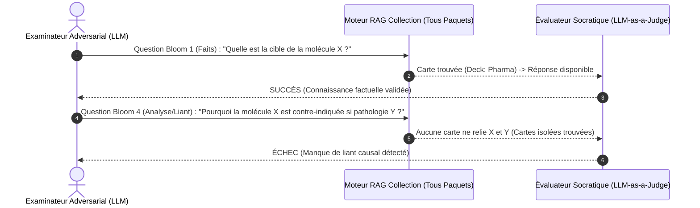
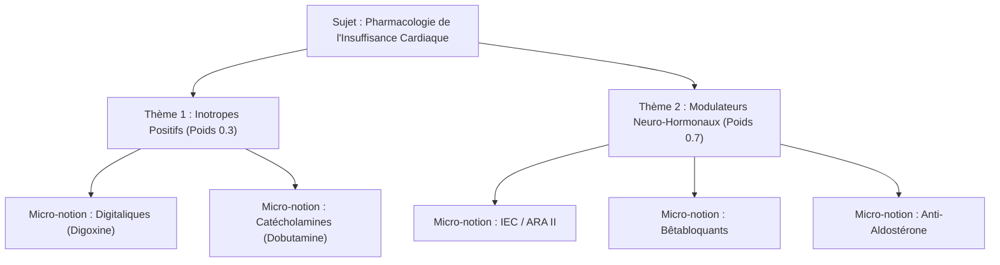
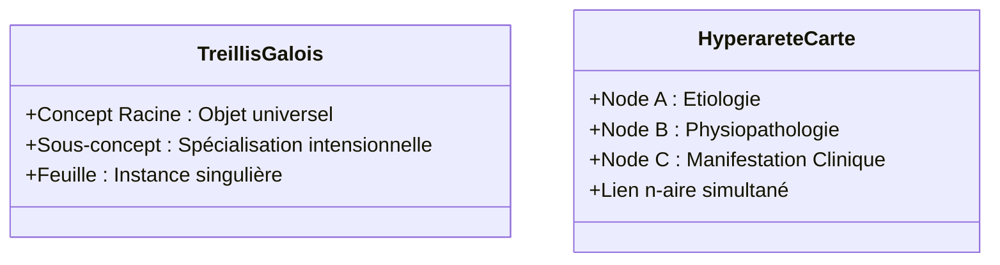
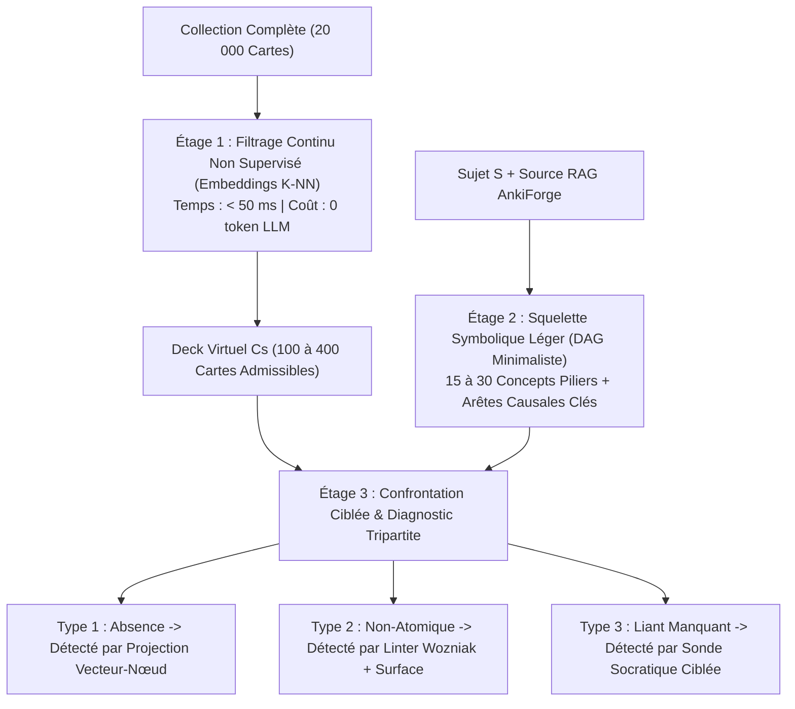
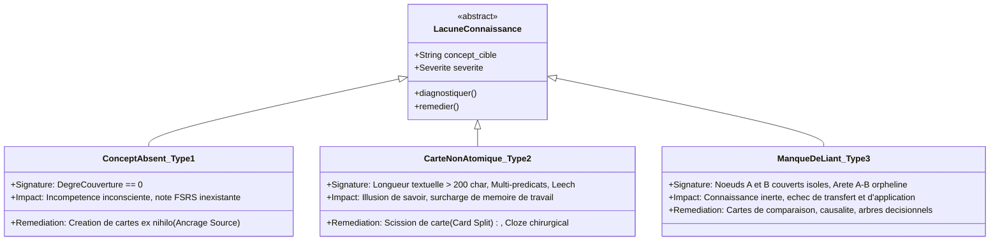
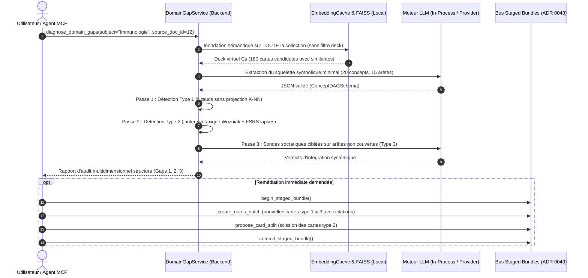

# Recherche Fondamentale — Modélisation des Domaines de Connaissances, Décloisonnement de Collection et Détection Multidimensionnelle des Lacunes de Cartes Flash

## Résumé Exécutif & Cadrage Épistémique

La modélisation automatique d'un domaine de connaissances et l'audit de complétude d'une collection de cartes de répétition espacée (SRS / Anki) constituent un verrou scientifique et technique majeur à l'intersection du traitement automatique des langues (NLP), de la géométrie de l'information et des sciences cognitives de l'apprentissage.

Historiquement, les logiciels de répétition espacée contraignent l'utilisateur à structurer son savoir sous la forme d'un partitionnement hiérarchique arbitraire en paquets (*decks*) et sous-paquets (*subdecks*). Cette arborescence reflète le plus souvent une organisation circonstancielle (sources de cours, semestres universitaires, manuels scolaires ou découpage administratif) plutôt que la topologie intrinsèque du domaine étudié. En conséquence, évaluer la maîtrise d'un sujet en se cantonnant aux frontières rigides d'un unique paquet engendre deux biais systématiques :
1. **L'illusion de lacune (Faux Négatif) :** Déclarer absent un concept fondamental alors que l'utilisateur l'a déjà minutieusement encodé dans un autre paquet transversal (ex. la physiopathologie de l'insuffisance cardiaque située dans un deck de médecine interne alors que l'analyse porte sur la pharmacologie cardiovasculaire).
2. **L'illusion de complétude (Faux Positif) :** Considérer un domaine maîtrisé sous prétexte que le paquet cible contient un nombre élevé de cartes, alors que ces cartes survolent superficiellement le sujet sans atomiser les notions critiques ou sans jamais tester les relations systémiques unissant les faits.

Ce document de recherche fondamentale explore, formalise et compare **six approches théoriques et algorithmiques** permettant à une intelligence artificielle :
1. De **cadrer et calibrer** un domaine de connaissances sur un sujet donné, sans dérive thématique et avec un niveau de granularité paramétrable ;
2. De **décloisonner l'analyse** en projetant l'ensemble de la collection de l'utilisateur (tous paquets confondus) dans un espace de connaissances unifié ;
3. D'établir une **taxonomie opérationnelle des trois types de lacunes mémorielles** : le *concept absent* (vide complet), la *carte non atomique* (survol cognitif masquant les détails), et le *manque de liant* (déficit d'intégration systémique et de causalité) ;
4. De formuler une **architecture pragmatique et modulaire** intégrable dans AnkiForge (Python 3.12+, Peewee ORM, RAG local FAISS/ChromaDB, outillage MCP).

---

## 1. Problématique Fondamentale : Le Décloisonnement de la Collection Anki

### 1.1 Formalisation Mathématique du Problème

Soit $\mathcal{C} = \{c_1, c_2, \dots, c_N\}$ l'ensemble fini des cartes (ou notes) constituant l'intégralité de la collection d'un profil utilisateur Anki, réparties dans une partition de paquets $\mathcal{P} = \{D_1, D_2, \dots, D_K\}$ telle que $\bigcup_{k=1}^K D_k = \mathcal{C}$ et $D_i \cap D_j = \emptyset$ pour $i \ne j$. Chaque carte $c_i$ est un tuple :
$$c_i = \langle \text{id}_i, \text{Fields}_i, \text{Tags}_i, D(c_i), \Theta_i \rangle$$
où $\text{Fields}_i$ représente les paires clé-valeur textuelles (recto, verso, texte cloze, remarques), $\text{Tags}_i$ l'ensemble des étiquettes associées, $D(c_i) \in \mathcal{P}$ le paquet d'appartenance, et $\Theta_i$ les métadonnées de répétition espacée (stabilité, difficulté, intervalle, nombre d'échecs / rétention FSRS).

Soit un sujet cible $S$ spécifié par l'utilisateur (ex. *"Immunologie fondamentale : voies du complément et hypersensibilités"*) assorti d'un niveau d'exigence cible $\mathcal{L} \in \{\text{Découverte}, \text{Universitaire}, \text{Expert / Concours}\}$.

Le domaine de connaissances calibré associé au couple $(S, \mathcal{L})$ est noté $\mathcal{D}(S, \mathcal{L})$. Ce domaine peut être abstraitement conceptualisé comme un espace structuré d'énoncés épistémiques, de concepts et de relations :
$$\mathcal{D}(S, \mathcal{L}) = \langle \mathcal{V}_S, \mathcal{E}_S, \Phi_S \rangle$$
où $\mathcal{V}_S$ est l'ensemble des entités conceptuelles requises, $\mathcal{E}_S$ l'ensemble des relations sémantiques ou causales liant ces concepts, et $\Phi_S$ l'ensemble des contraintes d'évaluation et de granularité associées au niveau $\mathcal{L}$.

L'objectif de l'IA est triple :
1. **Opérateur d'Extraction Décloisonnée (Corpus Virtuel) :** Définir une fonction d'admissibilité $\mu_S : \mathcal{C} \to [0, 1]$ mesurant l'appartenance sémantique d'une carte quelconque de la collection au domaine $\mathcal{D}$, indépendamment de son paquet d'origine $D(c)$ :
   $$\mathcal{C}_S = \{c \in \mathcal{C} \mid \mu_S(c) \ge \tau_{admissibilité}\}$$
2. **Opérateur de Modélisation du Domaine :** Instancier une représentation formelle computationnelle de $\mathcal{D}(S, \mathcal{L})$.
3. **Opérateur de Diagnostic Différentiel des Lacunes :** Classifier la confrontation entre $\mathcal{D}(S, \mathcal{L})$ et $\mathcal{C}_S$ en trois composantes disjointes :
   $$\text{Gaps}(\mathcal{D}, \mathcal{C}_S) = \langle \mathcal{G}_{\text{absent}}, \mathcal{G}_{\text{non-atomique}}, \mathcal{G}_{\text{liant}} \rangle$$

### 1.2 Le Biais de Cloisonnement et la Notion de "Paquet Virtuel"

L'erreur canonique des outils de gestion de flashcards consiste à considérer le paquet comme la frontière du savoir. Dans la pratique cognitive réelle :
- Un étudiant en médecine qui révise la *pharmacologie des bêtabloquants* possède des cartes sur les récepteurs adrénergiques dans un deck *"Physiologie"*, des cartes sur l'insuffisance cardiaque dans un deck *"Cardiologie"*, des cartes sur le glaucome dans un deck *"Ophtalmologie"*, et des contre-indications dans un deck *"Pneumologie (Asthme)"*.
- Si l'analyse se cantonne au deck *"Pharmacologie"*, le système génèrera des doublons ou signalera à tort l'absence de cartes sur les récepteurs $\beta_1$ et $\beta_2$, polluant la mémoire de l'utilisateur avec des cartes redondantes.

Le système doit donc substituer au partitionnement rigide des paquets un **deck virtuel dynamique** généré par inondation sémantique bornée (Bounded Semantic Query).

---

## 2. Cadrage et Calibration du Domaine de Connaissances

Avant de détecter les lacunes, l'IA doit définir avec une précision mathématique les frontières du domaine. Si le cadre est trop large, l'IA dérive vers l'infini du savoir encyclopédique (*out-of-scope explosion*) ; s'il est trop étroit, elle ignore des piliers indispensables (*under-specification*).



### 2.1 Les Trois Mécanismes d'Ancrage de Domaine

Le cadrage peut s'effectuer selon trois modalités, par ordre de robustesse décroissante :

1. **Ancrage sur Corpus Documentaire Interne (Grounding Source AnkiForge) :**
   - L'utilisateur associe le sujet à un ou plusieurs documents préalablement ingérés dans la bibliothèque locale de l'application (PDF de cours, chapitre de manuel, transcript de conférence, page web via `ADR 0057`).
   - Le domaine $\mathcal{D}(S, \mathcal{L})$ est délimité par l'arbre structurel des sections, sous-sections et fragments (`DocumentChunkModel`), filtré par les adresses de région (`ADR 0010`) pour écarter ou neutraliser les zones non pertinentes.
   - *Garantie :* Zéro hallucination sur l'étendue du domaine. La frontière est déterministe et possède une autorité absolue.

2. **Ancrage sur Référentiel d'Autorité Externe (Curriculum Standardisé) :**
   - Le système s'aligne sur une taxonomie formelle ou un syllabus officiel existant : référentiel ECNi/EDN pour la médecine en France, USMLE Step 1/2 aux USA, classification ACM Computing pour l'informatique, tables des matières d'ouvrages de référence (*open curricula*).
   - *Garantie :* Objectivité pédagogique éprouvée et standardisation des intitulés de compétences.

3. **Curriculum Génératif Calibré (LLM Domain Framing) :**
   - En l'absence de document source, le système sollicite un modèle de langage avec un protocole de bornage strict :
     - *Persona de cadrage :* Inspecteur académique expert du domaine.
     - *Contraintes de profondeur (Max Depth) :* Limitation stricte de l'arbre taxonomique à 3 niveaux (Macro-Thème $\to$ Concept Pivot $\to$ Notions Atomiques).
     - *Contraintes d'exclusion :* Énumération explicite des domaines limitrophes exclus (*out-of-scope boundaries*). Par exemple, pour *"L'algorithme Raft"*, exclure l'implémentation bas-niveau en Go ou les protocoles Byzantins (pBFT).

### 2.2 Extraction du Deck Virtuel par Inondation Sémantique Bornée

Pour extraire $\mathcal{C}_S$ sans balayer aveuglément les 20 000 cartes d'une collection avec un LLM :

1. **Représentation Vectorielle Globale :**
   Toutes les cartes de la collection $\mathcal{C}$ possèdent une signature vectorielle dense $\mathbf{e}(c) \in \mathbb{R}^d$ calculée sur leurs champs textuels concaténés et normalisés, stockée dans le cache persistant SQLite `EmbeddingCacheModel` (`text-embedding-3-small` ou embedding local HuggingFace type `bge-m3`).
2. **Centroïde et Enveloppe Sémantique du Domaine :**
   À partir de la description de $\mathcal{D}(S, \mathcal{L})$, le système génère $M$ vecteurs de requêtes clés $\{\mathbf{q}_1, \dots, \mathbf{q}_M\}$ couvrant les différentes facettes du sujet.
3. **Filtrage K-NN Multi-Sources :**
   Une recherche K-NN (via l'index vectoriel FAISS local) agrège les cartes candidates :
   $$\mathcal{C}_{\text{candidates}} = \bigcup_{m=1}^M \text{TopK}(\mathbf{q}_m, K=200)$$
4. **Calcul du Score d'Admissibilité $\mu_S(c)$ :**
   $$\mu_S(c) = \max_{m \in \{1, \dots, M\}} \cos(\mathbf{e}(c), \mathbf{q}_m) \cdot (1 + \alpha \cdot \mathbb{I}_{\text{tag\_match}}(c))$$
   où $\alpha$ est un bonus modéré accordé aux cartes partageant des tags lexicaux pertinents, sans que l'absence de tag ne soit éliminatoire.
5. **Résultat :** Un sous-ensemble $\mathcal{C}_S$ de taille maniable (ex. 150 à 600 cartes issues de 8 paquets différents), exempt de bruit hors sujet, servant de base exclusive à l'audit approfondi.

---

## 3. Analyse Comparative des Approches de Modélisation du Domaine

L'exploration de l'état de l'art révèle six paradigmes distincts pour modéliser le domaine et confronter la collection.

### 3.1 Approche A : Graphe de Connaissances & DAG de Prérequis (Concept Prerequisite Graph - CPG)

#### Principe et Modélisation Formelle
Le domaine est modélisé sous la forme d'un graphe orienté hétérogène $G = (V, E)$.
- Les sommets $v \in V$ représentent des concepts atomiques ou macro-concepts. Chaque sommet est qualifié par un tuple $\langle \text{label}, \text{definition}, \text{criticality} \rangle$.
- Les arêtes $(u, v) \in E$ portent une sémantique relationnelle typée :
  - $u \xrightarrow{\text{prerequisite\_of}} v$ : la compréhension de $u$ est nécessaire à l'assimilation de $v$ (relation d'ordre partiel / DAG).
  - $u \xrightarrow{\text{part\_of}} v$ : inclusion méréologique (ex. *Boucle de Henle* $\xrightarrow{\text{part\_of}}$ *Néphron*).
  - $u \xrightarrow{\text{causes}} v$ : causalité physiopathologique ou mécanique.
  - $u \xrightarrow{\text{contrasts\_with}} v$ : diagnostic différentiel, comparaison symétrique ou antinomie conceptuelle.



#### Confrontation avec les Cartes de la Collection
Chaque carte $c \in \mathcal{C}_S$ est projetée sur le graphe via une fonction de projection $\Gamma : \mathcal{C}_S \to \mathcal{P}(V) \cup \mathcal{P}(E)$ :
- **Couverture de Nœud :** Une carte couvre le nœud $v$ si son contenu teste la définition, les propriétés ou le rôle de $v$.
- **Couverture d'Arête :** Une carte couvre l'arête $(u, v)$ si elle teste explicitement la relation unissant $u$ et $v$ (ex. *"Quel est l'effet de la baisse du débit cardiaque sur les résistances périphériques ?"*).

#### Avantages Pédagogiques et Techniques
- **Explicabilité absolue :** L'utilisateur visualise exactement son chemin d'apprentissage. Si une carte manque, le système sait dire : *"Vous avez des cartes sur B et C, mais il vous manque le prérequis A"*.
- **Pédagogie de la dépendance :** Permet d'ordonnancer l'apprentissage selon le tri topologique du DAG (principe de Wozniak : *"Learn before you memorize"*).
- **Détection structurelle du liant :** Les arêtes $(u, v)$ sans carte rattachée révèlent mathématiquement le déficit de synthèse.

#### Critique Contradictoire Sévère
- **Explosion Combinatoire et Coût d'Extraction :** L'extraction automatisée d'un graphe de connaissances fiable par LLM est extrêmement coûteuse en tokens ($O(|V|^2)$ paires potentielles).
- **Instabilité et Hallucinations Relationnelles :** Les LLM ont tendance à créer des dépendances superflues (sur-connexion) ou à inventer des concepts synonymes formant des nœuds doublons distincts (ex. *"Débit systolique"* et *"Volume d'éjection systolique"*).
- **Arbitraire du seuil de rattachement :** Décider si une flashcard de 15 mots "couvre" un concept de niveau Master nécessite un seuil de confiance souvent instable.

---

### 3.2 Approche B : Modélisation Vectorielle & Analyse Topologique des Données (TDA / Densité Sémantique)

#### Principe et Modélisation Formelle
L'approche fait l'économie de toute représentation symbolique explicite. Les cartes de la collection $\mathcal{C}_S$ et le domaine cible sont plongés dans un espace pré-hilbertien $\mathbb{R}^d$ via des embeddings denses.
Le domaine $\mathcal{D}$ est représenté par une distribution de probabilité continue ou une variété riemannienne $\mathcal{M} \subset \mathbb{R}^d$ obtenue par échantillonnage de documents d'autorité ou d'un corpus de référence.

Trois outils mathématiques sont mobilisés :
1. **Estimation de Densité par Noyaux (KDE - Kernel Density Estimation) :**
   $$\hat{f}(x) = \frac{1}{|\mathcal{C}_S| \cdot h^d} \sum_{c \in \mathcal{C}_S} K\left(\frac{x - \mathbf{e}(c)}{h}\right)$$
   où $K$ est un noyau gaussien et $h$ la fenêtre de lissage. Les zones où $\hat{f}(x) \approx 0$ alors que la densité de référence du domaine $f_{\text{ref}}(x) > \theta$ correspondent à des vides conceptuels.
2. **Diagrammes de Voronoï et Triangulation de Delaunay :**
   L'espace du domaine est partitionné en cellules de Voronoï centrées sur les cartes de la collection. Une cellule dont le volume dépasse un seuil critique ou dont le centre est éloigné de tout point indique une lacune locale de granularité.
3. **Analyse Topologique des Données (TDA / Persistent Homology) :**
   Construction du complexe simplicial de Vietoris-Rips $\mathcal{VR}_\epsilon(\mathcal{C}_S)$ en faisant varier le rayon de filtration $\epsilon \in [0, \epsilon_{\max}]$.
   - $H_0(\mathcal{VR}_\epsilon)$ mesure la connectivité globale (composantes connexes).
   - $H_1(\mathcal{VR}_\epsilon)$ trace l'apparition et la disparition des boucles/trous 1D dans l'espace sémantique.
   Un cycle persistant ayant une durée de vie $(\text{death} - \text{birth}) \gg 0$ sur le code-barres topologique signale un **trou sémantique structurel** : les cartes de l'utilisateur encerclent un concept central sans jamais le toucher.



#### Avantages Pédagogiques et Techniques
- **Calcul Local-First Ultra-Rapide :** Zéro appel LLM pour la détection mathématique des zones de faible densité une fois les vecteurs calculés. Exécution en quelques millisecondes via FAISS ou scikit-learn.
- **Découverte Non Supervisée Indépendante des Ontologies :** Ne dépend d'aucun parti-pris ontologique préalable ; met en lumière des discontinuités mathématiques objectives dans la collection.
- **Scalabilité :** S'applique uniformément à une collection de 500 ou 50 000 cartes.

#### Critique Contradictoire Sévère
- **La Malédiction de la Dimensionnalité (*Curse of Dimensionality*) :** Dans $\mathbb{R}^{1536}$ ou même $\mathbb{R}^{384}$, la distance euclidienne tend à s'uniformiser (le rapport entre la distance maximale et minimale tend vers 1). Le calcul direct de volumes de Voronoï ou de KDE devient géométriquement dégénéré sans réduction drastique de dimension (PCA / UMAP), laquelle détruit une part significative de la topologie locale.
- **Inintelligibilité Pédagogique (L'opacité du vide) :** L'algorithme détecte un trou topologique aux coordonnées vectorielles $[0.042, -0.118, \dots]$, mais est incapable de formuler textuellement à l'utilisateur : *"Il vous manque le mécanisme d'action de l'amiodarone"*, sans devoir rétro-projeter ce trou via un LLM générateur (*inversion d'embedding* complexe et hallucinogène).
- **Faux Vides Sémantiques :** Certains espaces sémantiques "vides" correspondent simplement à des non-sens scientifiques ou à des zones triviales qui ne méritent aucune flashcard.

---

### 3.3 Approche C : Évaluateur Socratique / Questionneur Adversarial (Taxonomie de Bloom & Épistémique)

#### Principe et Modélisation Formelle
Cette approche inverse le paradigme : au lieu de modéliser ce que le domaine *est* de manière statique, elle modélise ce qu'un apprenant *doit être capable d'accomplir*.
Le domaine $\mathcal{D}(S, \mathcal{L})$ est modélisé par un ensemble d'objectifs d'apprentissage opérationnels (Learning Objectives) déclinés selon la **Taxonomie révisée de Bloom** (Anderson & Krathwohl, 2001) :

$$\mathcal{Q}_S = \{(q_i, b_i, a_i, \kappa_i)\}_{i=1}^M$$
- $q_i$ : Question d'épreuve conçue par un persona d'examinateur adversarial.
- $b_i \in \{1: \text{Remember}, 2: \text{Understand}, 3: \text{Apply}, 4: \text{Analyze}, 5: \text{Evaluate}, 6: \text{Create}\}$ : Niveau taxonomique de Bloom.
- $a_i$ : Réponse attendue de référence étayée par une preuve documentaire.
- $\kappa_i$ : Nature de la connaissance requise (Factuelle, Conceptuelle, Procédurale, Métacognitive).



#### Confrontation avec les Cartes de la Collection
Pour chaque épreuve $q_i$ :
1. Le système interroge le RAG local sur **l'ensemble de la collection** pour récupérer le contexte probant :
   $$\text{Context}(q_i) = \text{Retrieve}(\mathcal{C}_S, q_i, k=5)$$
2. Un persona de juge épistémique déterministe évalue si le contexte récupéré permet de répondre rigoureusement à $q_i$ :
   - Si $\text{Context}(q_i)$ est vide ou insuffisant $\implies$ **Lacune de Type 1 (Concept Absent)**.
   - Si $\text{Context}(q_i)$ contient un long bloc textuel non structuré qui mentionne la réponse au passage sans qu'elle soit isolée $\implies$ **Lacune de Type 2 (Carte Non Atomique)**.
   - Si des cartes répondent aux questions de niveau Bloom 1 sur les entités isolées, mais qu'aucune combinaison de cartes ne permet de résoudre une question de niveau Bloom 4 reliant ces entités $\implies$ **Lacune de Type 3 (Manque de Liant)**.

#### Avantages Pédagogiques et Techniques
- **Adéquation parfaite à la réalité de l'évaluation :** Reflète fidèlement la façon dont l'utilisateur sera testé dans la vie réelle (examens, concours, pratique professionnelle).
- **Discrimination chirurgicale de la synthèse :** C'est la seule méthode capable de prouver empiriquement qu'un ensemble de cartes atomiques échoue à former un tout cohérent face à un cas clinique ou un problème d'ingénierie transversal.
- **Génération immédiate de cartes de remédiation :** La question $q_i$ non résolue devient directement le prototype d'une nouvelle flashcard de haute qualité.

#### Critique Contradictoire Sévère
- **Consommation de Tokens et Coût Financier :** Générer 50 questions d'examen puis faire 50 évaluations RAG avec un LLM-as-a-judge consomme entre 100 000 et 300 000 tokens par sujet.
- **Latence Élevée :** Traitement nécessitant plusieurs dizaines de secondes à quelques minutes, incompatible avec une exécution interactive fluide sans barre de progression en arrière-plan.
- **Biais de Retriévabilité RAG :** Si le retriever RAG échoue à trouver une carte pourtant existante dans la collection (problème de reformulation lexicale ou synonymie non résolue), le juge déclare une fausse lacune.

---

### 3.4 Approche D : Arbre de Décision & Taxonomie Hiérarchique Guidée

#### Principe et Modélisation Formelle
Le domaine est décomposé de manière récursive sous forme d'une arborescence stricte $T = (N, E_{\text{child}}, w)$ :
- La racine $r$ représente le sujet global $S$.
- Chaque nœud interne $n \in N$ est une subdivision logique (Thème $\to$ Chapitre $\to$ Sous-section).
- Les feuilles $l \in \text{Leaves}(T)$ représentent des micro-compétences ou concepts terminaux atomiques.
- Chaque nœud possède un coefficient d'importance relative $w(n) \in ]0, 1]$ tel que $\sum_{c \in \text{Children}(n)} w(c) = 1$.



#### Confrontation et Propagation de Score
L'évaluation se fait par rattachement des cartes aux feuilles de l'arbre, puis par propagation ascendante déterministe en temps linéaire $O(|N|)$ :
$$\text{Score}(n) = \begin{cases} 
\min\left(1.0, \frac{|\text{Cards}(n)|}{k_{\text{target}}}\right) & \text{si } n \text{ est une feuille} \\
\sum_{c \in \text{Children}(n)} w(c) \cdot \text{Score}(c) & \text{sinon}
\end{cases}$$

#### Avantages Pédagogiques et Techniques
- **Simplicité cognitive et clarté :** L'étudiant comprend instantanément la hiérarchie, calquée sur les plans de cours universitaires et les tables des matières.
- **Algorithmique triviale et instantanée :** Complexité temporelle $O(|N|)$, zéro latence, calcul intégralement exécutable en SQLite pur.
- **Régression ordonnée :** Idéal pour afficher une barre de progression de complétude par chapitre dans l'UI.

#### Critique Contradictoire Sévère
- **L'Arborescence est une Falsification de la Réalité Scientifique :** La majorité des connaissances avancées ne sont pas des arbres mais des **réseaux intriqués** (*rhizomes* ou graphes poly-hiérarchiques). Forcer un concept dans une branche unique détruit ses liens croisés. Par exemple, *"L'insuffisance rénale causée par les IEC"* doit-elle être classée sous *Néphrologie*, sous *Pharmacologie*, ou sous *Cardiologie* ? L'arbre impose un choix artificiel qui aveugle l'analyse sur les deux autres facettes.
- **Incapacité Totale à Évaluer le Liant Transversal :** L'arbre évalue la somme des parties, jamais l'interaction entre les branches. Deux feuilles de branches opposées peuvent être cruciales à relier, l'arbre n'en a aucune représentation.

---

### 3.5 Approche E : Formal Concept Analysis (FCA) / Treillis de Galois & Hypergraphes

#### Principe et Modélisation Formelle
L'Analyse Formelle de Concepts (FCA - Wille, 1982) offre le cadre mathématique le plus rigoureux pour modéliser l'émergence des concepts à partir d'objets et d'attributs discrets.

Soit un contexte formel $\mathbb{K} = (G, M, I)$ :
- $G$ est l'ensemble des objets du domaine (ex. cas d'usage, entités cliniques, molécules, théorèmes).
- $M$ est l'ensemble des attributs observables (ex. symptômes, mécanismes d'action, contre-indications, propriétés formelles).
- $I \subseteq G \times M$ est une relation binaire d'incidence ($(g, m) \in I \iff$ l'objet $g$ possède l'attribut $m$).

Pour un ensemble d'objets $A \subseteq G$ et d'attributs $B \subseteq M$, on définit les opérateurs de dérivation de Galois (connexion de Birkhoff) :
$$A' = \{m \in M \mid \forall g \in A, (g, m) \in I\}$$
$$B' = \{g \in G \mid \forall m \in B, (g, m) \in I\}$$

Un **concept formel** est un couple $(A, B)$ vérifiant $A' = B$ et $B' = A$, où $A$ est l'*extension* (les instances couvertes) et $B$ l'*intension* (les propriétés caractéristiques).
L'ensemble de tous les concepts formels muni de l'ordre d'inclusion sur les intensions forme un **Treillis de Concepts (Treillis de Galois)** $\underline{\mathfrak{B}}(\mathbb{K})$.

Dans la perspective des **Hypergraphes** $\mathcal{H} = (V, \mathcal{E})$, une carte flash $c$ n'est pas une simple arête binaire reliant deux concepts, mais une **hyperarête** reliant simultanément un sous-ensemble fini de concepts $e_c \subseteq V$ dans un contexte d'implication non linéaire :
$$e_c = \{\text{Pathologie}_A, \text{Symptôme}_B, \text{Biomarqueur}_C\} \xrightarrow{\text{déduit}} \text{Traitement}_D$$



#### Confrontation avec les Cartes de la Collection
- **Lacune d'Intension :** Si un concept formel $(A, B)$ du domaine voit son intension $B$ tronquée dans la collection (les cartes ne mentionnent qu'un sous-ensemble strict $B_{\text{user}} \subsetneq B$), il y a déficit d'attributs critiques.
- **Règles d'Implication Violées :** La FCA génère la base canonique de Duquenne-Guigues des implications valides ($B_1 \implies B_2$). Si une implication valide dans le domaine de référence ne possède aucune carte miroir, une lacune déductive est formellement démontrée.

#### Avantages Pédagogiques et Techniques
- **Rigueur Mathématique Absolue :** Zéro arbitraire subjectif dans la hiérarchie des concepts. Les niveaux d'abstraction émergent directement des données.
- **Détection des Fausses Équivalences :** Identifie avec exactitude mathématique si l'utilisateur confond deux concepts voisins partageant 80% de leurs attributs en isolant l'attribut discriminant manquant.

#### Critique Contradictoire Sévère
- **Intransférabilité Pratique Immédiate :** Construire le contexte formel $\mathbb{K} = (G, M, I)$ à partir de cartes flash rédigées en langage naturel informel requiert une étape d'extraction d'entités et d'attributs booléens extrêmement fragile.
- **Complexité Algorithmique Pire-Cas :** Le nombre de concepts dans le treillis de Galois peut croître exponentiellement ($O(2^{\min(|G|, |M|)})$), rendant l'algorithme de Ganter (*NextClosure*) prohibitif sur de grands corpus.
- **Illisibilité pour l'Utilisateur :** Visualiser un treillis de treillis de 300 concepts forme un enchevêtrement illisible pour un étudiant, inutilisable en pratique desktop.

---

### 3.6 Approche F : Modélisation Hybride Neuro-Symbolique Calibrée (Le Sweet Spot AnkiForge)

L'analyse critique des cinq approches précédentes met en évidence une dichotomie fondamentale :
- Les **approches purement symboliques** (Graphes CPG, Arbres, FCA) offrent une explicabilité et une rigueur exemplaires, mais souffrent d'une rigidité ontologique, d'une lourdeur d'extraction et d'une vulnérabilité aux variations lexicales.
- Les **approches purement continues/vectorielles** (TDA, Embeddings) excellent dans la scalabilité, le calcul local-first et l'agnosticisme vis-à-vis des paquets, mais souffrent de la malédiction de la dimension et de l'incapacité à verbaliser la sémantique de leurs trous.
- L'**approche socratique** est sémantiquement inégalable pour discriminer la synthèse, mais trop lente et coûteuse pour être exécutée sur l'intégralité d'une collection.

La solution d'ingénierie réside dans une **architecture hybride neuro-symbolique à trois étages** :



1. **Étage 1 (Continu - Local-First) :** Décloisonnement instantané et extraction du deck virtuel $\mathcal{C}_S$ par K-NN vectoriel local sur FAISS/ChromaDB.
2. **Étage 2 (Symbolique - DAG Minimal) :** Extraction d'un squelette conceptuel calibré restreint aux concepts de premier et second rang (15 à 35 nœuds clés et leurs relations fondamentales), issu du document source AnkiForge ou généré par un appel LLM unique sous contrainte de schéma JSON strict.
3. **Étage 3 (Socratique / Règle - Frugal) :** Audit ciblé appliquant un linter déterministe pour l'atomicité, un mapping vectoriel pour les absences, et réservant les sondes socratiques (LLM-as-a-judge) **uniquement** aux arêtes relationnelles non couvertes pour prouver le manque de liant.

---

## 4. Taxonomie Approfondie des Trois Types de Lacunes de Connaissances

Pour qu'un audit soit pédagogiquement actionnable, l'IA ne doit jamais se contenter d'un score global flou (ex. *"Vous maîtrisez 68% du sujet"*). Elle doit catégoriser rigoureusement les lacunes selon les trois pathologies cognitives identifiées par l'utilisateur.



---

### 4.1 Type 1 : Le Concept Absent (Vide Complet / Lacune d'Existence)

#### Définition Théorique et Ancrage Cognitif
Le concept absent correspond à une entité informationnelle pivot du domaine de référence qui ne possède **strictement aucune trace mémorielle** dans la collection de l'utilisateur.
Sur le plan de l'apprentissage (modèle de compétence de Noël Burch), l'apprenant se situe dans l'**incompétence inconsciente** : il ne sait pas qu'il ne sait pas. Sur la courbe d'oubli d'Ebbinghaus, aucune trace mnésique ($R = e^{-t/S}$) n'a jamais été initialisée ; la stabilité $S$ est nulle.

#### Signature Observable dans les Données AnkiForge
- **Dans le graphe de concepts :** Le nœud $v \in V$ possède un score de rattachement maximal $\max_{c \in \mathcal{C}_S} \text{Sim}(c, v) < \tau_{\text{absence}}$ (typiquement $< 0.42$ en similarité cosinus avec `text-embedding-3-small`).
- **Dans les documents sources :** Le chunk ou la section du document de cours (`DocumentChunkModel`) possède `note_links.count() == 0` après exécution de `CoverageAlignmentService.resolve_attachment`.
- **Dans la collection Anki :** Aucune carte ne contient les lexèmes pivots ou leurs synonymes formels (requête SQLite FTS5 vide).

#### Mécanisme Algorithmique de Détection
```python
def detect_absence_gaps(domain_concepts: list[ConceptNode], candidate_cards: list[CardVector], threshold: float = 0.45) -> list[AbsenceGap]:
    gaps = []
    for concept in domain_concepts:
        # Recherche du plus proche voisin dans toute la collection décloisonnée
        max_sim, best_card = find_nearest_card(concept.embedding, candidate_cards)
        if max_sim < threshold:
            gaps.append(AbsenceGap(concept=concept.name, similarity=max_sim, severity=concept.criticality, provenance_source=concept.source_chunk_id))
    return gaps
```

#### Stratégie de Remédiation Pédagogique
- **Génération ciblée sous contrainte de preuve :** Extraction du fragment source officiel du document et formulation de 1 à 3 cartes conformes aux règles de Wozniak.
- **Interdiction d'hallucination :** Conformément à l'ADR 0057, l'agent MCP assemble un Staged Bundle (`begin_staged_bundle`) contenant une commande `create_notes_batch` avec la citation textuelle exacte et le tag de traçabilité `section:<slug>`.

---

### 4.2 Type 2 : La Carte Non Atomique (Survol / Déficit d'Atomicité)

#### Définition Théorique et Ancrage Cognitif
Le concept est formellement mentionné dans la collection, mais il est emprisonné dans une carte qui viole frontalement la **Règle 4 de Piotr Wozniak : "Stick to the minimum information principle"**.
La carte présente un texte fleuve, une liste à puces de 6 éléments, fusionne mécanisme, diagnostic et posologie sur le même recto, ou multiplie les occlusions imbriquées au sein d'une longue citation.

#### Conséquences Cognitives Dévastatrices
1. **Surcharge de la Mémoire de Travail (Cognitive Load Theory - Sweller) :** Durant les 5 secondes de révision, l'utilisateur sature sa mémoire de travail (limitée à $4 \pm 1$ éléments selon Cowan).
2. **L'Illusion de Savoir (*Recognition Bias*) :** En lisant le pavé de réponse, l'utilisateur reconnaît le texte et clique complaisamment sur "Correct" (Good), alors qu'en situation d'examen réel, son rappel actif (*active recall*) est incapable d'extraire le micro-détail critique isolé.
3. **L'Effet Sangsue (*Leech Effect*) :** Si l'un des 6 faits de la liste est oublié, l'utilisateur échoue sur l'intégralité de la carte. Les 5 autres faits, pourtant parfaitement sus, sont ré-entraînés inutilement, gaspillant le budget attentionnel et créant du découragement.

#### Signature Observable dans les Données AnkiForge
- **Métriques Textuelles de Surface (Linter Déterministe) :**
  - Nombre de mots du champ de réponse $> 60$ mots.
  - Présence de plus de 2 éléments de liste HTML (`<li>`, `<br> - `).
  - Présence de plusieurs propositions indépendantes coordonnées comportant des conjonctions causales multiples (*"donc"*, *"parce que"*, *"de plus"*).
- **Indicateurs FSRS / Historique de Révision :**
  - Nombre d'échecs (lapses) élevé ($\ge 4$) qualifiant la note de sangsue (*leech*).
  - Temps de révision médian anormalement élevé ($> 15$ secondes par carte).
  - Difficulté FSRS dérivée $D \to 1.0$ (proche du plafond de difficulté).
- **Signature Graphe :** Une seule carte est rattachée à $\ge 4$ concepts distincts du domaine en même temps.

#### Mécanisme Algorithmique de Détection
```python
def detect_atomicity_defects(note: NoteModel, parsed_fields: dict[str, str]) -> list[AtomicityDefect]:
    defects = []
    text_content = " ".join(parsed_fields.values())
    word_count = len(text_content.split())
    bullet_count = text_content.count("<li>") + text_content.count("\n- ")
    
    # Règle 1 : Surcharge volumétrique
    if word_count > 60:
        defects.append(AtomicityDefect(type="VOLUMETRIC_OVERLOAD", word_count=word_count))
        
    # Règle 2 : Énumération complexe masquée
    if bullet_count >= 3:
        defects.append(AtomicityDefect(type="COMPLEX_LIST", items_count=bullet_count))
        
    # Règle 3 : Multi-prédicats sémantiques (analyse syntaxique ou prompt léger)
    facts_detected = count_independent_assertions(text_content)
    if facts_detected > 2:
        defects.append(AtomicityDefect(type="MULTI_PREDICATE_OVERLAP", facts_count=facts_detected))
        
    return defects
```

#### Stratégie de Remédiation Pédagogique
- **Scission de Carte (Card Split) :** Découpage chirurgical du pavé en $K$ flashcards indépendantes, chacune testant une assertion unique.
- **Occlusion de Précision :** Remplacement d'une grande question ouverte par des occlusions de texte (*cloze deletions*) ciblant exclusivement le mot-clé opératoire (Wozniak Règle 5).

---

### 4.3 Type 3 : Le Manque de Liant / Synthèse (Déficit Systémique & Intégration)

#### Définition Théorique et Ancrage Cognitif
C'est le défaut le plus pernicieux des collections de répétition espacée. L'utilisateur possède des dizaines de cartes atomiques impeccables sur des faits isolés (ex. dates historiques, valeurs biologiques normales, molécules pharmaceutiques), mais **aucune carte ne teste les relations causales, les comparaisons différentielles ou la vision d'ensemble**.

Sur le plan cognitif :
- **La Connaissance Inerte (*Inert Knowledge* - Alfred North Whitehead) :** Les faits sont stockés dans des compartiments étanches de la mémoire sémantique. L'étudiant est capable de réciter la définition du concept $A$ et celle du concept $B$, mais est totalement incapable de faire le lien entre $A$ et $B$ lorsqu'un problème nouveau exige leur synthèse conjointe.
- **Déficit d'Activation Associative (Modèle ACT-R de John R. Anderson) :** La mémoire déclarative fonctionne par propagation d'activation le long des liens associatifs. En l'absence de traces mnésiques explicites testant l'arête $(A \to B)$, le passage de $A$ à $B$ sous contrainte de temps ou de stress est bloqué.
- **Échec aux Niveaux Supérieurs de Bloom :** L'apprenant survole le niveau Bloom 1 (Rappel factuel), mais échoue brutalement aux niveaux Bloom 3 (Application), Bloom 4 (Analyse/Comparaison) et Bloom 5 (Évaluation).

#### Signature Observable dans les Données AnkiForge
- **Dans le graphe de concepts :**
  - Soient deux nœuds pivots $u$ et $v$ possédant chacun une excellente couverture locale ($\text{Score}(u) \ge 0.8$ et $\text{Score}(v) \ge 0.8$).
  - Soit l'arête $(u, v) \in E$ portant la relation `causes`, `contrasts_with`, ou `prerequisite_of`.
  - La couverture de l'arête est nulle : $\max_{c \in \mathcal{C}_S} \text{LinkRelevance}(c, u, v) < \tau_{\text{link}}$.
- **Dans l'évaluateur socratique :**
  - L'IA pose une question de diagnostic différentiel ou de cascade causale : *"Qu'est-ce qui distingue fondamentalement le mécanisme d'action de X par rapport à Y dans la situation Z ?"*
  - Le RAG extrait la carte sur X et la carte sur Y, mais aucune carte ne formule la distinction ou la confrontation directe.

#### Mécanisme Algorithmique de Détection
```python
def detect_integration_gaps(graph: ConceptGraph, cards: list[NoteModel]) -> list[IntegrationGap]:
    gaps = []
    for edge in graph.structural_edges:  # relations 'causes', 'contrasts_with', etc.
        u, v = edge.source, edge.target
        # Vérification : Les concepts aux extrémités sont-ils sus individuellement ?
        u_covered = is_concept_covered(u, cards)
        v_covered = is_concept_covered(v, cards)

        if u_covered and v_covered:
            # Recherche d'une carte faisant explicitement le pont sémantique entre u et v
            co_occurrence = find_bridging_cards(u, v, cards)
            if not co_occurrence:
                gaps.append(IntegrationGap(source_concept=u.name, target_concept=v.name, relation_type=edge.relation_type, severity="HIGH"))
    return gaps
```

#### Stratégie de Remédiation Pédagogique
- **Cartes de Diagnostic Différentiel / Tableaux Comparatifs :** Formulation de questions forçant l'arbitrage : *"Quelle est la différence clinique majeure entre l'affection A et l'affection B face au symptôme C ?"*
- **Cartes de Cascade Causalité (Why-Cards) :** Remplacement d'une simple mémorisation de fait par la chaîne causale : *"Par quel mécanisme physiologique la baisse de A entraîne-t-elle la hausse de B ?"* (Wozniak Règle 2 : *"Understand before you memorize"*).
- **Cartes de Vision d'Ensemble (*Big Picture Cards*) :** Cartes schématiques ou récapitulatives présentant la classification générale avant d'aborder les détails.

---

## 5. Matrice Comparative et Grille d'Arbitrage Multidimensionnelle

Le tableau suivant dresse le bilan comparatif des approches explorées, selon 8 critères d'ingénierie et d'efficacité pédagogique :

| Critère d'Évaluation | A. Graphe CPG (Symbolique) | B. Topologie TDA (Vectoriel) | C. Socratique (Adversarial) | D. Arbre Décision (Hiérarchie) | E. Formel FCA (Treillis) | F. Hybride Neuro-Symbolique |
| :--- | :--- | :--- | :--- | :--- | :--- | :--- |
| **1. Détection Type 1 (Concept Absent)** | Excellente (nœud orphelin) | Bonne (zone faible densité) | Excellente (échec de rappel RAG) | Excellente (feuille sans carte) | Excellente (concept vide) | **Excellente (K-NN + Nœud)** |
| **2. Détection Type 2 (Non-Atomique)** | Faible (aveugle à la forme) | Nulle (inapte au format texte) | Très bonne (analyse du pavé RAG) | Nulle (compte binaire de cartes) | Faible (intension floue) | **Maximale (Linter syntaxe + FSRS)** |
| **3. Détection Type 3 (Manque Liant)** | Excellente (arête non couverte) | Moyenne (trou 1D abstrait) | **Maximale (épreuves Bloom 4-5)** | Nulle (branches cloisonnées) | Excellente (implication rompue) | **Très Haute (Arêtes CPG + Sondes)** |
| **4. Explicabilité pour l'Utilisateur** | Maximale (graphe visuel) | Inintelligible (trou vectoriel) | Excellente (question d'épreuve) | Maximale (plan de cours) | Très faible (treillis abstrait) | **Excellente (Arbre/Graphe + Questions)** |
| **5. Complexité Algorithmique** | $O(|V|^2 + |C|)$ | $O(|C| \log |C|)$ | $O(M \cdot \text{RAG})$ | **$O(|N|)$ (Linéaire ultra-rapide)** | $O(2^{\min(\|G\|, \|M\|)})$ | **$O(\|C\| \log K + \|V_{\text{léger}}\|)$** |
| **6. Consommation Tokens LLM** | Élevée (extraction complète) | **Zéro token (Local)** | Très Élevée (150k - 300k tokens) | Moyenne (génération de l'arbre) | Élevée (extraction attributs) | **Faible à Modérée (15k - 30k tokens)** |
| **7. Latence d'Exécution** | 10 à 30 secondes | **< 1 seconde (instantané)** | 60 à 180 secondes | < 2 secondes | > 60 secondes | **3 à 8 secondes** |
| **8. Résilience aux Hallucinations** | Modérée (arêtes parasites) | **Absolue (Mathématique)** | Modérée (dérive d'évaluation) | Bonne | Bonne | **Haute (Ancrée source RAG)** |

---

## 6. Recommandation Architecturale Pragmatique pour AnkiForge

En application des principes directeurs d'AnkiForge (Python 3.12, local-first, base de données SQLite Peewee, non-régression CRAP, asynchronisme Qt et outillage MCP Two-Phase Commit), l'implémentation opérationnelle doit reposer sur un **Pipeline Tripartite Décloisonné**.



### 6.1 Architecture des Données (Extension Modulaire Peewee)

Pour ne pas altérer les tables existantes sans nécessité, le diagnostic s'appuie sur une structure éphémère ou matérialisée dans une table dédiée aux sessions d'audit :

```python
# Modélisation proposée dans src/ankiforge/database/models/domain_gap.py

from peewee import CharField, ForeignKeyField, IntegerField, TextField, FloatField
from ankiforge.database.base import BaseModel
from ankiforge.database.models.cards import NoteModel
from ankiforge.database.models.rag import DocumentModel


class DomainAuditSessionModel(BaseModel):
    """Session d'audit de domaine de connaissances."""

    subject = CharField(max_length=255)
    target_level = CharField(default="Universitaire")
    source_document = ForeignKeyField(DocumentModel, null=True, on_delete="SET NULL")
    created_at = DateTimeField(default=datetime.datetime.now)
    coverage_score = FloatField(default=0.0)


class DomainGapItemModel(BaseModel):
    """Détail unitaire d'une lacune identifiée."""

    session = ForeignKeyField(DomainAuditSessionModel, backref="gaps", on_delete="CASCADE")
    gap_type = CharField(index=True)  # ABSENT_CONCEPT, NON_ATOMIC_CARD, MISSING_SYNTHESIS
    concept_label = CharField()
    secondary_concept = CharField(null=True)  # Pour les lacunes de Type 3 (arête)
    severity = CharField(default="MEDIUM")  # LOW, MEDIUM, HIGH, CRITICAL
    culprit_note = ForeignKeyField(NoteModel, null=True, on_delete="SET NULL")  # Pour Type 2
    suggested_action = TextField()
    evidence_quote = TextField(null=True)  # Preuve textuelle issue de la source RAG
```

### 6.2 Les Trois Passes de Traitement

#### Passe 1 : Récolte Décloisonnée & Tamisage Vectoriel (Coût LLM : 0)
- Requête K-NN sur `EmbeddingCacheModel` avec le centroïde vectoriel du sujet $S$.
- Extraction des identifiants de cartes dont la similarité dépasse le seuil $\tau = 0.40$.
- Regroupement des cartes candidates $\mathcal{C}_S$ indépendamment de leur table parente `DeckModel`.

#### Passe 2 : Extraction Symbolique Légère & Linter Déterministe
- Génération ou chargement du DAG de référence (15 à 30 concepts maximum) ancré sur les chunks du document de référence via `CoverageAlignmentService`.
- **Détection Type 1 (Absence) :** Projection vectorielle des cartes sur les nœuds du DAG. Tout concept dont la similarité maximale est inférieure à $0.45$ est classé en *Concept Absent*.
- **Détection Type 2 (Non-Atomique) :** Analyse statique immédiate des cartes de $\mathcal{C}_S$ :
  - Décompte de mots du champ de réponse $> 60$.
  - Décompte de puces HTML $\ge 3$.
  - Historique des lapses FSRS $\ge 4$ ou carte identifiée comme sangsue via `LeechService` (`ADR 0019`).
  - Chaque anomalie lève un drapeau de *Non-Atomicité*.

#### Passe 3 : Sondes Socratiques Frugales sur Arêtes Orphelines (Type 3)
- Analyse des chemins du DAG : identification des paires de concepts $(u, v)$ reliés par une relation forte (`causes`, `contrasts_with`) où $u$ et $v$ sont individuellement couverts mais où aucune carte ne contient les deux termes simultanément.
- Émission d'une question socratique ciblée au LLM pour valider si le corpus $\mathcal{C}_S$ permet d'inférer la relation.
- Si le moteur RAG échoue $\implies$ Déclaration d'un *Manque de Liant*.

### 6.3 Intégration dans le Registre MCP (`mcp_server.py`)

Trois nouveaux outils analytiques en lecture seule, respectant strictement le formalisme de validation en deux temps (`ADR 0043`, `ADR 0057`) :

1. **`diagnose_cross_deck_domain_gaps(subject: str, document_id: int | None = None, target_level: str = "Universitaire") -> str`** :
   - Exécute le pipeline en 3 passes sur l'ensemble du profil actif.
   - Retourne un diagnostic JSON exhaustif segmenté selon les trois types de lacunes (`absent_concepts`, `non_atomic_cards`, `missing_synthesis_links`).
2. **`inspect_card_atomicity_metrics(note_id: int) -> str`** :
   - Évalue de manière chirurgicale la conformité d'une note aux 20 règles de formulation de Piotr Wozniak (détection de survol, surcharge cognitive, suggestions de découpage).
3. **`generate_synthesis_remediation_proposals(gap_id: int) -> str`** :
   - Propose un brouillon de cartes comparatives ou causales résolvant une lacune de Type 3 identifiée, prêt à être injecté dans un Staged Bundle.

---

## 7. Synthèse et Perspectives

Cette modélisation fondamentale démontre que la détection intelligente des lacunes de connaissances dans une collection Anki ne peut se satisfaire ni d'un simple linter de surface, ni d'une recherche vectorielle naïve, ni d'un partitionnement rigide par paquets.

En mariant :
1. **L'émancipation topologique des paquets** (Deck Virtuel par inondation vectorielle),
2. **La modélisation neuro-symbolique hybride** (DAG conceptuel léger couplé à la projection continue),
3. **La taxonomie tripartite rigoureuse** des lacunes cognitives (Absence factuelle, Déficit d'atomicité, Manque d'intégration systémique),

AnkiForge pose les bases d'un environnement de métacognition assistée par IA, capable de guider l'utilisateur de l'apprentissage initial atomique jusqu'à la maîtrise intégrée et fluide des domaines les plus complexes.
