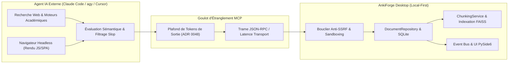
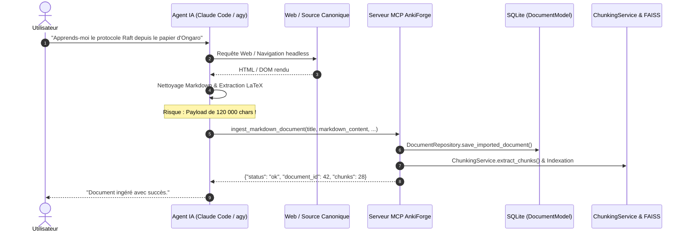
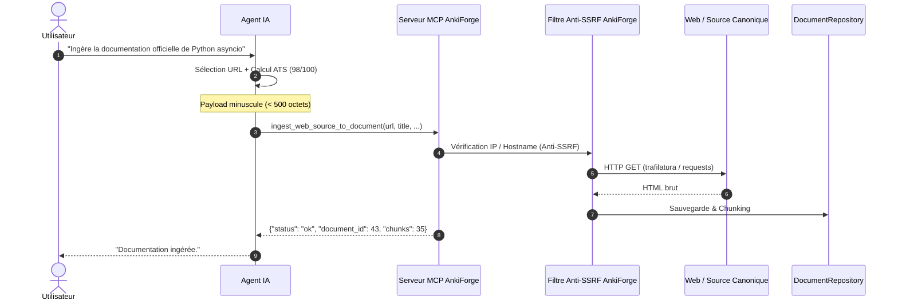
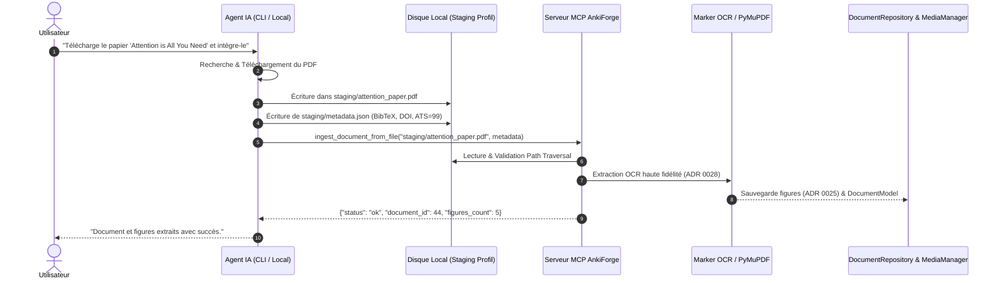
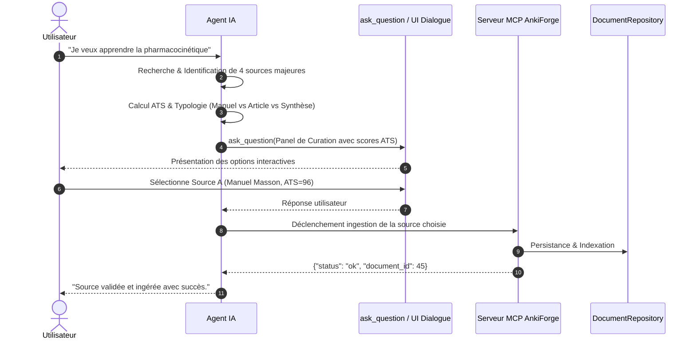
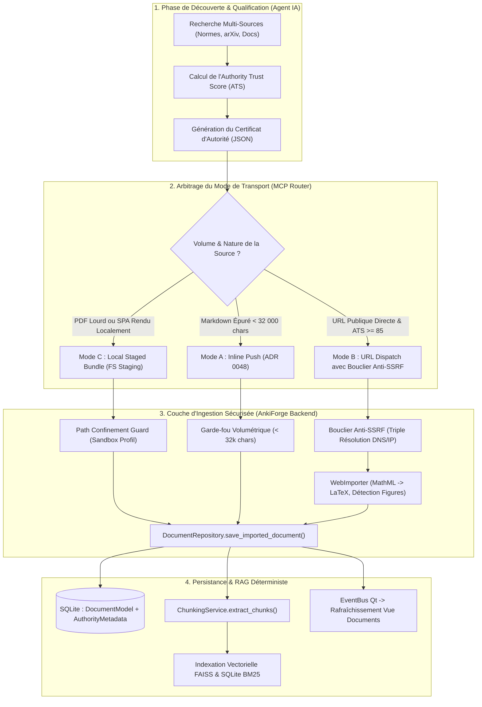

# Recherche Fondamentale : Sourcage d'Autorité et Ingestion Documentaire sans Friction par Agents Externes pour AnkiForge

**Auteur :** Sous-agent de Recherche Fondamentale AnkiForge  
**Date :** 10 novembre 2026  
**Statut :** Synthèse d'architecture et de recherche prospective  
**Périmètre :** Protocole MCP persistant, Ingestion RAG locale, Qualification épistémique, Sécurité SSRF / Sandbox, Intégration PySide6 / SQLite  

---

## Résumé Exécutif

L'apprentissage par répétition espacée (SRS / Anki) n'a de valeur que si la matière mémorisée repose sur des **sources de vérité incontestables**. La génération de cartes mémoire à partir de connaissances implicites de modèles de langage (LLM) produit couramment des approximations, des formulations contraires aux 20 règles de formulation de Piotr Wozniak, voire des hallucinations factuelles indécelables sans ancrage formel.

Le projet AnkiForge a résolu la traçabilité interne par le rattachement déterministe entre notes et fragments documentaires (`NoteChunkLinkModel`, [ADR 0009](file:///Users/tristanrigaud-humbert/PycharmProjects/AnkiForge/docs/adr/0009-provenance-par-section-et-paliers-de-resolution.md), [ADR 0057](file:///Users/tristanrigaud-humbert/PycharmProjects/AnkiForge/docs/adr/0057-outillage-mcp-ancrage-documentaire-et-skills-couverture-enrichissement-deck.md)). Cependant, **l'approvisionnement en amont** de cette bibliothèque documentaire par des agents IA autonomes (Claude Code, agy, Cursor, Windsurf) se heurtait jusqu'ici à un fossé architectural : comment un agent externe, doté d'outils avancés de recherche web et d'analyse, peut-il identifier des sources académiques ou canoniques d'élite, certifier leur fiabilité, et les ingérer dans une application desktop locale (Qt6 / SQLite) **sans friction, sans saturer les fenêtres de tokens, et sans créer de brèche de sécurité (SSRF, Path Traversal)** ?

Cette étude explore l'ensemble du spectre architectural à travers quatre approches archétypales (Push Markdown direct, Pull URL déporté, Bundle multimodal sur système de fichiers partagé, Curation interactive guidée). Après une analyse contradictoire impitoyable de leurs faiblesses respectives, elle formalise et recommande une cinquième architecture unifiée : **l'Ingestion Hybride Adaptative avec Certificat d'Autorité (Approche E)**. 

Cette architecture combine un **Certificat d'Autorité** normalisé (`AuthorityCertificate`), un **canal de transport polymorphique** respectueux des limites volumétriques MCP ([ADR 0048](file:///Users/tristanrigaud-humbert/PycharmProjects/AnkiForge/docs/adr/0048-troncature-des-arguments-tool-call-et-plafonds-volumetriques-des-lots-mcp.md)), un **bouclier réseau anti-SSRF à triple vérification**, et une intégration directe avec le moteur de persistance transactionnelle d'AnkiForge (`DocumentRepository`, `ChunkingService`, Event Bus PySide6).

---

## 1. Problématique Fondamentale & Écosystème

### 1.1 Le Paradoxe de l'Ingestion par Agent IA

Les agents de code et de recherche contemporains disposent d'une puissance d'investigation sans précédent :
- Moteurs de recherche web multi-index (Google, Brave, Bing, Exa, Tavily, Perplexity).
- Moteurs de rendu headless complets (Playwright, Puppeteer, Chrome DevTools Protocol) capables d'exécuter le JavaScript des applications monopages (SPA), de gérer les sessions et d'extraire le DOM rendu.
- Capacité d'évaluation sémantique permettant d'extraire la substantifique moelle d'un corpus technique.

Pourtant, dès que cet agent doit transmettre ces connaissances à une application locale comme AnkiForge via le protocole MCP (*Model Context Protocol*), il se heurte à des contraintes physiques et protocolaires strictes :



1. **Le goulot d'étranglement de la génération de tokens (Token Egress Bottleneck) :** Si un document scientifique ou une documentation complète fait 80 pages (soit ~200 000 caractères), un LLM ne peut pas matérialiser ce contenu brut dans l'argument JSON d'un appel d'outil MCP sans saturer sa fenêtre de sortie (généralement plafonnée entre 4 096 et 16 384 tokens), exploser les coûts de calcul et risquer une troncature fatale `PAYLOAD_TOO_LARGE` / `INVALID_JSON` ([ADR 0048](file:///Users/tristanrigaud-humbert/PycharmProjects/AnkiForge/docs/adr/0048-troncature-des-arguments-tool-call-et-plafonds-volumetriques-des-lots-mcp.md)).
2. **Le paradoxe du fetch local et des SPAs :** Si l'agent se contente de donner une URL à AnkiForge, l'application locale (exécutée sur la machine de l'utilisateur) se retrouve souvent bloquée par des protections anti-robots (Cloudflare Turnstile, CAPTCHA, WAF), par des murs de consentement de cookies ou par des sites modernes entièrement construits en React/Vue/Next.js ne renvoyant qu'un squelette HTML vide (`<div id="root"></div>`) à un client HTTP classique tel que `requests` ou `trafilatura`.
3. **Le vecteur d'attaque SSRF (Server-Side Request Forgery) :** Une application desktop disposant de droits réseau complets sur la machine hôte risque, si elle exécute aveuglément des requêtes vers des URLs fournies par un modèle (ou induites par un prompt malveillant), de sonder le réseau local de l'utilisateur (`192.168.1.1`), ses conteneurs Docker (`172.17.0.1`), ses services d'infrastructure internes (`169.254.169.254`) ou ses serveurs d'administration locaux (`127.0.0.1:8080`, `localhost:5432`).

### 1.2 Le Mandat d'AnkiForge : Ancrage et Souveraineté

AnkiForge refuse le modèle du « nuage opaque ». Ses principes cardinaux imposent :
- **Local-first absolu :** Toutes les données (documents, fragments, métadonnées, embeddings, bases Peewee) résident sur le disque local dans le profil utilisateur (`~/.ankiforge/profiles/<nom>/`).
- **Grounding déterministe ([ADR 0009](file:///Users/tristanrigaud-humbert/PycharmProjects/AnkiForge/docs/adr/0009-provenance-par-section-et-paliers-de-resolution.md)) :** Toute carte mémoire doit être traçable jusqu'à son fil d'Ariane (`heading_path`) et son document source.
- **Préservation non destructive ([ADR 0010](file:///Users/tristanrigaud-humbert/PycharmProjects/AnkiForge/docs/adr/0010-adresse-de-region-et-exclusion-non-destructive.md)) :** Écarter une section d'un document ne détruit jamais la matière physique mais constitue une règle de portée (`node:`, `heading:`, `page:`).
- **Zéro régression de réactivité UI :** L'ingestion d'un corpus volumineux ne doit jamais geler la boucle d'événements principale de l'interface PySide6.

---

## 2. Taxonomie et Qualification Épistémique des Sources d'Autorité

Pour qu'un agent externe puisse agir comme un curateur académique rigoureux, il doit appliquer une grille d'évaluation épistémique déterministe capable de séparer le savoir canonique du bruit promotionnel.

### 2.1 La Pyramide de l'Autorité Cognitive

Dans le cadre d'un apprentissage à long terme avec AnkiForge, les sources d'information se structurent selon la hiérarchie suivante :

```
                  ▲
                 / \
                /   \     Niveau 1 : Standards Normatifs & RFCs (IETF, W3C, ISO, IEEE)
               /  1  \    Vérité canonique prescriptive, rigueur formelle maximale.
              /───────\
             /    2    \   Niveau 2 : Littérature Scientifique Peer-Reviewed (arXiv, PubMed, ACM)
            /───────────\  Théorèmes, preuves expérimentales, consensus académique vérifié.
           /      3      \  Niveau 3 : Manuels & Cours Universitaires (MIT OCW, Stanford, Ed. Dunod)
          /───────────────\ Pédagogie structurée, progression didactique, exhaustivité conceptuelle.
         /        4        \ Niveau 4 : Documentations Officielles Primaires (Python, Qt, MDN, Rust)
        /───────────────────\ Référence contractuelle du concepteur, exempte d'interprétation tierce.
       /          5          \ Niveau 5 (Rejeté) : Blogs SEO, Tutoriels Agrégés, Fermes IA, Medium
      /───────────────────────\ Vulgarisation approximative, obsolescence rapide, erreurs subtiles.
```

### 2.2 Signaux de Confiance vs Signaux de Contamination

L'agent externe doit évaluer systématiquement chaque candidat selon des signaux objectifs :

| Dimension | Signaux de Confiance (Autorité Épistémique) | Signaux d'Alerte (SEO-Spam & AI-Slop) |
|---|---|---|
| **Domaine & TLD** | Domaines institutionnels protégés (`.edu`, `.gov`, `.ac.uk`, `.asso.fr`), dépôts normatifs (`ietf.org`, `w3.org`, `iso.org`), documentations officielles hébergées sur le domaine racine du projet (`docs.python.org`, `doc.qt.io`). | Domaines génériques monétisés, plateformes de blogging non modérées (`medium.com`, `dev.to`), fermes de tutoriels bourrées d'annonces publicitaires (`geeksforgeeks.org`, agrégateurs clones). |
| **Paternité & Attribution** | Auteurs nommément identifiés avec affiliations universitaires, identifiants ORCID, signataires de RFCs, core-maintainers reconnus. | Auteur anonyme ("Admin", "Editorial Team"), profil généré par IA, absence totale de biographie professionnelle vérifiable. |
| **Structure & Réfutabilité** | Présence d'un identifiant persistant (DOI, RFC number, ISBN, Git commit SHA), bibliographie exhaustive, citations académiques croisées, formules en notation formelle (LaTeX). | Absence totale de sources bibliographiques, liens sortants uniquement vers des programmes d'affiliation ou des pages de vente, texte narratif vague sans formalisme. |
| **Fraîcheur & Versioning** | Datation explicite de publication et de révision, spécification précise de la version logicielle ou du standard traité (ex. "Python 3.12+", "Qt 6.8", "C++23"). | Aucune date de mise à jour, articles recyclés avec dates rafraîchies artificiellement pour le référencement, mélange incohérent de syntaxes obsolètes et modernes. |
| **Intégrité Typographique** | Structure ATX stricte (niveaux de titres hiérarchiques cohérents `h1` -> `h2` -> `h3`), tableaux comparatifs formels, diagrammes techniques sourcés. | Murs de mots-clés, répétitions lexicales de bourrage SEO, bannières d'inscription intempestives, fragments de code non fonctionnels. |

### 2.3 Modélisation Formelle : L'Authority Trust Score (ATS)

Afin d'éliminer toute appréciation subjective du modèle de langage, nous définissons une fonction mathématique explicite calculée par l'agent ou par AnkiForge :

$$\text{ATS} = \min\left(100, \; \max\left(0, \; w_D \cdot S_{\text{domain}} + w_P \cdot S_{\text{peer}} + w_S \cdot S_{\text{struct}} + w_R \cdot S_{\text{recency}} - P_{\text{penalty}}\right)\right)$$

Avec les pondérations normalisées :
- **$w_D = 0.35$ (Autorité de Domaine) :** TLD gouvernemental/académique = 100, domaine officiel de technologie = 90, dépôt institutionnel (arXiv/PubMed) = 90, blog reconnu avec peer-reviewing technique = 60, domaine générique = 20.
- **$w_P = 0.25$ (Preuve & Attribution) :** Présence d'un DOI/RFC/ISBN valide (+40), auteurs avec affiliation académique/industrielle vérifiable (+30), bibliographie formelle (> 5 références citées) (+30).
- **$w_S = 0.25$ (Rigueur Structurelle & LaTeX) :** Formules mathématiques en LaTeX/MathML valides (+30), code source complet exécutable avec typage strict (+30), structure hiérarchique profonde avec table des matières (+40).
- **$w_R = 0.15$ (Pérennité & Fraîcheur) :** Version courante canonique (+100), révision < 2 ans (+80), standard historique figé (ex. RFC immuable) (+100).
- **$P_{\text{penalty}}$ (Pénalités d'Alerte) :** Présence d'indices de paywall (+25), indices de contenu généré en masse / scraper (+50), bannières de cookies invasives masquant le texte (+20).

#### Grille de Décision Opérationnelle :
- **$\text{ATS} \ge 85$ : Source d'Autorité Majeure (Admissibilité Directe).** Ingestion automatique recommandée, indexation prioritaire.
- **$65 \le \text{ATS} < 85$ : Source Valable mais Non Canonique (Admissibilité avec Avertissement).** Notification à l'utilisateur lors de l'ingestion.
- **$\text{ATS} < 65$ : Source Sub-standard (Refus par Défaut).** L'agent doit rechercher une source alternative plus solide ou solliciter explicitement une dérogation de l'utilisateur.

---

## 3. Exploration Comparative des Architectures d'Ingestion

Nous examinons ci-après les quatre approches canoniques envisageables, suivies de l'architecture cible unifiée.

---

### 3.1 Approche A : Agent-driven Scraping & Markdown Push (Push Direct Inline)

Dans cette approche, l'agent externe prend en charge l'intégralité du cycle de consultation et d'extraction web : il navigue sur la cible via ses outils internes (moteur headless, curl, Playwright), télécharge le HTML, convertit le contenu en Markdown normalisé (titres ATX, formules LaTeX protégées par des `$$`, tables GFM) et transmet ce texte brut à AnkiForge via un outil MCP dédié : `ingest_markdown_document(title, markdown_content, source_url, metadata)`.



#### Coutures MCP Requises :
- Outil MCP : `create_document_from_markdown(title: str, markdown_content: str, source_url: str = "", metadata_json: str = "{}") -> str`.
- Validation amont du format Markdown via `MarkdownFormatter.format()`.

#### Avantages Majeurs :
1. **Immunité contre les blocages locaux :** L'agent utilise des environnements d'exécution avancés (navigateurs headless distribués, contournement de Cloudflare, exécution JS complète des SPAs React/Next.js) inaccessibles à une bibliothèque Python locale légère.
2. **Nettoyage sémantique amont :** L'agent est capable d'éliminer chirurgicalement les menus de navigation, les encarts publicitaires, les bannières d'abonnement et de transformer les notations mathématiques hétérogènes en LaTeX strict.
3. **Zéro requête HTTP sortante depuis AnkiForge :** Aucun risque de blocage réseau ou de configuration de proxy côté desktop.

#### Critique Contradictoire Sévère :
> [!CAUTION]
> **Violation directe des limites de transport et de tokens (ADR 0048) :**
> Si un cours universitaire ou un article scientifique fait 40 pages (soit 80 000 à 150 000 caractères), le LLM de l'agent externe **doit générer l'intégralité de ce texte dans son appel d'outil MCP**. Or :
> - Les fenêtres d'émission des LLMs actuels saturent entre 4 096 et 16 384 tokens (~16 000 à 60 000 caractères). La réponse sera brutalement tronquée en plein milieu d'une phrase, provoquant une erreur `JSONDecodeError: Unterminated string` ou `PAYLOAD_TOO_LARGE` ([ADR 0048](file:///Users/tristanrigaud-humbert/PycharmProjects/AnkiForge/docs/adr/0048-troncature-des-arguments-tool-call-et-plafonds-volumetriques-des-lots-mcp.md)).
> - Le coût financier en tokens d'émission (output tokens) est prohibitif et gaspille les ressources du modèle pour un simple transfert de texte brut.
> - **Risque de corruption sémantique (Hallucination par compression) :** En recopiant le texte, le modèle de l'agent a une propension naturelle à résumer, omettre des passages techniques ardus ou reformuler involontairement les définitions axiomatiques, ruinant la fidélité de la source de vérité.

---

### 3.2 Approche B : Agent-driven URL Dispatch & Local Normalization (Pull Local Déporté)

Dans cette approche, l'agent IA se comporte comme un simple dispatcher d'autorité : il effectue la recherche web, identifie l'URL canonique, calcule l'Indice de Confiance (ATS), prépare les métadonnées (titre recommandé, tags, auteurs) et appelle un outil MCP ultra-léger : `ingest_web_source_to_document(url: str, title: str = "", metadata_json: str = "{}")`. C'est le moteur interne d'AnkiForge (`WebImporter`, `trafilatura`, `BeautifulSoup`) qui effectue la requête HTTP, parse le contenu, le nettoie et le persiste.



#### Coutures MCP Requises :
- Outil MCP : `ingest_web_source_to_document(url: str, title: str = "", metadata_json: str = "{}") -> str` (décrit conceptuellement dans l'[ADR 0057](file:///Users/tristanrigaud-humbert/PycharmProjects/AnkiForge/docs/adr/0057-outillage-mcp-ancrage-documentaire-et-skills-couverture-enrichissement-deck.md)).
- Pipeline sous-jacent : `WebImporter.analyze_url()` combiné à `DocumentRepository.save_imported_document()`.

#### Avantages Majeurs :
1. **Plafonds MCP totalement préservés :** La taille de l'appel d'outil est dérisoire (< 500 octets). Zéro consommation de tokens d'output pour l'agent, respect immédiat du plafond dur de 32 000 caractères ([ADR 0048](file:///Users/tristanrigaud-humbert/PycharmProjects/AnkiForge/docs/adr/0048-troncature-des-arguments-tool-call-et-plafonds-volumetriques-des-lots-mcp.md)).
2. **Fidélité textuelle 100% brute :** Le document téléchargé est le reflet exact de ce qui se trouve sur le serveur web distant, sans risque de modification ou de paraphrase par un LLM.
3. **Pérennité du lien :** L'URL source est persistée dans `DocumentModel.source_url`, permettant un rechargement ultérieur ou une vérification de mise à jour.

#### Critique Contradictoire Sévère :
> [!WARNING]
> **Échecs massifs sur les architectures Web modernes & Risque SSRF critique :**
> - **Incapacité face aux SPAs :** Comme documenté dans `WebImporter._extract_markdown` (`category="empty_dynamic"`), une part croissante de la documentation technique (React, Vue, Stripe docs, sites Docusaurus complexes) charge son contenu via JavaScript. Le client HTTP local d'AnkiForge ne recevra qu'un conteneur vide et échouera avec une exception bloquante.
> - **Vulnérabilité aux attaques SSRF (Server-Side Request Forgery) :** Si l'agent IA (compromis par une injection de prompt indirecte dans une page web consultée) transmet une URL du type `http://127.0.0.1:8080/admin/delete` ou `http://169.254.169.254/latest/meta-data/`, AnkiForge exécutera cette requête avec les privilèges réseau de la machine locale. Bien qu'un filtre partiel existe (`_is_private_host`), il doit être durci pour parer au *DNS Rebinding* et aux raccourcisseurs d'URL.
> - **Blocages anti-scraping :** Les institutions universitaires et éditeurs scientifiques (ScienceDirect, IEEE, Cloudflare) bloquent quasi-systématiquement les User-Agents non-navigateurs dépourvus de pile cryptographique TLS complète et de cookies de session.

---

### 3.3 Approche C : Multi-modal / Document Bundle (Fichier d'Échange Partagé / Staging FS)

Dans cette approche, l'agent externe télécharge ou génère un artefact physique complet sur le système de fichiers local partagé (dans le dossier de staging de profil `~/.ankiforge/profiles/<nom>/staging/` ou dans un dossier temporaire). L'artefact peut être un document Markdown propre (`.md`), un document PDF scientifique natif (`.pdf`) téléchargé directement depuis arXiv/PubMed, ou une archive structurée (`.zip` / `.afbundle`) contenant le document principal, les images/schémas haute résolution et un fichier de métadonnées normalisées (`metadata.json`, BibTeX). L'agent invoque ensuite l'outil MCP en passant simplement le **chemin absolu ou relatif du fichier**.



#### Coutures MCP Requises :
- Outil MCP : `ingest_document_from_file(file_path: str, title: str = "", metadata_json: str = "{}") -> str`.
- Intégration dans AnkiForge : Appel de `DocumentParser.parse_document()` (qui active automatiquement Marker OCR selon l'[ADR 0028](file:///Users/tristanrigaud-humbert/PycharmProjects/AnkiForge/docs/adr/0028-encapsulation-options-marker-et-acceleration-materielle.md) pour les PDFs) et sauvegarde des figures via `MediaManager` ([ADR 0025](file:///Users/tristanrigaud-humbert/PycharmProjects/AnkiForge/docs/adr/0025-ingestion-figures-filtrage-et-liaison-par-le-chunking.md)).

#### Avantages Majeurs :
1. **Élimination totale de la barrière volumétrique MCP :** Ni l'argument MCP ni la fenêtre de sortie de l'agent ne portent le contenu brut. Des ouvrages de 500 pages peuvent être transférés instantanément par une simple référence de chemin sur le disque.
2. **Support indigène de la multimodalité académique :** Permet d'importer directement des PDFs natifs de recherche. AnkiForge prend en charge l'extraction des figures scientifiques ([ADR 0025](file:///Users/tristanrigaud-humbert/PycharmProjects/AnkiForge/docs/adr/0025-ingestion-figures-filtrage-et-liaison-par-le-chunking.md)) et les planches de cours ([ADR 0011](file:///Users/tristanrigaud-humbert/PycharmProjects/AnkiForge/docs/adr/0011-rotation-durelle-de-planche.md), [ADR 0012](file:///Users/tristanrigaud-humbert/PycharmProjects/AnkiForge/docs/adr/0012-modal-transcription-albums.md)).
3. **Extraction OCR professionnelle locale :** Exploite le moteur Marker OCR ou PyMuPDF déjà configuré et optimisé localement avec accélération matérielle ([ADR 0028](file:///Users/tristanrigaud-humbert/PycharmProjects/AnkiForge/docs/adr/0028-encapsulation-options-marker-et-acceleration-materielle.md)).

#### Critique Contradictoire Sévère :
> [!CAUTION]
> **Rupture en environnement d'agent distant (Remote Agent Disconnect) & Risque Path Traversal :**
> - **Inopérance pour les agents Cloud :** Cette approche repose sur l'hypothèse que l'agent s'exécute sur la même machine que l'application de bureau (cas de Claude Code en local, du CLI `agy`, ou de Cursor en mode workspace local). Si l'agent tourne dans un container distant (GitHub Codespaces, agent web hébergé, serveur MCP distant via SSE/HTTP), le chemin de fichier local sur l'hôte distant est rigoureusement inaccessible à l'application AnkiForge desktop !
> - **Vulnérabilité critique de Traversée de Répertoire (Path Traversal) :** Si l'outil MCP accepte un chemin arbitraire sans contrôle strict, un attaquant pourrait passer `file_path="../../.ssh/id_rsa"` ou `file_path="/etc/shadow"` et tenter d'ingérer des fichiers sensibles dans la base SQLite locale consultable via RAG.
> - **Pollution du disque :** Risque d'accumulation d'artefacts temporaires volumineux dans le dossier de staging sans politique d'éviction automatique.

---

### 3.4 Approche D : Protocole Conversationnel Guidé & Curation Interactive (HITL)

Dans cette approche, l'agent ne procède à aucune ingestion unilatérale. À la demande de l'utilisateur, l'agent explore le web, sélectionne un éventail de 3 à 5 sources d'autorité candidates, et soumet un **panel de curation interactif** détaillant pour chaque source l'Indice de Confiance (ATS), la typologie, la table des matières résumée, le nombre estimé de flashcards générables et les forces/faiblesses pédagogiques. L'utilisateur valide, sélectionne ou rejette les sources avant que l'ingestion physique ne soit déclenchée.



#### Coutures MCP Requises :
- Outil MCP ou Skill de Curation : Exploitation de l'outil interactif `ask_question` ou affichage d'un modal de staging via `propose_source_curation_panel()`.
- Suivi du consentement utilisateur dans les métadonnées du document (`curation_validated_by_user: true`).

#### Avantages Majeurs :
1. **Souveraineté pédagogique totale de l'utilisateur :** L'utilisateur garde le contrôle absolu sur son programme d'étude (syllabus). Il évite que l'agent ne pollue sa base de données avec 20 documents périphériques ou non désirés.
2. **Alignement d'intention et clarté :** L'utilisateur comprend *pourquoi* une source a été choisie (score ATS explicité, provenance claire).
3. **Prévention des dérives d'automatisation :** Empêche les boucles autonomes de submerger AnkiForge de cartes redondantes.

#### Critique Contradictoire Sévère :
> [!WARNING]
> **Friction cognitive maximale & Rupture des flux de travail autonomes :**
> - **Fatigue décisionnelle (User Friction) :** Si l'utilisateur a délégué une tâche complexe à l'agent ("Prépare-moi un deck complet pour réviser mon concours de neurologie demain matin"), devoir valider interactivement chaque chapitre ou source bloque l'exécution autonome (commandes `/goal`, sessions nocturnes ou agents en arrière-plan).
> - **Couche de transport non résolue :** Cette approche résout la *décision* d'ingestion mais ne résout en rien le *mécanisme physique* de transport (elle doit obligatoirement être couplée à l'Approche A, B ou C pour l'acheminement des octets).

---

## 4. Matrice Comparative Multidimensionnelle (Benchmark)

Le tableau suivant confronte de manière critique les quatre approches explorées selon 12 critères déterminants pour l'ingénierie d'AnkiForge :

| Critère d'Ingénierie | Approche A (Push Markdown) | Approche B (Pull URL Déporté) | Approche C (File Bundle FS) | Approche D (Curation HITL) | Approche E (Cible Unifiée) |
|---|:---:|:---:|:---:|:---:|:---:|
| **Résilience SPAs / JS dynamiques** | **Excellente** (moteur agent) | **Médiocre** (échec `trafilatura`) | **Excellente** (moteur agent) | Neutre (dépend transport) | **Excellente** (stratégie adaptative) |
| **Respect limites MCP / Tokens (ADR 0048)** | **Critique** (risque troncature >32k) | **Parfait** (< 500 octets) | **Parfait** (passage par ref) | Neutre | **Parfait** (routage volumétrique) |
| **Immunité aux attaques SSRF** | **Absolue** (zéro fetch desktop) | **Vulnérable** (nécessite proxy/filtre) | **Absolue** | Neutre | **Garantie** (triple bouclier DNS/IP) |
| **Sécurité Système (Path Traversal)** | **Absolue** (en mémoire) | **Absolue** | **Risque élevé** (accès disque) | Neutre | **Garantie** (sandbox confinement) |
| **Support Documents Lourds & Multimodaux** | **Inopérant** (> 50 pages) | **Faible** (HTML web uniquement) | **Excellente** (PDF, Marker, OCR) | Neutre | **Excellente** (PDF, figures, web) |
| **Compatibilité Agents Cloud / Distants** | **Totale** (protocole pur) | **Totale** (URL publique) | **Nulle** (FS partagé requis) | **Totale** | **Totale** (repli transparent) |
| **Fidélité de la Source (Anti-Hallucination)**| **Moyenne** (risque réécriture LLM) | **100% Brute** | **100% Brute** | **Excellente** | **100% Brute Certifiée** |
| **Autonomie en Tâche de Fond (`/goal`)** | **Totale** | **Totale** | **Totale** | **Faible** (bloqué par l'humain)| **Adaptative** (seuil ATS auto/HITL) |
| **Gestion des Figures & Schémas (ADR 0025)**| Partielle (base64 lourd) | Moyenne (`download_images`) | **Native** (`MediaManager`) | Neutre | **Native** (`MediaManager` unifié) |
| **Traçabilité Bibliographique (DOI, BibTeX)**| Manuelle / Éparse | Minimale (URL seule) | Structurée (`metadata.json`) | Explicite | **Certifiée** (`AuthorityCertificate`) |
| **Réactivité UI Desktop (Non-bloquant)** | **Bonne** | **Moyenne** (latence réseau Qt) | **Excellente** (worker QThread)| **Excellente** | **Excellente** (EventBus asynchrone) |
| **Complexité d'Implémentation Globale** | Faible | Faible | Moyenne | Faible | **Maîtrisée** (coutures modulaires) |

---

## 5. Spécification Technique de l'Architecture Recommandée (Approche E) : "Dual-Channel Ingestion with Authority Certificate"

Face aux faiblesses éliminatoires des approches isolées, nous concevons une architecture **hybride et résiliente**, tirant parti de la force respective de chaque acteur : **l'agent qualifie et pré-rend ; AnkiForge sécurise, persiste et indexe**.



---

### 5.1 Le Certificat d'Autorité (`AuthorityCertificate`)

Tout acte d'ingestion par un agent externe doit s'accompagner d'un certificat JSON standardisé garantissant la traçabilité épistémique de la source :

```json
{
  "$schema": "https://ankiforge.org/schemas/authority_certificate_v1.json",
  "source_type": "RFC",
  "authority_tier": 1,
  "trust_score": 98.5,
  "canonical_title": "RFC 7540 - Hypertext Transfer Protocol Version 2 (HTTP/2)",
  "canonical_url": "https://www.rfc-editor.org/rfc/rfc7540.html",
  "archive_url": "https://web.archive.org/web/2026/https://www.rfc-editor.org/rfc/rfc7540.html",
  "doi": "10.17487/RFC7540",
  "authors": [
    {"name": "M. Belshe", "affiliation": "BitGo"},
    {"name": "R. Peon", "affiliation": "Google"},
    {"name": "M. Thomson", "affiliation": "Mozilla"}
  ],
  "published_date": "2015-05-01",
  "revised_date": "2022-06-01",
  "license": "Public Domain / IETF Trust",
  "pedagogical_profile": {
    "target_level": "Expert / Architecte",
    "prerequisites": ["Réseaux TCP/IP", "HTTP/1.1", "Multiplexage"],
    "estimated_cards_capacity": 45
  },
  "score_breakdown": {
    "domain_authority": 100,
    "peer_review_attribution": 100,
    "structural_rigor": 95,
    "recency_lifecycle": 98,
    "penalties": 0
  }
}
```

---

### 5.2 Évolution du Modèle de Données Peewee (`DocumentModel`)

Pour stocker ce certificat sans introduire de rupture de compatibilité, nous étendons `DocumentModel` dans `src/ankiforge/database/models/rag.py` :

```python
class DocumentModel(BaseModel):
    """Stocke les cours et références pour le moteur RAG local."""

    title = CharField(unique=True)
    content = TextField(default="")
    chroma_collection_name = CharField(null=True)
    created_at = DateTimeField(default=datetime.datetime.now)
    folder = ForeignKeyField(FolderModel, backref="documents", null=True, on_delete="SET NULL")
    original_media = ForeignKeyField(MediaModel, backref="parsed_documents", null=True, on_delete="SET NULL")
    file_type = CharField(default="md")  # pdf, md, web, rfc, academic, album
    source_url = CharField(null=True)
    total_pages = IntegerField(default=1)

    # ── Nouvelles colonnes d'Autorité Épistémique (Migration 033) ────────────
    authority_score = FloatField(null=True, index=True)  # Score ATS (0.0 à 100.0)
    authority_type = CharField(null=True, index=True)  # RFC, ACADEMIC, OFFICIAL_DOC, COURSE
    authority_certificate = TextField(null=True)  # Certificat JSON complet
    source_sha256 = CharField(max_length=64, null=True)  # Empreinte cryptographique du texte d'origine
```

---

### 5.3 Coutures MCP : L'Outil Unifié `ingest_authority_source`

Le serveur MCP persistant in-process (`mcp_server.py`) s'enrichit d'un outil unifié, polyvalent et blindé :

```python
@mcp.tool()
def ingest_authority_source(
    transport_mode: str,
    locator: str,
    certificate_json: str,
    inline_content: str = "",
    folder_name: str = "Sources d'Autorité",
) -> str:
    """Ingère une source d'autorité qualifiée dans la bibliothèque locale d'AnkiForge.

    Args:
        transport_mode: Mode de transport ('url_dispatch', 'staged_file', 'inline_markdown').
        locator: URL canonique (mode url_dispatch) ou chemin relatif dans staging (mode staged_file).
        certificate_json: Certificat d'autorité JSON normalisé attestant du score ATS.
        inline_content: Contenu Markdown brut (uniquement si transport_mode='inline_markdown', max 32 000 chars).
        folder_name: Dossier cible dans la bibliothèque de documents AnkiForge.

    Returns:
        JSON structuré confirmant l'ingestion, le document_id, le nombre de fragments et les adresses de région.
    """
    return MCPToolRegistry.ingest_authority_source(
        transport_mode=transport_mode,
        locator=locator,
        certificate_json=certificate_json,
        inline_content=inline_content,
        folder_name=folder_name,
    )
```

#### Logique Interne de l'Outil (Workflow Séquentiel Déterministe) :

1. **Validation du Certificat d'Autorité :** Le payload `certificate_json` est validé face au schéma. Si $\text{ATS} < 65$, l'ingestion est rejetée avec le code d'erreur `SOURCE_AUTHORITY_TOO_LOW`, invitant l'agent à rehausser ses critères de recherche.
2. **Aiguillage Sécurisé selon `transport_mode` :**
   - **Si `transport_mode == "url_dispatch"` :**
     - Soumission de l'URL au **Bouclier Anti-SSRF** à triple vérification (voir section 5.4).
     - Téléchargement et extraction via `WebImporter` (avec conversion MathML -> LaTeX).
   - **Si `transport_mode == "staged_file"` :**
     - Vérification de confinement de chemin (Path Traversal Guard). Le fichier *doit impérativement* résider dans le répertoire de staging du profil actif (`~/.ankiforge/profiles/<nom>/staging/`).
     - Extraction du contenu via `DocumentParser.parse_document()` (déclenchement automatique de Marker OCR pour les PDFs scientifiques et conservation des figures de cours selon l'[ADR 0025](file:///Users/tristanrigaud-humbert/PycharmProjects/AnkiForge/docs/adr/0025-ingestion-figures-filtrage-et-liaison-par-le-chunking.md)).
   - **Si `transport_mode == "inline_markdown"` :**
     - Vérification stricte du plafond de volume ([ADR 0048](file:///Users/tristanrigaud-humbert/PycharmProjects/AnkiForge/docs/adr/0048-troncature-des-arguments-tool-call-et-plafonds-volumetriques-des-lots-mcp.md)) : `len(inline_content) <= 32 000`. Rejet immédiat avec `PAYLOAD_TOO_LARGE` en cas de dépassement.
     - Nettoyage et normalisation par `MarkdownFormatter`.
3. **Persistance Atomique & Indexation RAG :**
   - Création ou récupération du dossier via `FolderModel.get_or_create(name=folder_name)`.
   - Persistance dans SQLite via `DocumentRepository.save_imported_document()`.
   - Enregistrement du certificat, de la note d'autorité, du type de document et de l'empreinte SHA-256.
   - Découpage sémantique en fragments RAG par `ChunkingService.extract_chunks()`.
   - Indexation dans FAISS / SQLite FTS5 BM25.
4. **Notification Réactive sur l'Event Bus Qt :**
   - Émission du signal `document_imported` sur l'Event Bus central d'AnkiForge.
   - La vue `documents_view` rafraîchit immédiatement son arbre documentaire sans rechargement applicatif complet.
5. **Restitution à l'Agent :**
   - L'agent reçoit l'identifiant `document_id`, le titre déduit, le nombre de fragments RAG générés (`chunks_count`), et la table des matières (`outline`). Il peut immédiatement enchaîner avec les compétences de couverture et de génération de cartes ([ADR 0057](file:///Users/tristanrigaud-humbert/PycharmProjects/AnkiForge/docs/adr/0057-outillage-mcp-ancrage-documentaire-et-skills-couverture-enrichissement-deck.md)).

---

### 5.4 Le Bouclier de Sécurité Réseau & Système

L'application d'ingestion intègre deux garde-fous structurels inviolables :

#### A. Bouclier Anti-SSRF Durci (Protection Réseau)
Pour neutraliser les attaques SSRF (y compris via des techniques de *DNS Rebinding* ou de redirection HTTP 302 vers une IP interne), le protocole d'acquisition d'URL applique l'algorithme suivant :

```python
import ipaddress
import socket
from urllib.parse import urlparse


def assert_url_is_safe_public_web(url: str) -> None:
    """Valide qu'une URL cible un service Web public et ne sonde pas le réseau local."""
    parsed = urlparse(url)
    if parsed.scheme not in ("http", "https"):
        raise ValueError(f"Protocole non autorisé : '{parsed.scheme}'. Seuls HTTP et HTTPS sont admis.")

    hostname = parsed.hostname
    if not hostname:
        raise ValueError("URL invalide : hôte manquant.")

    # 1. Résolution DNS de tous les enregistrements A / AAAA
    try:
        addr_infos = socket.getaddrinfo(hostname, None)
    except socket.gaierror as e:
        raise ValueError(f"Échec de résolution DNS pour '{hostname}': {e}") from e

    # 2. Vérification stricte de chaque adresse IP résolue
    for family, _, _, _, sockaddr in addr_infos:
        ip_str = sockaddr[0].split("%")[0]
        ip = ipaddress.ip_address(ip_str)

        if (
            ip.is_private  # RFC 1918 (10.0.0.0/8, 172.16.0.0/12, 192.168.0.0/16)
            or ip.is_loopback  # 127.0.0.0/8, ::1
            or ip.is_link_local  # 169.254.0.0/16, fe80::/10
            or ip.is_multicast  # 224.0.0.0/4, ff00::/8
            or ip.is_reserved  # IETF réservé
            or ip.is_unspecified  # 0.0.0.0, ::
        ):
            raise PermissionError(f"Sécurité SSRF : L'hôte '{hostname}' résout vers l'adresse protégée/interne {ip_str}. Requête strictement refusée par AnkiForge.")
```

#### B. Confinement de Répertoire (Path Traversal Guard)
En mode `staged_file`, l'accès au disque est strictement confiné au sous-dossier de staging du profil utilisateur :

```python
from pathlib import Path


def resolve_safe_staged_path(profile_staging_dir: Path, relative_locator: str) -> Path:
    """Garantit qu'un fichier d'ingestion se situe exclusivement dans le dossier de staging du profil."""
    staging_canonical = profile_staging_dir.resolve(strict=True)
    target_path = (profile_staging_dir / relative_locator).resolve()

    if not target_path.is_relative_to(staging_canonical):
        raise PermissionError(f"Tentative de traversée de répertoire détectée : '{relative_locator}' échappe à l'espace de staging '{staging_canonical}'.")
    if not target_path.is_file():
        raise FileNotFoundError(f"Fichier de staging introuvable : '{target_path.name}'.")

    return target_path
```

---

### 5.5 Intégration Visuelle dans l'Interface PySide6

Pour offrir une visibilité immédiate à l'utilisateur sans rompre les standards de [DESIGN.md](file:///Users/tristanrigaud-humbert/PycharmProjects/AnkiForge/DESIGN.md) :
1. **Badge d'Autorité dans la Vue Documents :** Chaque document ingéré via ce canal arbore une puce visuelle stylisée `AuthorityBadge` indiquant le type de source (`RFC`, `ACADÉMIQUE`, `CANONIQUE`) et son score de confiance ATS coloré selon sa sévérité (vert pour $\ge 85$, ambre pour $65-84$).
2. **Onglet d'Inspection Bibliographique :** Dans l'éditeur de document (`document_editor.py`), un volet latéral rétractable affiche le certificat d'autorité complet, la liste des auteurs, le lien DOI actif et le bouton d'ouverture de l'archive pérenne.
3. **Mise à jour Réactive :** L'ingestion déclenche immédiatement un rafraîchissement ciblé de l'arbre documentaire sans recharger l'ensemble de l'application ni provoquer de clignotement.

---

## 6. Feuille de Route d'Implémentation & Articulation Agentique

### 6.1 Plan de Déploiement par Phases

L'intégration de cette solution s'opère en 3 étapes chirurgicales, sans régression sur le socle existant :

| Phase | Intitulé | Livrables Techniques | Dépendances & Impacts |
|---|---|---|---|
| **Phase 1** | *Bouclier & Outil MCP Unifié* | - Implémentation de `assert_url_is_safe_public_web()` et `resolve_safe_staged_path()`.<br>- Ajout de l'outil `ingest_authority_source` dans `mcp_server.py` et `MCPToolRegistry`.<br>- Suite de tests unitaires et de sécurité headless (`test_mcp_authority_ingest.py`). | Zéro impact schéma DB. Compatible avec tous les profils existants. |
| **Phase 2** | *Migration DB & Persistance Métadonnées* | - Migration Peewee `033_document_authority_metadata.py` (`authority_score`, `authority_type`, `authority_certificate`, `source_sha256`).<br>- Mise à jour de `DocumentRepository.save_imported_document()`. | Sauvegarde automatique SQLite avant migration. |
| **Phase 3** | *Compétences Agentiques & UI Polish* | - Enrichissement de la compétence `.agents/skills/research/SKILL.md` pour intégrer le calcul déterministe de l'ATS et l'émission du certificat.<br>- Ajout du widget visuel `AuthorityBadge` dans `documents_view`.<br>- Alignement avec `audit-couverture-deck` et `enrichissement-deck-ia` ([ADR 0057](file:///Users/tristanrigaud-humbert/PycharmProjects/AnkiForge/docs/adr/0057-outillage-mcp-ancrage-documentaire-et-skills-couverture-enrichissement-deck.md)). | Documentation Zensical mise à jour (`zensical build`). |

### 6.2 Articulation avec le Workflow de Curation Agentique

Grâce à cette infrastructure, le cycle complet de conception d'un deck d'apprentissage par un agent externe s'unifie :

```
┌────────────────────────────────────────────────────────────────────────┐
│                   Agent Externe (Claude Code / agy)                    │
│                                                                        │
│  1. Écoute de la requête utilisateur ("Je veux apprendre X")           │
│  2. Recherche web d'élite & filtrage SEO-spam                          │
│  3. Calcul de l'Authority Trust Score (ATS)                            │
│  4. Appel MCP : ingest_authority_source(transport_mode, ...)           │
└───────────────────────────────────┬────────────────────────────────────┘
                                    │
                                    ▼
┌────────────────────────────────────────────────────────────────────────┐
│                   AnkiForge Desktop (Local Backend)                    │
│                                                                        │
│  5. Validation Anti-SSRF / Path Confinement                            │
│  6. Persistance DocumentModel + Découpage ChunkingService              │
│  7. Indexation RAG (FAISS + FTS5 BM25)                                 │
│  8. Rafraîchissement réactif de l'UI PySide6                           │
└───────────────────────────────────┬────────────────────────────────────┘
                                    │
                                    ▼
┌────────────────────────────────────────────────────────────────────────┐
│               Compétences Aval (ADR 0057 & Piotr Wozniak)              │
│                                                                        │
│  9. audit-couverture-deck : Cartographie des lacunes conceptuelles     │
│ 10. enrichissement-deck-ia : Formulation de cartes conformes Wozniak   │
│ 11. Staged Bundles (ADR 0043) : Validation humaine en Two-Phase Commit  │
└────────────────────────────────────────────────────────────────────────┘
```

---

## 7. Conclusion

Cette recherche fondamentale démontre que l'ingestion documentaire par des agents IA ne peut être traitée ni comme un simple téléchargement d'URL (trop vulnérable aux SPAs et aux failles SSRF), ni comme un transfert textuel direct par arguments JSON-RPC (condamné par les plafonds volumétriques et les coûts en tokens, [ADR 0048](file:///Users/tristanrigaud-humbert/PycharmProjects/AnkiForge/docs/adr/0048-troncature-des-arguments-tool-call-et-plafonds-volumetriques-des-lots-mcp.md)).

En articulant un **Certificat d'Autorité déterministe** et un **moteur de transport polymorphique (Approche E)**, AnkiForge dote les agents d'un canal d'alimentation haut débit, sécurisé et qualifié. Cette architecture scelle définitivement la promesse du produit : **offrir un apprentissage d'une efficacité clinique, ancré dans des sources de vérité irréfutables, avec la souveraineté totale du local-first.**
