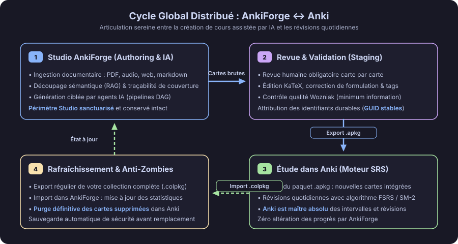
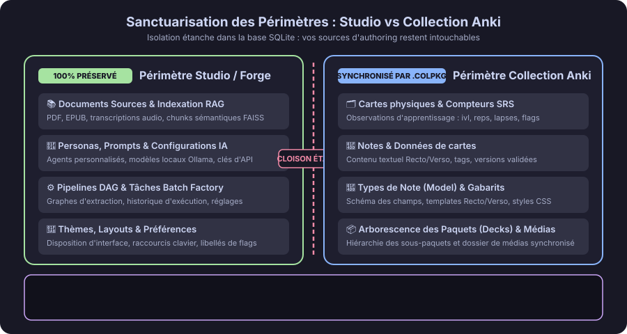
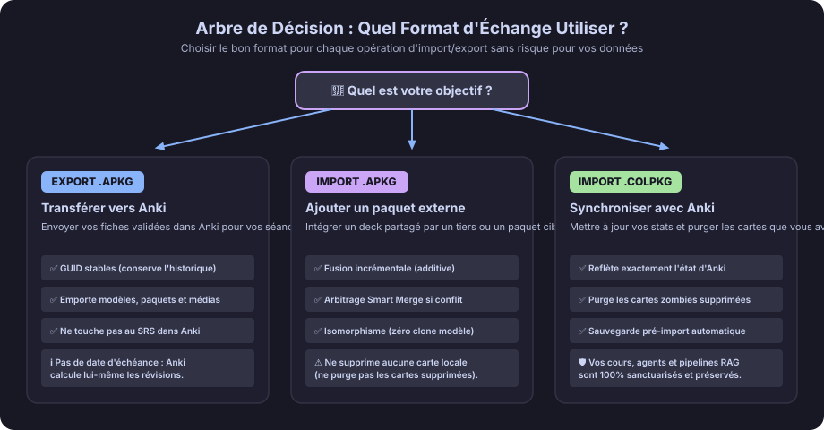
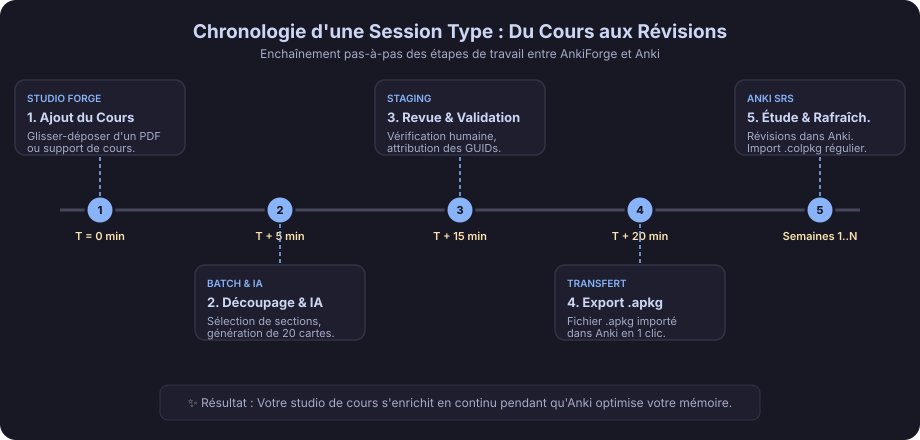
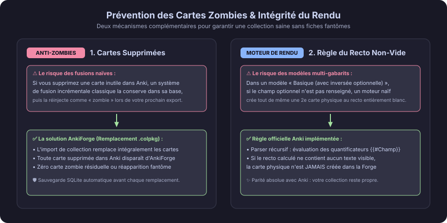

# Visual Guide to the Distributed Lifecycle (AnkiDraft ↔ Anki) 🔄

Welcome to the distributed workflow guide for AnkiDraft (formerly AnkiForge).

AnkiDraft and Anki work hand in hand as complementary tools:
- **AnkiDraft is your Authoring Studio**: your AI-assisted workspace where you organize textbooks, track chapter coverage (Smart Coverage / Cycle Global Distribué), design flashcards, and validate card quality.
- **Anki is your Spaced Repetition Engine (SRS)**: the application dedicated to your daily reviews. Anki holds exclusive authority over your review intervals, due dates, and spaced repetition algorithms (FSRS or SM-2).

Thanks to this strict boundary (**Sanctuarisation**), **you never risk losing your review progress in Anki or overwriting your study documents and AI models in AnkiDraft**.

---

## 1. The Global Workflow Cycle

The diagram below illustrates the workflow between creating cards in AnkiDraft and reviewing them in Anki:

1. **AnkiDraft Studio**: Import your study sources (PDF, articles, videos, audio lectures). The studio segments the text and tracks your chapter coverage.
2. **Staging Review**: Every generated flashcard goes through human validation and receives a permanent unique identifier (GUID).
3. **Export to Anki (.apkg)**: Export your new cards as an `.apkg` package and open it in Anki.
4. **Periodic Refresh (.colpkg)**: Review daily in Anki. Periodically export your `.colpkg` collection from Anki and drop it into AnkiDraft to refresh your retention statistics and sync card deletions.

---

## 2. Data Boundary: Studio Scope vs. Anki Scope (Sanctuarisation)

### 🛡️ Studio Scope (Strictly Preserved)
Never overwritten when you import an Anki collection:
- Original documents (PDFs, transcripts, Markdown files, image plates).
- Local semantic indexes and coverage links.
- AI personas, prompts, and generation pipelines.
- Application settings, themes, and custom shortcuts.

### 🗂️ Anki Collection Scope (Synchronized & Replaced)
Reflects your exact Anki collection:
- Decks and hierarchical sub-decks.
- Note types, Front/Back templates, and CSS styles.
- Notes, physical cards, flags, and SRS review counters.

---

## 3. Which Archive Format Should You Choose: .apkg or .colpkg?

| Criterion | Deck Package (`.apkg`) | Collection Archive (`.colpkg`) |
| :--- | :--- | :--- |
| **Purpose** | Share or add new/updated flashcards | Full replacement for exact alignment with Anki |
| **Behavior** | **Incremental merge**: adds or updates cards without touching other decks | **Full Anki scope replacement**: matches your Anki collection state |
| **Deletions** | Never deletes existing local cards | **Purges cards deleted in Anki (prevents Zombies)** |
| **Safety** | Smart Merge conflict dialog | **Automatic SQLite backup created before replacement** |

---

## 4. Typical Study Session Timeline

---

## 5. Preventing Zombie Cards (Zombies) and Empty Fronts

### 🧟 1. Eradicating Zombie Cards (Zombies)
When you delete an obsolete card in Anki and later import a `.colpkg` archive into AnkiDraft, the deleted card is permanently removed from AnkiDraft so it never reappears in future exports.

### 📄 2. Official Anki Non-Empty Front Rule
AnkiDraft evaluates conditional templates (`{{#Field}}...{{/Field}}` and `{{^Field}}...{{/Field}}`): if the rendered front of a card is empty, no physical card is created.
